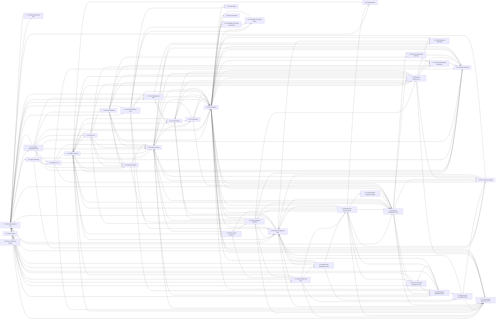

# Form graph

How the 66 forms of A Project Manager's Book of Forms (3rd edition) feed each other. Generated by `scripts/form_graph.py --markdown --out references/form-graph.md` from `references/knowledge/*.json` (each form's receives_from, provides_to and alignment) and `references/forms-index.md`; do not edit by hand. A link counts when either form lists it. The knowledge files record where the book is silent: for most links the book says a form provides to or receives from another, not which fields flow. Run `form_graph.py <form>` for the wording per link and `form_graph.py --check` for the links only one side lists. Every link is named in the prose or Alignment section of at least one form; "declared only by X" means the other form's list is silent, a gap in the book's lists and not a finding against a project. Treat such a link as real when rechecking documents and as weak when ordering them; the wording of what flows is sometimes a reading, and says so.

Page numbers are the form's prose pages, the section that holds the Alignment and the information-flow paragraphs, as PDF page (printed page); PDF page = printed page + 11.

Documents the book names without a form number (the charter's inputs, business case, agreements, project budget, schedule baseline and others) appear as plain names and are listed in the last section. The scope baseline is the one composite: the book defines it as 2.8, 2.9 and 2.10 together (Book of Forms form 2.9, PDF page 60 (printed page 49) and form 2.10, PDF page 63 (printed page 52)), so a form that receives from or aligns with it is linked to each of the three.

## Initiating

| Form | Name | Receives from | Provides to | Aligned with | Book pages |
| --- | --- | --- | --- | --- | --- |
| 1.1 | Project Charter | Agreements, Benefits management plan, Business case, Statements of work | 1.2, 1.3, 1.4, 2.1, 2.3, 2.4, 2.5, 2.6, 2.7, 2.8, 2.11, 2.14, 2.19, 2.23, 2.26, 2.30, 2.31, 2.37, 2.38, 2.40, 5.2 | 1.2, 1.3, 2.8, 2.9, 2.10, 2.11, 2.14, 2.18, 2.19, 2.23, 2.32, 2.38, Budget, Business case, Milestone schedule | PDF pages 13-15 (printed pages 2-4) |
| 1.2 | Assumption Log | 1.1, Any project document, Customer, sponsor or regulatory agencies, Project team | 2.6, 2.7, 2.8, 2.10, 2.13, 2.15, 2.16, 2.17, 2.18, 2.23, 2.28, 2.29, 2.32, 2.33, 2.40, Resource estimates | 1.1, 2.13, 2.16, 2.18, 2.20, 2.22, 2.32, 2.33, 3.1 | PDF pages 20-21 (printed pages 9-10) |
| 1.3 | Stakeholder Register | 1.1, 1.4, 2.6, 2.30, 2.37, 2.40, Procurement documents | 2.6, 2.7, 2.23, 2.24, 2.25, 2.26, 2.30, 2.31, 2.32, 2.37, 2.38, 2.40 | 1.1, 1.4, 2.30, 2.34, 2.35, 2.40 | PDF pages 23-24 (printed pages 12-13) |
| 1.4 | Stakeholder Analysis | 1.1, Procurement documents | 1.3, 2.40 | 1.3, 2.40 | PDF page 26 (printed page 15) |

## Planning

| Form | Name | Receives from | Provides to | Aligned with | Book pages |
| --- | --- | --- | --- | --- | --- |
| 2.1 | Project Management Plan | 1.1, 2.2, 2.4, 2.5, 2.11, 2.19, 2.22, 2.23, 2.26, 2.30, 2.31, 2.37, 2.40, Baselines | 2.2, 2.3, 2.4, 2.5, 2.11, 2.19, 2.23, 2.24, 2.26, 2.30, 2.31, 2.37, 2.40, Other integration processes | 2.3, 2.14, 5.2, Subsidiary management plans | PDF pages 31-33 (printed pages 20-22) |
| 2.2 | Change Management Plan | 2.1, 3.3, 3.4 | 2.1 | 2.3, 2.4, 2.5, 2.11, 2.19, 2.23, 3.3, 3.4, 3.5, Configuration management plan | PDF pages 36-37 (printed pages 25-26) |
| 2.3 | Project Roadmap | 1.1, 2.1 | 2.14, 2.18, 2.32, 2.38 | 2.1, 2.2, 2.14, 2.15, 2.18, 2.38, 6.1, 6.2, 6.3 | PDF page 39 (printed page 28) |
| 2.4 | Scope Management Plan | 1.1, 2.1, 2.23 | 2.1, 2.5, 2.6, 2.7, 2.8, 2.9, 2.10, 2.37 | 2.2, 2.5, 2.23, 2.31, 2.37, 4.9, Development approach, Life cycle description, Release and iteration plan | PDF pages 41-42 (printed pages 30-31) |
| 2.5 | Requirements Management Plan | 1.1, 2.1, 2.4, 2.23, Development approach | 2.1, 2.6, 2.7, 2.23, 2.32 | 2.2, 2.4, 2.6, 2.7, 2.23, 2.37, Development approach, Release and iteration plan, Requirements backlog | PDF pages 44-45 (printed pages 33-34) |
| 2.6 | Requirements Documentation | 1.1, 1.2, 1.3, 2.4, 2.5, 2.40, 3.5, Stakeholder management plan | 1.3, 2.8, 2.9, 2.10, 2.23, 2.24, 2.25, 2.26, 2.30, 2.32, 2.37, 2.38, 4.9, Project close out report, Scope baseline | 2.5, 2.7, 2.8, 2.9, 2.10, 2.23, 2.24, 2.25, 2.26, 2.38, 2.39, 4.9, 6.3, Benefits management plan | PDF pages 48-49 (printed pages 37-38) |
| 2.7 | Requirements Traceability Matrix | 1.1, 1.2, 1.3, 2.4, 2.5, 2.40, 3.5 | 2.23, 2.37, 2.38, 3.3, Procurement statement of work, Product acceptance | 2.5, 2.6, 2.38, 4.9, Development approach, Release and iteration plan | PDF pages 51-53 (printed pages 40-42) |
| 2.8 | Project Scope Statement | 1.1, 1.2, 2.4, 2.6, 2.32 | 2.9, 2.10, 2.18, Scope baseline | 1.1, 2.6, 2.9, 2.10, 2.18, 2.37, 2.39, 3.2 | PDF pages 56-57 (printed pages 45-46) |
| 2.9 | Work Breakdown Structure | 2.4, 2.6, 2.8 | 2.12, 2.15, 2.16, 2.18, 2.20, 2.23, 2.26, 2.28, 2.32, 2.37, Accepted deliverables, Project budget, Scope baseline | 1.1, 2.6, 2.8, 2.10, 2.12, 2.13, 2.18, 2.25, 2.26, 2.37, 2.39 | PDF pages 60-61 (printed pages 49-50) |
| 2.10 | WBS Dictionary | 1.2, 2.4, 2.6, 2.8, 2.12, 2.14, 2.20, 2.24, 2.28, Contracts | 2.12, 2.15, 2.16, 2.18, 2.20, 2.23, 2.26, 2.28, 2.32, 2.37, Accepted deliverables, Project budget, Scope baseline | 1.1, 2.6, 2.8, 2.9, 2.12, 2.13, 2.18, 2.37, 2.39 | PDF pages 63-65 (printed pages 52-54) |
| 2.11 | Schedule Management Plan | 1.1, 2.1 | 2.1, 2.12, 2.13, 2.14, 2.15, 2.16, 2.18, 2.19, 2.32, Schedule baseline | 1.1, 2.2, 2.18, 2.19, 2.31, 2.37, 2.38 | PDF pages 67-68 (printed pages 56-57) |
| 2.12 | Activity List | 2.9, 2.10, 2.11, Scope baseline | 2.10, 2.13, 2.15, 2.16, 2.17, 2.18, 2.28, Gantt chart or other schedule presentation | 2.9, 2.10, 2.13, 2.14, 2.18, 6.2, Iteration release plan | PDF pages 70-71 (printed pages 59-60) |
| 2.13 | Activity Attributes | 1.2, 2.11, 2.12, 2.15, 2.28, Scope baseline | 2.15, 2.16, 2.17, 2.18, 2.28, 2.29 | 1.2, 2.9, 2.10, 2.12, 2.14, 2.15, 2.16, 2.18, 2.20, 2.28 | PDF pages 73-74 (printed pages 62-63) |
| 2.14 | Milestone List | 1.1, 2.3, 2.11, Scope baseline | 2.10, 2.15, 2.16, 2.18, 2.37, 2.38, 3.3, Close out report, Gantt chart or other schedule presentation | 1.1, 2.1, 2.3, 2.12, 2.13, 2.15, 2.16, 2.18 | PDF page 76 (printed page 65) |
| 2.15 | Network Diagram | 1.2, 2.9, 2.10, 2.11, 2.12, 2.13, 2.14, Scope baseline | 2.13, 2.18 | 2.3, 2.13, 2.14, 2.18 | PDF pages 78-79 (printed pages 67-68) |
| 2.16 | Duration Estimates | 1.2, 2.9, 2.10, 2.11, 2.12, 2.13, 2.14, 2.17, 2.28, 2.29, 2.32, 3.5, Project team assignments, Resource calendars, Scope baseline | 2.18, 2.32, Schedule baseline | 1.2, 2.13, 2.14, 2.18, 2.28 | PDF pages 81-82 (printed pages 70-71) |
| 2.17 | Duration Estimating Worksheet | 1.2, 2.12, 2.13, 2.28, 2.29, 2.32, 3.5, Project team assignments, Resource calendars, Scope baseline | 2.16 |  | PDF pages 84-87 (printed pages 73-76) |
| 2.18 | Project Schedule | 1.2, 2.3, 2.8, 2.9, 2.10, 2.11, 2.12, 2.13, 2.14, 2.15, 2.16, 2.28, 2.32, 2.38, 3.5, Project team assignments, Resource calendars | 2.20, 2.21, 2.22, 2.26, 2.32, 2.37, 2.38, 2.40, 4.1, Project budget | 1.1, 1.2, 2.3, 2.8, 2.9, 2.10, 2.11, 2.12, 2.13, 2.14, 2.15, 2.16, 2.20, 2.22, 2.28, 2.30, 2.37, 2.39, 2.40, 4.1, 4.2, 4.3, 4.4, 4.6, Project calendars, Project team assignments, Scope baseline | PDF pages 89-90 (printed pages 78-79) |
| 2.19 | Cost Management Plan | 1.1, 2.1, 2.11, 2.31 | 2.1, 2.20, 2.21, 2.22, 2.32 | 1.1, 2.2, 2.11, 2.31, 2.37, 2.38 | PDF pages 93-94 (printed pages 82-83) |
| 2.20 | Cost Estimates | 2.9, 2.10, 2.18, 2.19, 2.23, 2.28, 2.32, 3.5, Scope baseline | 2.10, 2.22, 2.28, 2.32 | 1.2, 2.13, 2.18, 2.22, 2.28, 2.37, 4.1, 4.2, 4.3, 4.6, Project team assignments | PDF pages 96-97 (printed pages 85-86) |
| 2.21 | Cost Estimating Worksheet | 2.18, 2.19, 2.23, 2.28, 2.32, 3.5, Scope baseline |  |  | PDF pages 99-101 (printed pages 88-90) |
| 2.22 | Cost Baseline | 2.18, 2.19, 2.20, 2.26, 2.32, Agreements, Scope baseline | 2.1, 2.32 | 1.2, 2.18, 2.20, 2.32, Project team assignments | PDF page 104 (printed page 93) |
| 2.23 | Quality Management Plan | 1.1, 1.2, 1.3, 2.1, 2.5, 2.6, 2.7, 2.9, 2.10, 2.31, 2.32, 2.38, 2.40, Scope baseline | 2.1, 2.4, 2.5, 2.20, 2.21, 2.26, 2.32, 2.37, 3.6, Procurement documents | 1.1, 2.2, 2.4, 2.5, 2.6, 2.24, 2.26, 2.31, 3.6, 4.9, Procurement documents | PDF pages 106-107 (printed pages 95-96) |
| 2.24 | Quality Metrics | 1.3, 2.1, 2.6 | 2.10, Control Quality process, Manage Quality process | 2.6, 2.23 | PDF page 110 (printed page 99) |
| 2.25 | Responsibility Assignment Matrix | 1.3, 2.6, Scope baseline | 2.26 | 2.6, 2.9, 2.28, 3.2, Procurement documents | PDF pages 112-113 (printed pages 101-102) |
| 2.26 | Resource Management Plan | 1.1, 1.3, 2.1, 2.6, 2.9, 2.10, 2.18, 2.23, 2.25, 2.32, Scope baseline | 2.1, 2.22, 2.28, 2.29, 2.30, 2.32, 2.37, 2.38, 2.40, 3.7, Project budget | 2.6, 2.9, 2.23, 2.27, 2.29, 2.31, 2.37, 2.38, 2.39, 3.7 | PDF pages 115-117 (printed pages 104-106) |
| 2.27 | Team Charter |  |  | 2.26 | PDF pages 120-121 (printed pages 109-110) |
| 2.28 | Resource Requirements | 1.2, 2.9, 2.10, 2.12, 2.13, 2.20, 2.26, 2.32, Cost estimates resource calendars, Scope baseline | 2.10, 2.13, 2.16, 2.17, 2.18, 2.20, 2.21, 2.32, 2.37, 2.38 | 2.13, 2.16, 2.18, 2.20, 2.25, 2.29, 2.39, Bid documents | PDF pages 124-125 (printed pages 113-114) |
| 2.29 | Resource Breakdown Structure | 1.2, 2.13, 2.26, Scope baseline | 2.16, 2.17 | 2.26, 2.28 | PDF page 127 (printed page 116) |
| 2.30 | Communications Management Plan | 1.1, 1.3, 2.1, 2.6, 2.26, 2.40 | 1.3, 2.1, 2.40 | 1.3, 2.18, 2.40, 3.2 | PDF pages 129-130 (printed pages 118-119) |
| 2.31 | Risk Management Plan | 1.1, 1.3, 2.1 | 2.1, 2.19, 2.23, 2.32, 2.33, 2.34, 2.35, 2.40, 4.5 | 2.4, 2.11, 2.19, 2.23, 2.26, 2.33, 2.34, 2.35, 2.37, 2.40, 4.5 | PDF pages 132-134 (printed pages 121-123) |
| 2.32 | Risk Register | 1.2, 1.3, 2.3, 2.5, 2.6, 2.9, 2.10, 2.11, 2.16, 2.18, 2.19, 2.20, 2.22, 2.23, 2.26, 2.28, 2.31, 2.34, 2.35, 2.37, 2.38, 3.1, 3.5, 4.1, 4.2, 4.6, Agreements, Procurement documents, Schedule baseline, Scope baseline | 2.8, 2.16, 2.17, 2.18, 2.20, 2.21, 2.22, 2.23, 2.26, 2.28, 2.33, 2.34, 2.35, 2.36, 2.37, 2.40, 3.1, 3.5, 4.5, 5.2 | 1.1, 1.2, 2.22, 2.33, 2.34, 2.35, 2.36, 3.1, 4.1, 4.2, 4.5, 5.1 | PDF pages 139-140 (printed pages 128-129) |
| 2.33 | Risk Report | 1.2, 2.31, 2.32, 3.1, 3.5, 4.3, 4.5, 4.6, Earned value status, Project performance report | 3.5, 5.2 | 1.2, 2.31, 2.32, 2.36, 3.1, 4.5, Project performance report | PDF pages 142-143 (printed pages 131-132) |
| 2.34 | Probability and Impact Assessment | 2.31, 2.32 | 2.32, 2.35 | 1.3, 2.31, 2.32, 2.35 | PDF pages 148-150 (printed pages 137-139) |
| 2.35 | Probability and Impact Matrix | 2.31, 2.32, 2.34 | 2.32 | 1.3, 2.31, 2.32, 2.34, 2.36 | PDF page 153 (printed page 142) |
| 2.36 | Risk Data Sheet | 2.32 |  | 2.32, 2.33, 2.35 | PDF pages 155-156 (printed pages 144-145) |
| 2.37 | Procurement Management Plan | 1.1, 1.3, 2.1, 2.4, 2.6, 2.7, 2.9, 2.10, 2.14, 2.18, 2.23, 2.26, 2.28, 2.32, Project team assignments, Scope baseline | 1.3, 2.1, 2.32 | 2.4, 2.5, 2.8, 2.9, 2.10, 2.11, 2.18, 2.19, 2.20, 2.26, 2.31, 2.38, 2.39, 4.6, 4.7, 4.8, Project budget, Scope baseline | PDF pages 158-160 (printed pages 147-149) |
| 2.38 | Procurement Strategy | 1.1, 1.3, 2.3, 2.6, 2.7, 2.14, 2.18, 2.26, 2.28, Scope baseline | 2.18, 2.23, 2.32, Project budget | 1.1, 2.3, 2.6, 2.7, 2.11, 2.19, 2.26, 2.37, 2.39 | PDF pages 163-164 (printed pages 152-153) |
| 2.39 | Source Selection Criteria |  |  | 2.6, 2.8, 2.9, 2.10, 2.18, 2.26, 2.28, 2.37, 2.38, Scope baseline | PDF pages 166-167 (printed pages 155-156) |
| 2.40 | Stakeholder Engagement Plan | 1.1, 1.2, 1.3, 1.4, 2.1, 2.18, 2.26, 2.30, 2.31, 2.32, 3.1, 3.4 | 1.3, 2.1, 2.6, 2.7, 2.23, 2.30 | 1.3, 1.4, 2.18, 2.30, 2.31 | PDF pages 169-170 (printed pages 158-159) |

## Executing

| Form | Name | Receives from | Provides to | Aligned with | Book pages |
| --- | --- | --- | --- | --- | --- |
| 3.1 | Issue Log | 2.32, 4.1, 4.2, 4.6 | 2.32, 2.33, 2.40 | 1.2, 2.32, 2.33, 3.2, 3.5, 4.1, 4.2, 4.3, 5.1 | PDF pages 176-177 (printed pages 165-166) |
| 3.2 | Decision Log | 4.1, 4.2 |  | 2.8, 2.25, 2.30, 3.1, 3.5, 5.1 | PDF page 179 (printed page 168) |
| 3.3 | Change Request | 2.7, 2.14, Executing, monitoring and controlling processes | 2.2, 3.4, Change control board | 2.2, 3.4 | PDF pages 181-182 (printed pages 170-171) |
| 3.4 | Change Log | 3.3 | 2.2, 2.40, 4.2, 4.8 | 2.2, 3.3, 3.5, 4.8 | PDF pages 186-187 (printed pages 175-176) |
| 3.5 | Lessons Learned Register | 2.32, 2.33, 4.1, 4.2 | 2.6, 2.7, 2.16, 2.17, 2.18, 2.20, 2.21, 2.32, 2.33, 5.1, Organization and other projects | 2.2, 3.1, 3.2, 3.4, 5.1 | PDF pages 189-190 (printed pages 178-179) |
| 3.6 | Quality Audit | 2.23, Similar projects | Other projects | 2.23 | PDF pages 192-193 (printed pages 181-182) |
| 3.7 | Team Performance Assessment | 2.26 | Project manager | 2.26 | PDF pages 195-196 (printed pages 184-185) |

## Monitoring and Controlling

| Form | Name | Receives from | Provides to | Aligned with | Book pages |
| --- | --- | --- | --- | --- | --- |
| 4.1 | Team Member Status Report | 2.18 | 2.32, 3.1, 3.2, 3.5, 4.2 | 2.18, 2.20, 2.32, 3.1, 4.2, 4.3, 4.4, Project budget | PDF pages 202-203 (printed pages 191-192) |
| 4.2 | Project Status Report | 3.4, 4.1, 4.3, 4.4, 4.6 | 2.32, 3.1, 3.2, 3.5, Sponsor, portfolio management group, PMO or other oversight person or group | 2.18, 2.20, 2.32, 3.1, 4.1, 4.3, 4.4, 4.6, Project budget | PDF pages 207-208 (printed pages 196-197) |
| 4.3 | Variance Analysis |  | 2.33, 4.2, 4.4 | 2.18, 2.20, 3.1, 4.1, 4.2, 4.4, 4.6, Project budget | PDF pages 213-214 (printed pages 202-203) |
| 4.4 | Earned Value Analysis | 4.3 | 4.2 | 2.18, 4.1, 4.2, 4.3, 4.6, Project budget | PDF pages 217-218 (printed pages 206-207) |
| 4.5 | Risk Audit | 2.31, 2.32 | 2.33, Other projects, and the organization's risk forms, templates, policies, procedures and processes | 2.31, 2.32, 2.33 | PDF pages 220-221 (printed pages 209-210) |
| 4.6 | Contractor Status Report | Contractor (vendor) | 2.32, 2.33, 3.1, 4.2 | 2.18, 2.20, 2.37, 4.2, 4.3, 4.4, 4.7, Project budget | PDF pages 224-225 (printed pages 213-214) |
| 4.7 | Procurement Audit |  | Current procurement and other contracts, Other projects and organization policies, procedures and processes | 2.37, 4.6, 4.8 | PDF pages 229-230 (printed pages 218-219) |
| 4.8 | Contract Closeout Report | 3.4, 4.9 | 5.2, Future work with the vendor | 2.37, 3.4, 4.7, 5.2 | PDF pages 233-234 (printed pages 222-223) |
| 4.9 | Product Acceptance Form | 2.6 | 4.8, 5.2 | 2.4, 2.6, 2.7, 2.23, 5.2 | PDF page 237 (printed page 226) |

## Closing

| Form | Name | Receives from | Provides to | Aligned with | Book pages |
| --- | --- | --- | --- | --- | --- |
| 5.1 | Lessons Learned Summary | 3.5 | Lessons learned repository | 2.32, 3.1, 3.2, 3.5, 5.2, 6.4 | PDF pages 240-243 (printed pages 229-232) |
| 5.2 | Project or Phase Closeout | 1.1, 2.32, 2.33, 4.8, 4.9 |  | 2.1, 4.8, 4.9, 5.1, 6.4 | PDF pages 246-247 (printed pages 235-236) |

## Agile

| Form | Name | Receives from | Provides to | Aligned with | Book pages |
| --- | --- | --- | --- | --- | --- |
| 6.1 | Product Vision |  | 6.2, 6.3, Business case | 2.3, 6.2, 6.3 | PDF page 251 (printed page 240) |
| 6.2 | Product Backlog | 6.1 | 6.3 | 2.3, 2.12, 6.1, 6.3 | PDF page 253 (printed page 242) |
| 6.3 | Release Plan | 6.1, 6.2 |  | 2.3, 2.6, 6.1, 6.2 | PDF page 255 (printed page 244) |
| 6.4 | Retrospective |  | The team's later sprints | 5.1, 5.2 | PDF page 257 (printed page 246) |

## Planning flowchart

Planning forms only; an arrow means the first form provides to the second. Links to and from forms of other groups, external documents and alignment are in the tables above.

## Dependency cycles

Some forms depend on each other in a loop. `form_graph.py --order` cuts every link that runs from a form of a later PMBOK 6 process to a form of an earlier one (process group, then chapter and section, then form number; 9.1 and 9.2 rank before 6.4 because their outputs are inputs of 6.4), so the earlier form is drafted first and revised once the later one exists. Forms the book says are created at the start of the project (2.32, 2.33, 3.1, 3.2) take their incoming links as revision inputs. The cut links stay in the tables above. The loops and the links cut inside them:

- Loop among 41 forms: 1.3, 2.1, 2.2, 2.3, 2.4, 2.5, 2.6, 2.7, 2.8, 2.9, 2.10, 2.11, 2.12, 2.13, 2.14, 2.15, 2.16, 2.17, 2.18, 2.19, 2.20, 2.22, 2.23, 2.24, 2.25, 2.26, 2.28, 2.29, 2.30, 2.31, 2.37, 2.38, 2.40, 3.3, 3.4, 3.5, 4.1, 4.2, 4.3, 4.4, 4.6. Cut: 2.2 to 2.1; 2.4 to 2.1; 2.5 to 2.1; 2.6 to 1.3; 2.11 to 2.1; 2.12 to 2.10; 2.14 to 2.10; 2.15 to 2.13; 2.17 to 2.16; 2.18 to 2.26; 2.19 to 2.1; 2.20 to 2.10; 2.20 to 2.28; 2.22 to 2.1; 2.23 to 2.1; 2.23 to 2.4; 2.23 to 2.5; 2.23 to 2.20; 2.23 to 2.26; 2.24 to 2.10; 2.26 to 2.1; 2.28 to 2.10; 2.28 to 2.13; 2.30 to 1.3; 2.30 to 2.1; 2.31 to 2.1; 2.31 to 2.19; 2.31 to 2.23; 2.37 to 1.3; 2.37 to 2.1; 2.38 to 2.18; 2.38 to 2.23; 2.40 to 1.3; 2.40 to 2.1; 2.40 to 2.6; 2.40 to 2.7; 2.40 to 2.23; 2.40 to 2.30; 3.3 to 2.2; 3.4 to 2.2; 3.4 to 2.40; 3.5 to 2.6; 3.5 to 2.7; 3.5 to 2.16; 3.5 to 2.17; 3.5 to 2.18; 3.5 to 2.20; 4.1 to 3.5; 4.2 to 3.5; 4.3 to 4.2; 4.4 to 4.2; 4.6 to 4.2.

## Documents named without a form number

| Document | Feeds | Fed by | Aligned with |
| --- | --- | --- | --- |
| Accepted deliverables |  | 2.9, 2.10 |  |
| Agreements | 1.1, 2.22, 2.32 |  |  |
| Any project document | 1.2 |  |  |
| Baselines | 2.1 |  |  |
| Benefits management plan | 1.1 |  | 2.6 |
| Bid documents |  |  | 2.28 |
| Budget |  |  | 1.1 |
| Business case | 1.1 | 6.1 | 1.1 |
| Change control board |  | 3.3 |  |
| Close out report |  | 2.14 |  |
| Configuration management plan |  |  | 2.2 |
| Contractor (vendor) | 4.6 |  |  |
| Contracts | 2.10 |  |  |
| Control Quality process |  | 2.24 |  |
| Cost estimates resource calendars | 2.28 |  |  |
| Current procurement and other contracts |  | 4.7 |  |
| Customer, sponsor or regulatory agencies | 1.2 |  |  |
| Development approach | 2.5 |  | 2.4, 2.5, 2.7 |
| Earned value status | 2.33 |  |  |
| Executing, monitoring and controlling processes | 3.3 |  |  |
| Future work with the vendor |  | 4.8 |  |
| Gantt chart or other schedule presentation |  | 2.12, 2.14 |  |
| Iteration release plan |  |  | 2.12 |
| Lessons learned repository |  | 5.1 |  |
| Life cycle description |  |  | 2.4 |
| Manage Quality process |  | 2.24 |  |
| Milestone schedule |  |  | 1.1 |
| Organization and other projects |  | 3.5 |  |
| Other integration processes |  | 2.1 |  |
| Other projects |  | 3.6 |  |
| Other projects and organization policies, procedures and processes |  | 4.7 |  |
| Other projects, and the organization's risk forms, templates, policies, procedures and processes |  | 4.5 |  |
| Procurement documents | 1.3, 1.4, 2.32 | 2.23 | 2.23, 2.25 |
| Procurement statement of work |  | 2.7 |  |
| Product acceptance |  | 2.7 |  |
| Project budget |  | 2.9, 2.10, 2.18, 2.26, 2.38 | 2.37, 4.1, 4.2, 4.3, 4.4, 4.6 |
| Project calendars |  |  | 2.18 |
| Project close out report |  | 2.6 |  |
| Project manager |  | 3.7 |  |
| Project performance report | 2.33 |  | 2.33 |
| Project team | 1.2 |  |  |
| Project team assignments | 2.16, 2.17, 2.18, 2.37 |  | 2.18, 2.20, 2.22 |
| Release and iteration plan |  |  | 2.4, 2.5, 2.7 |
| Requirements backlog |  |  | 2.5 |
| Resource calendars | 2.16, 2.17, 2.18 |  |  |
| Resource estimates |  | 1.2 |  |
| Schedule baseline | 2.32 | 2.11, 2.16 |  |
| Scope baseline | 2.12, 2.13, 2.14, 2.15, 2.16, 2.17, 2.20, 2.21, 2.22, 2.23, 2.25, 2.26, 2.28, 2.29, 2.32, 2.37, 2.38 | 2.6, 2.8, 2.9, 2.10 | 2.18, 2.37, 2.39 |
| Similar projects | 3.6 |  |  |
| Sponsor, portfolio management group, PMO or other oversight person or group |  | 4.2 |  |
| Stakeholder management plan | 2.6 |  |  |
| Statements of work | 1.1 |  |  |
| Subsidiary management plans |  |  | 2.1 |
| The team's later sprints |  | 6.4 |  |
