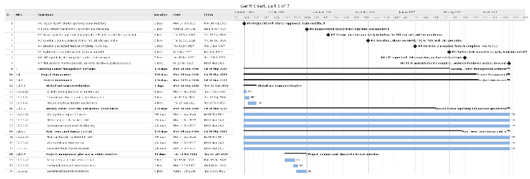
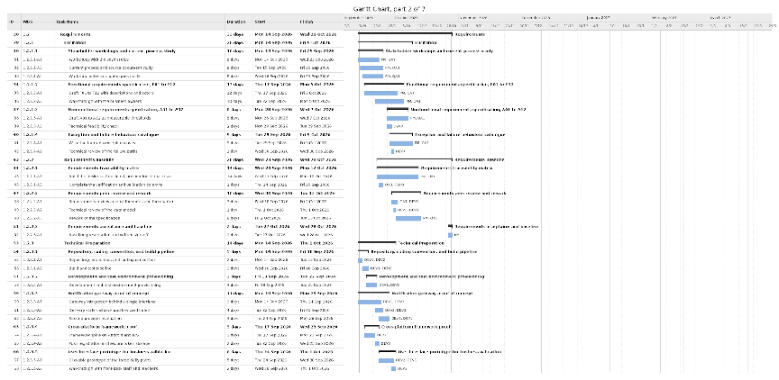
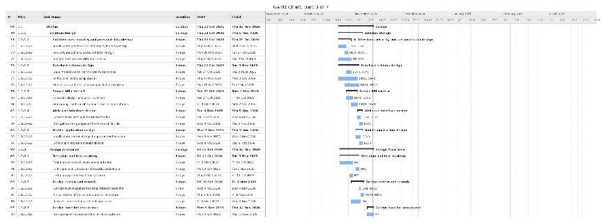
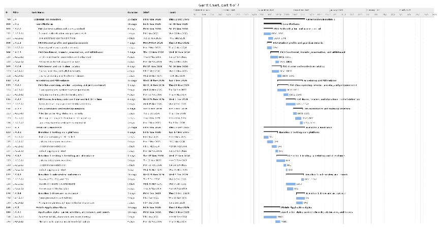
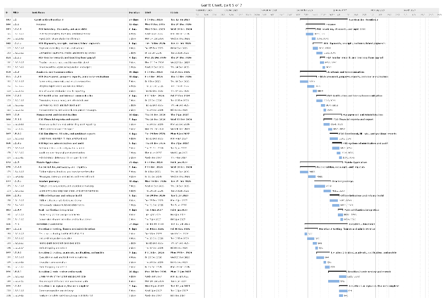
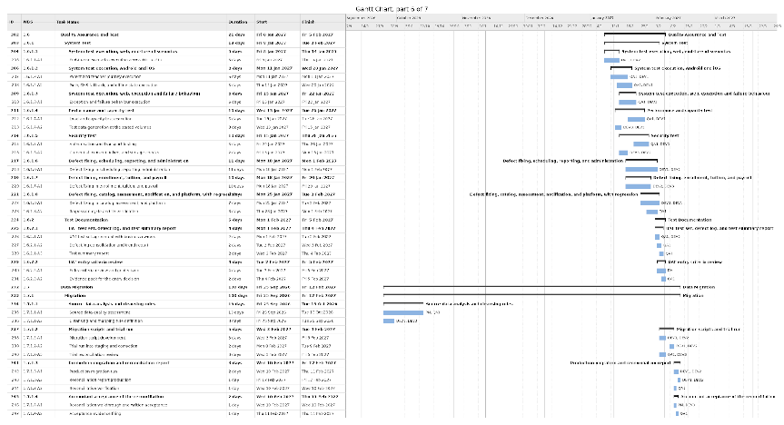
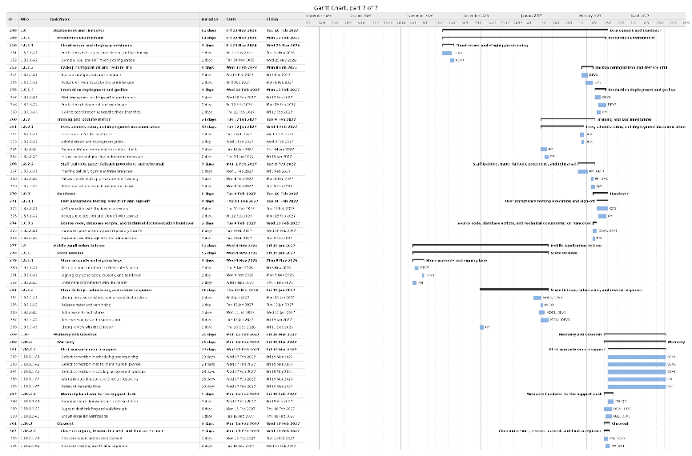
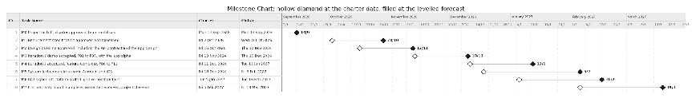

<!-- Bản xuất nguyên văn tab "Báo cáo tổng hợp" (bản đầy đủ, trước khi rút gọn) của Google Doc 1OTrxc3-L_t_NQcNiMG0EzwVsMU8Ftb7WFKuPSxHYgTw, xuất ngày 2026-11-18 để đọc và học. Không sửa tay: sửa trên Doc rồi xuất lại. -->

**HỌC VIỆN CÔNG NGHỆ BƯU CHÍNH VIỄN THÔNG**

**KHOA CÔNG NGHỆ THÔNG TIN I**

**BÁO CÁO BÀI TẬP LỚN**

**MÔN QUẢN LÝ DỰ ÁN PHẦN MỀM**

| Giảng viên hướng dẫn | : ĐỖ THỊ BÍCH NGỌC |
| :---- | :---- |
| **Họ và tên sinh viên** |   **Mã sinh viên** |
| **NGÔ HẢI ĐĂNG** |   **B23DCDT044** |
| **NGUYỄN BÁ HÙNG** |   **B23DCAT120** |
| **NGUYỄN ĐẠI DŨNG** |   **B23DCVT103** |
| **TRẦN XUÂN THÀNH** |   **B23DCAT280** |
| **Lớp** | **: E23CNPM01** |
| **Nhóm** | **: 04** |

***Hà Nội – 2026***

## 

## Table of contents {#table-of-contents}

[**Table of contents	2**](#table-of-contents)

[**1: Requirement Specification	4**](#1:-requirement-specification)

[1.1 Project Scope Description	4](#1.1-project-scope-description)

[1.1.1 The problem	4](#1.1.1-the-problem)

[1.1.2 The product	4](#1.1.2-the-product)

[1.1.3 Users and roles	4](#1.1.3-users-and-roles)

[1.1.4 Functions	5](#1.1.4-functions)

[1.1.5 Exception and failure behaviour	7](#1.1.5-exception-and-failure-behaviour)

[1.2 Project Deliverables	8](#1.2-project-deliverables)

[1.3 Product Acceptance Criteria	10](#1.3-product-acceptance-criteria)

[1.4 Project Exclusions	11](#1.4-project-exclusions)

[1.5 Project Constraints	11](#1.5-project-constraints)

[1.6 Project Assumptions	12](#1.6-project-assumptions)

[**2: Project Charter	14**](#2:-project-charter)

[2.1 Charter Elements	14](#2.1-charter-elements)

[Project purpose	14](#project-purpose)

[Overall project risk	16](#overall-project-risk)

[Summary milestone schedule	17](#summary-milestone-schedule)

[Project approval requirements	18](#project-approval-requirements)

[2.2 Project Charter	19](#2.2-project-charter)

[**3: Scope Baseline	26**](#3:-scope-baseline)

[3.1 Requirements Traceability Matrix	27](#3.1-requirements-traceability-matrix)

[3.1.1 Requirement information and relationship traceability	27](#3.1.1-requirement-information-and-relationship-traceability)

[3.1.2 Inter-requirements traceability matrix	32](#3.1.2-inter-requirements-traceability-matrix)

[3.2 Work Breakdown Structure	32](#3.2-work-breakdown-structure)

[3.2.1 Inputs and method	32](#3.2.1-inputs-and-method)

[3.2.2 The structure	33](#3.2.2-the-structure)

[3.2.3 Roll-up	36](#3.2.3-roll-up)

[3.2.4 Coverage	38](#3.2.4-coverage)

[**4: Project Schedule	39**](#4:-project-schedule)

[4.1 Project Schedule	39](#4.1-project-schedule)

[PROJECT SCHEDULE: Gantt chart	39](#project-schedule:-gantt-chart)

[PROJECT SCHEDULE: milestone chart	49](#project-schedule:-milestone-chart)

[**5: Cost Estimation	50**](#5:-cost-estimation)

[5.1 Rules of the estimate	50](#5.1-rules-of-the-estimate)

[5.2 Activity Cost Estimates	52](#5.2-activity-cost-estimates)

[5.3 Cost Estimating Worksheet	62](#5.3-cost-estimating-worksheet)

[5.4 Paid time without booked work	64](#5.4-paid-time-without-booked-work)

[5.5 Estimate against the charter: for the team to decide	64](#5.5-estimate-against-the-charter:-for-the-team-to-decide)

[5.6 References	66](#5.6-references)

[5.7 Change Request	66](#5.7-change-request)

[**6: Quality Management Plan	70**](#6:-quality-management-plan)

[6.1 Quality Management Plan	70](#6.1-quality-management-plan)

[**7: Resource Plan	75**](#7:-resource-plan)

[7.1 Team Charter	75](#7.1-team-charter)

[7.2 Resource Requirements	77](#7.2-resource-requirements)

[7.3 Resource Breakdown Structure	81](#7.3-resource-breakdown-structure)

[**8: Risk Register	83**](#8:-risk-register)

[Probability and impact scales	83](#probability-and-impact-scales)

[**9: Stakeholders	102**](#9:-stakeholders)

[9.1 Stakeholder Register	102](#9.1-stakeholder-register)

[9.2 Stakeholder Analysis	108](#9.2-stakeholder-analysis)

[Levels	108](#levels)

[Interest and influence grid	111](#interest-and-influence-grid)

[**Appendices	112**](#appendices)

[Appendix B: Inter-requirements traceability matrix	112](#appendix-b:-inter-requirements-traceability-matrix)

[Appendix C: Bottom-up cost estimating worksheet, form 2.21 page 2	114](#appendix-c:-bottom-up-cost-estimating-worksheet,-form-2.21-page-2)

[Appendix D: References of section 5	119](#appendix-d:-references-of-section-5)

## 1: Requirement Specification {#1:-requirement-specification}

### 1.1 Project Scope Description {#1.1-project-scope-description}

#### 1.1.1 The problem {#1.1.1-the-problem}

The customer owns a private after-school learning center with about 1,200 active students, 35 teachers, and 3 branches in one city. It teaches English, mathematics, and IT skills in fixed-length courses of 24 to 48 sessions. The learners are school-age students, aged 6 to 18, who attend after school and at weekends; the center runs no preschool programme, and the system is scoped to these learners at these three branches.

The center runs today on paper registers, Excel workbooks, and a group-chat channel. Enrollment lists live in one spreadsheet, attendance is taken on printed sheets and typed up later, tuition debt is tracked by the accountant in a separate workbook, and parents are informed by messages typed by hand. Four consequences follow, and they are the reason for the project:

* the same student data is entered two or three times, in different places, by different people;  
* rooms and teachers are double-booked, because nobody can see the whole timetable at once;  
* tuition is collected late, because there is no reliable list of who owes what;  
* the Director cannot see revenue, class fill rate, or teaching load across the three branches without asking three people to build a spreadsheet.

#### 1.1.2 The product {#1.1.2-the-product}

A Vietnamese-language web application and a companion mobile app. Staff use the web application from a desktop browser; teachers and parents use the mobile app on Android and iOS, or a phone browser. Both are backed by one shared database that is the single source of truth for students, courses, classes, sessions, attendance, invoices, payments, and teaching hours, and by one documented server API that serves the web application and the app alike.

The project delivers the software, deploys it on a cloud server, migrates the center's current data, trains the staff, and supports the center through a warranty of six months from go-live, of which the first month runs inside the project.

#### 1.1.3 Users and roles {#1.1.3-users-and-roles}

| Role | Who they are | What they do with the system |
| :---- | :---- | :---- |
| Center Director | Owner of the center, and the project's customer | Dashboards, revenue and enrollment reports, approvals |
| Academic Manager | Runs the teaching operation | Course catalog, opening classes, scheduling, teacher assignment, assessment; assigns substitutes and postpones sessions, approves teaching-hour sheets, reviews the daily exception list |
| Front-desk / Admissions staff | Reception counter at each branch | Student profiles, enrollment, invoices, recording payments, parent enquiries; handles make-up and re-enrollment requests and sends the notifications of F09 |
| Teacher | Teaching staff | Class roster, attendance, scores and progress comments, session notes and a per-class report, announcements and messages to parents, own teaching-hour sheet, the end-of-course evaluation of their classes, from the mobile app (F12) or the web |
| Accountant | Finance | Debt tracking, payment confirmation, matching of unmatched bank transfers, approval of refund proposals, teaching-hour payroll and the monthly payroll close, financial reports |
| Student / Parent | End customer | Own schedule, attendance and score history, tuition balance, notifications and messages to the front desk, make-up session request, bank-transfer confirmation with reference, re-enrollment request, end-of-course evaluation of the course and the teacher, all from the mobile app (F12) or the web |
| System Administrator | The center's IT staff | Accounts, roles, configuration, backup, audit log |

#### 1.1.4 Functions {#1.1.4-functions}

| ID | Function | Primary actor | Description |
| :---- | :---- | :---- | :---- |
| F01 | Authentication and access control | System Administrator | Creates accounts, authenticates users by username and password, resets passwords, times out idle sessions, and enforces role-based permission so that each role sees only its own screens and its own data. Every account has exactly one role; staff accounts are additionally tied to one or more branches. |
| F02 | Student profile and enrollment | Front-desk staff | Records the student profile (personal data, guardian and contact details, how the student found the center, notes) and enrolls the student into an open class. Handles transfer between classes, reservation of a seat, and withdrawal with a refund calculation. Refuses an enrollment when the class is full or when the timetable collides with another class of the same student. |
| F03 | Course and curriculum catalog | Academic Manager | Defines what the center sells: course code, level, number of sessions, session length, standard tuition fee, prerequisite course, and the syllabus outline session by session. Courses are versioned, so that editing a course does not change the definition of classes that were already opened from it. |
| F04 | Class opening, scheduling, and assignment | Academic Manager | Opens a class from a course (branch, start date, weekly time slots, capacity), generates the whole session calendar from that, and assigns a room and a teacher to each session. Detects and blocks conflicts on room, on teacher, and on class time at the moment the class or session is created or moved, and recalculates the calendar when a session is postponed. |
| F05 | Attendance and make-up sessions | Teacher | Marks every student of a session present, absent with notice, absent without notice, or late, with an optional remark. Registers a make-up session in another class for an absent student, and shows the attendance rate per student and per class. |
| F06 | Tuition, invoicing, and debt tracking | Front-desk staff, Accountant | Generates the tuition invoice at enrollment from the course fee, applying the discount policies of the center (sibling, early payment, referral, promotion code) and installment plans. Records cash and bank-transfer payments against invoices, issues receipts, and maintains the outstanding balance and an aged debt list per student, per class, and per branch. |
| F07 | Teacher records and teaching-hour payroll | Accountant | Holds teacher profiles, qualifications, contract type, and pay rate per teaching hour by course level. Aggregates the sessions actually taught, taken from F05, into a monthly teaching-hour sheet per teacher, applies allowances and deductions, and exports the payroll figures to Excel. |
| F08 | Assessment, progress reports, and course evaluation | Teacher | Records scores for the assessment items the course defines (quizzes, midterm, final, skill scores) and a comment per student. Computes the final result and pass or fail against the course rule, and produces a printable progress report per student and a result summary per class. At the end of each course collects an evaluation of the course and the teacher from students and parents, on a fixed five-point scale with a free comment, and reports it per class and per teacher to the Academic Manager. |
| F09 | Notification and internal communication | Front-desk staff | Sends email and SMS from templates for the events that matter: enrollment confirmed, session reminder, absence alert, tuition due, tuition overdue, schedule changed, results published. Supports a manual send to a chosen group, a scheduled automatic send, and a log of every message with its delivery status. Carries the center's internal communication in the same place: announcements from the Academic Manager to teachers and staff, a per-class notice board from the teacher to the parents of that class, and messages between a parent and the front desk, all kept in the same log. |
| F10 | Reports and management dashboard | Center Director | The management view: revenue and collection by period and branch, outstanding debt, new and retained student counts, class fill rate, teacher workload and teaching hours, attendance rate. Every report is filterable by period, branch, and course, and exports to Excel and PDF. |
| F11 | System administration and audit | System Administrator | Maintains the center's reference data and configuration (branches, rooms, terms, fee and discount policies, notification templates, holidays), triggers and restores backups, and keeps an audit log of every create, update, and delete on financial and student data, with the user and the timestamp. |
| F12 | Mobile app for parents and teachers | Student / Parent, Teacher | An Android and iOS app built from one cross-platform codebase, using the same server API and the same accounts (F01) as the web application. For a parent: the child's schedule, attendance and score history, tuition balance and invoices, push notifications for the F09 events, messages to the front desk and the class teacher, make-up session request, bank-transfer confirmation with reference, end-of-course evaluation (F08), and re-enrollment request. For a teacher: today's sessions and rosters, attendance marking while online, score entry, own teaching-hour sheet, and class announcements. Push becomes the third F09 channel next to email and SMS, and SMS stays as the fallback for guardians without the app. Staff functions stay on the web, and no function is app-only. |

#### 1.1.5 Exception and failure behaviour {#1.1.5-exception-and-failure-behaviour}

The twelve functions above describe the system working normally. The cases below define what the system must do when it does not, and they are in scope on the same terms as the functions themselves.

| Situation | Required behaviour |
| :---- | :---- |
| A teacher does not record attendance | The session is flagged *attendance missing* on the Academic Manager's daily exception list. Attendance can still be entered later, but a late entry is stamped as late with the name of whoever entered it, and a month containing missing attendance cannot be closed for payroll. |
| A teacher is absent on the day | The Academic Manager assigns a substitute or postpones the session. Teaching hours are credited to whoever actually taught, never to whoever was originally scheduled. Affected parents are notified automatically. |
| A class is cancelled after students have paid | One action applies the center's cancellation policy to every enrolled student, producing a refund proposal or a credit note on each balance, and records the reason. The sessions are marked cancelled and keep their history; nothing is deleted. |
| A student withdraws mid-course | The refund is calculated from the sessions actually delivered. It is a proposal: it does not change the balance until the Accountant approves it. The seat is released. |
| A bank transfer cannot be matched to an invoice | The payment is held in an unmatched list. It is neither guessed at nor discarded, and no balance moves until someone matches it. No overdue reminder is sent to a student who has an unmatched payment on file, so that a parent who has already paid is not chased for the money. |
| A parent overpays or pays twice | The excess becomes a credit on the payer's account. Moving a credit between siblings needs the Accountant. Reversing a receipt is not a delete: it posts a reversing entry, and both entries stay in the audit log. |
| The SMS or email gateway fails | Every message carries a delivery state and, on failure, a reason. Failed messages are retried and then listed for manual action, and the administrator is alerted when gateway credit runs low. No failed notification is dropped without a record. |
| A teacher disputes the monthly teaching-hour sheet | The sheet moves through draft, confirmed by teacher, approved by Academic Manager, exported. Only approved sheets reach payroll, and the person who recorded the attendance is never the person who approves the sheet that pays for it. |
| The system is unavailable during teaching hours | The center falls back to a written paper procedure for attendance and receipts, and enters the data afterwards. Late entry is stamped as such and does not corrupt the payroll or debt figures. The fallback is part of the user manual and is rehearsed before go-live. |
| Migrated data does not reconcile with the Excel files | Migration produces a reconciliation report of every difference. Go-live requires the Accountant's written acceptance of that report, including any difference the center chooses to accept rather than correct. |
| The app cannot reach the server | The app shows the last synced data read-only with its timestamp; attendance marking and payment confirmation are disabled until the connection returns, and the teacher falls back to the web or to the paper procedure. |
| A guardian has no smartphone or does not install the app | SMS and email carry every notification, and every app function has a web equivalent; no function is app-only. |
| A store rejects or delays the app release | Go-live proceeds on the web. The app launch may slip by up to two weeks after M6 without moving M6, and the onboarding message to guardians is sent when the app is live. |
| A push notification is not delivered | The delivery state is logged in F09 as for any other channel; tuition-due and overdue messages fall back to SMS after four hours. |

### 1.2 Project Deliverables {#1.2-project-deliverables}

| \# | Deliverable | For | Due at |
| :---- | :---- | :---- | :---- |
| D1 | Requirement specification, approved and baselined | Customer | M1 |
| D2 | Design baseline: architecture, API contract, database schema, UI and app design | Customer | M2 |
| D3 | Iteration 1 release, F01 to F05 | Customer | M3 |
| D4 | Iteration 2 release, F06 to F12 | Customer | M4 |
| D5 | Test documentation: test plan, test cases, defect log, test summary report | Customer | M5 |
| D6 | Production data migrated and reconciled against the source files | Customer | M6 |
| D7 | Production deployment on the cloud server, with backup configured and a restore tested | Customer | M6 |
| D8 | User manual, administrator and deployment guide, trained staff with a training record | Customer | M6 |
| D9 | Source code, database scripts, and technical documentation handed over | Customer | M6 |
| D10 | First warranty month completed, warranty for months 2 to 6 handed to the support desk, closeout report and lessons learned | Internal | M7 |
| D11 | Mobile app published on Google Play and the App Store under the center's accounts, with store listings, release notes, signing keys, and the API documentation handed over | Customer | M6 |

The deliverables marked Customer are what the center receives and signs for. The project also produces its own management deliverables, which are internal to the supplier and are reviewed by the sponsor rather than accepted by the customer:

| Internal deliverable | Produced |
| :---- | :---- |
| Project management plan, schedule, and communication plan | M1, updated at each milestone |
| Weekly status report to the sponsor and the Center Director | Every week from M0 |
| Risk register with responses and owners | M1, reviewed weekly |
| Test plan and test cases | M2, completed at M5 as part of D5 |
| Closeout report and lessons learned | M7, as D10 |

### 1.3 Product Acceptance Criteria {#1.3-product-acceptance-criteria}

The product is accepted when the functions of 1.1.4 and the behaviour of 1.1.5 pass user acceptance testing and the measurable criteria below are met. Each criterion is stated as a threshold, so that acceptance can be measured rather than judged.

| ID | Category | Criterion |
| :---- | :---- | :---- |
| A01 | Functional completeness | All twelve functions F01 to F12 accepted in UAT against the test set agreed and signed at M5; at least 99% of UAT test cases passed, the remainder being defects that do not affect the operation of the system, each logged with an agreed fix date; no open Critical or High defect, and no open defect of any severity in the tuition, payment, or teaching-hour path |
| A02 | Performance | Staff screens respond within 3 seconds with 52 concurrent staff users; the parent portal responds within 3 seconds at 300 concurrent sessions; a report covering one term is produced within 10 seconds; app screens load within 3 seconds on a 4G connection |
| A03 | Capacity | 5,000 student records, 200 classes per term, and 3 years of session history without redesign |
| A04 | Security | HTTPS only; passwords never stored or recoverable in readable form; every request authorised on the server; personal data handled in line with the Law on Personal Data Protection in force from 1 January 2026; notification consent recorded per guardian; app session tokens expire, and no personal data is cached unencrypted on the device |
| A05 | Auditability | Every create, update, and delete on financial and student records written to an audit log that cannot be edited, kept for at least 3 years |
| A06 | Availability | 99% availability between 07:00 and 22:00, measured monthly; nightly backup with a recovery point objective of 24 hours and a recovery time objective of 4 hours; the restore demonstrated once during UAT and once during warranty |
| A07 | Degraded operation | The written paper fallback and its catch-up procedure exist, are trained, and are rehearsed once before go-live |
| A08 | Usability | Vietnamese interface; attendance, payment recording, and enrollment each reachable within 3 clicks of the home screen; a staff member can perform their daily tasks after half a day of training |
| A09 | Compatibility | The latest two versions of Chrome, Edge, and Firefox on desktop; usable layout on a tablet and on a phone for teacher and parent screens; the mobile app on Android 10 and later and iOS 15 and later, phones only |
| A10 | Maintainability and handover | Coding convention applied; deployment guide and database schema documentation delivered with the source code |
| A11 | Data ownership | A complete export of the center's data in an open format, produced by the center's own administrator at any time without the supplier's involvement |
| A12 | Mobile app | Published on Google Play and the App Store under the center's accounts; every F12 function within 3 taps of the home screen; push delivery recorded in the F09 log, with SMS fallback for tuition-due and overdue messages within 4 hours of a failed push |

### 1.4 Project Exclusions {#1.4-project-exclusions}

* **Staff functions on mobile.** Enrollment, invoicing, payroll, administration, and reports are web only; the mobile app of F12 serves parents, students, and teachers.  
* **Offline mode.** The app does not queue attendance or payments while offline; it shows the last synced data read-only.  
* **Tablet layouts, wearables, and app features beyond F12.**  
* **Store subscriptions beyond 12 months**, and publishing the app under any name but the center's.  
* **Online teaching**: live video class, content authoring, quiz engine, streaming of e-learning material.  
* **Automated payment**: no payment gateway, card capture, or e-wallet integration. The system records payments and reconciles bank-transfer references manually.  
* **Accounting, tax, and social-insurance integration.** The system computes teaching-hour payroll figures and exports them; the accountant posts them elsewhere.  
* **Attendance hardware** such as biometric and card readers, and any hardware procurement.  
* **Serving other companies.** Adding a fourth branch of this customer is *not* excluded: branches are configuration data in F11, so the branch planned for 2027 can be created by the center's own administrator. What is excluded is multi-tenant operation for other centers and consolidation across separate legal entities.  
* **Preschool programmes and learners under 6\.** The center's courses are for school-age learners; nothing in the system is designed for a kindergarten.  
* **Historical data older than the two most recent terms.**  
* **Support and maintenance after the warranty period.** The supplier corrects defects for six months from go-live, funded by budget line 5; enhancements, and any support after those six months, need a separate support agreement. The 12 months of hosting and the 6 months of warranty are separate commitments and are listed separately here.  
* **Project exclusions**, as distinct from the product exclusions above. The project does not procure or pay for the cloud or gateway subscriptions beyond the first 12 months; does not clean the source Excel files, which the center does (assumption 11); does not recruit, restructure, or manage the center's staff; does not operate the system after handover; and does not train parents beyond the in-app guide and the onboarding message.

### 1.5 Project Constraints {#1.5-project-constraints}

* **Budget** is fixed at 700,000,000 VND and covers software, deployment, migration, training, and warranty.  
* **Duration** is fixed: 14 September 2026 to 5 February 2027, which is 144 days, or 20.6 weeks. The brief says five months; this document plans against the dates, not the rounded figure.  
* **The first warranty month must finish inside the project.** Go-live is therefore baselined a full month before closeout, not immediately before it; the remaining five warranty months run after closeout under budget line 5\. This constraint drives the whole schedule.  
* **Team size is 5** full-time staff plus one part-time mobile developer for 2.5 person-months, six people in all, within the 4 to 6 the brief allows. No further headcount is available, and the project manager is also the business analyst.  
* **The system must be in Vietnamese** and must run within the center's existing cloud budget of one virtual server plus a staging environment.  
* **The Lunar New Year break** begins immediately after closeout and can absorb no overrun.

### 1.6 Project Assumptions {#1.6-project-assumptions}

Every assumed figure in this document is listed here. None of them is given by the assignment brief, which supplies only the budget, the duration, and the team size. Each is highlighted where it appears in the text.

| \# | Assumption |
| :---- | :---- |
| 1 | The center has 1,200 active students aged 6 to 18, 35 teachers, and 3 branches, and runs no preschool programme. No real customer data is used; this is an academic exercise. |
| 2 | There are 52 staff users: the 35 teachers plus 17 administrative, finance, and management staff, being 1 Director, 3 academic managers, 9 front-desk staff across the three branches, 3 accountants, and 1 IT administrator. Each of the 3 academic managers also manages one of the three branches, so the branch managers are counted among the academic managers and not separately. Students and parents are counted separately and are not part of the training target. |
| 3 | The parent portal peaks at about 300 concurrent sessions, when results are published or a tuition notice goes to the whole center. |
| 4 | Annual tuition turnover is about 7,200,000,000 VND, being 1,200 students at about 6,000,000 VND a year. |
| 5 | Manual duplicate data entry costs about 60 staff-hours a month, at a fully loaded cost of about 60,000 VND a staff-hour. |
| 6 | About 8% of tuition sits past its due date, and about 1% of turnover is eventually written off. |
| 7 | The cost of carrying overdue money is taken at 10% a year, and hosting after the first 12 months at about 25,000,000 VND a year. |
| 8 | The Lunar New Year of 2027 begins on 6 February 2027\. Closeout is baselined the day before. This should be checked against a published lunar calendar before the schedule is committed. |
| 9 | Personnel funding is contracted as 25 person-months, being 5 staff for 5 months. The elapsed window is shorter than five calendar months, so this is a funding basis rather than a measured effort figure. |
| 10 | The Academic Manager and the Accountant are each available at least 4 hours a week for workshops, demos, and UAT. |
| 11 | The center's Excel files are usable as the migration source and are cleaned by the center before migration. |
| 12 | One SMS and email gateway account is provided and paid for by the center, and its API is stable and documented. |
| 13 | Discount and refund rules are confirmed during analysis and frozen at requirement sign-off. |
| 14 | No public holiday other than the Lunar New Year break affects the schedule materially. |
| 15 | The commercial product name and the project manager's name are not yet decided. |
| 16 | The sponsor and the customer are two different people. The sponsor's organisational relationship to the learning center is not stated, because it was not specified; the charter defines his authority rather than his affiliation. Funding is released by the sponsor against the center's capital budget. |
| 17 | The personnel rate of 19,600,000 VND per person-month is the average of a rate mix: project manager and business analyst 26,000,000, developer 19,000,000, QA engineer 15,000,000, fully loaded and without supplier margin. The mobile developer is costed at the average. |
| 18 | About 80% of guardians have an Android or iOS smartphone. The app is built from one cross-platform codebase (Flutter or React Native) by one developer in 2.5 person-months over the same API as the web application; the store accounts are opened in the center's name at M1; a store review takes at most one week; 70% of the guardians with a smartphone activate the app within the first term. |
| 19 | An SMS costs about 800 VND, and the center sends about 4 messages per student a month. Guardians on the app receive those messages by push at no cost. Hosting after the first year rises from about 25,000,000 to about 27,600,000 VND a year for the Apple developer account. |

## 2: Project Charter {#2:-project-charter}

### 2.1 Charter Elements {#2.1-charter-elements}

#### Project purpose {#project-purpose}

The center is run on paper and spreadsheets. That costs about 60 staff-hours a month in duplicate data entry, causes recurring room and teacher double-booking, and at any moment about 8% of billed tuition is past its due date, because nobody holds a reliable list of who owes what. The project removes that operational loss and gives the Director one current view of enrollment, revenue, and teaching capacity across three branches, which the center needs before it opens a fourth branch in 2027; opening that branch is outside this project (section 1.4).

**The business case.** The center loses money in three ways today. Two of them can be quantified from the assumptions in section 1.6; the third cannot be quantified from anything the center currently measures, and is therefore left out of the calculation rather than estimated.

| Loss today | Value today | What the project changes |
| :---- | :---- | :---- |
| Duplicate data entry | 60 hours a month at 60,000 VND \= 43,200,000 VND a year | Falls to 15 hours a month: 32,400,000 VND a year, recurring |
| Tuition sitting overdue | 8% of 7,200,000,000 VND \= 576,000,000 VND overdue at any moment | Cut to 3%: releases 360,000,000 VND once, then saves the cost of carrying it, about 36,000,000 VND a year at 10% |
| Tuition eventually written off | 1% of turnover \= 72,000,000 VND a year | Halved by chasing debt earlier: 36,000,000 VND a year, recurring |
| Double-booking and lost class slots | Not measured by the center | Removed at source by the conflict check in F04, and excluded from the calculation |
| Notification cost created by the new system | None today: parents are messaged by hand in a group chat | SMS for every F09 event would cost 1,200 students, 4 messages a month, 800 VND each, 46,100,000 VND a year, borne by the center (assumption 12). Push through the app carries the messages of the 70% of guardians who use it, leaving 13,800,000 VND a year of SMS |

The overdue balance is a stock, not a flow. Cutting it from 8% to 3% releases the money once; only the carrying cost and the avoided write-off recur. Treating that release as an annual benefit would overstate the case by roughly a factor of four, so it is treated as a one-off below.

|  | Amount |
| :---- | :---- |
| One-off cost | 700,000,000 VND, plus about 27,600,000 VND a year of hosting and store accounts after the first 12 months |
| One-off benefit, first year | 360,000,000 VND released from overdue tuition |
| Recurring benefit | 90,600,000 VND a year net: 32.4 staff time, 36.0 carrying cost, 36.0 write-off, less 13.8 notification cost |
| Cumulative net | year 1 \-249.4M, year 2 \-186.4M, year 3 \-123.4M, year 4 \-60.4M, year 5 \+2.6M |

Payback therefore falls in the fifth year; on recurring benefit alone it would be close to eleven years. Earlier versions of this document left out the notification cost that the new system itself creates. With SMS as the only channel the net recurring benefit would be 58,300,000 VND a year and payback would slip to the tenth year, which is why the push channel of the mobile app is part of the scope rather than an extra. The cash case is a sanity check rather than the main argument for the project. The main justification is strategic: the center cannot open a fourth branch on spreadsheets that already fail at three, and today it has no visibility of its own revenue or fill rate.

**Who owns the benefit.** An aged debt list does not collect tuition on its own; somebody has to work it. The Accountant owns the tuition benefit, the front-desk supervisor owns the calls, and the Director reviews the overdue percentage monthly from go-live. Without that process change the project delivers an accurate report of the same 8%, which is risk R11.

#### Overall project risk {#overall-project-risk}

**Medium.** The technology is well understood and the domain is stable. What raises the risk is that budget and end date are both fixed while the five-month window must contain delivery *and* the first warranty month in full, which leaves analysis, design, and test about one week of float each. The team is small enough that losing one developer moves the critical path, the project manager is also the business analyst, and the customer staff who own the business rules are only part-time available. The dominant uncertainty is the volatility of tuition, discount, and refund policy, which is a management decision of the center rather than a technical question. The exposure the center feels most directly is go-live itself: three branches switch over on one day, mid-term, four weeks before the Lunar New Year break, which can absorb no overrun. The mobile app adds one dependency the project does not control, the store review, so it is kept off the go-live critical path. The register separates product risks, where the system may not fit the operation, from project risks, where delivery may miss its date or cost, and lists first the risk that the objectives themselves are missed.

| \# | Type | Risk | Response |
| :---- | :---- | :---- | :---- |
| R1 | Product | The delivered system does not meet the acceptance criteria A01 to A12, so the center cannot run its operation on it and the objectives are missed | Agree the UAT test set with the business owners at M5 and measure acceptance against it; pilot F01 to F06 at one branch before M6; gate go-live on A01; if UAT fails, put the three options of the approval requirements to the sponsor within two working days |
| R2 | Product | Tuition, discount, and refund rules change after the requirement baseline | Freeze the rules at M1 with written sign-off; route later changes through the change process against the reserve |
| R3 | Project | Customer staff not available for workshops, demos, and UAT | Fixed weekly slot agreed with the sponsor at kickoff; a missed slot escalated to the sponsor within 2 working days |
| R4 | Project | Loss or absence of a developer, or of the part-time mobile developer | Pair on the scheduling and tuition modules; keep code and documentation in shared repositories; sponsor-approved replacement within 2 weeks |
| R5 | Project | Notification gateway unstable or unexpectedly priced | Isolate it behind one interface; prove it with a proof of concept before M2; keep a second provider as fallback |
| R6 | Product | Source Excel data too dirty to migrate | Assess data quality at M1; the center cleans the files before M5; migration limited to the two most recent terms |
| R7 | Project | Scheduling and conflict detection harder than estimated | Build F04 first in iteration 1, timeboxed, and review it at the M3 demo |
| R8 | Project | Go-live slips and pushes the first warranty month into the Lunar New Year break | Baseline go-live at M6, a full month before the break; escalate to the sponsor immediately on a forecast slip past 15 January 2027, and re-plan the warranty rather than compress it silently |
| R9 | Project | The project manager is also the business analyst, so analysis and management compete for one person | Front-load analysis into M0 to M1 while management load is lowest; the QA engineer writes test cases from the requirement baseline as a second reader; escalate if analysis rework after M1 exceeds one week |
| R10 | Product | Go-live fails and the center cannot run its evening classes | Pilot F01 to F06 at one branch for the two weeks before M6; keep the spreadsheets in deliberate parallel for two weeks after go-live; rehearse the paper fallback; agree written rollback criteria that the center itself can invoke |
| R11 | Product | The system is delivered but the tuition benefit never appears, because nobody works the debt list | Name the Accountant as benefit owner at M0; report the overdue percentage to the Director monthly from go-live; state the actual percentage in the closeout report |
| R12 | Project | A store rejects or delays the app, or the cross-platform framework fails on one platform | Open the store accounts in the center's name at M1; prove the framework on both platforms before M2; submit at M5; go-live does not depend on the app, and an app slip of up to two weeks after M6 is absorbed without moving M6 |

#### Summary milestone schedule {#summary-milestone-schedule}

| ID | Milestone | Due date |
| :---- | :---- | :---- |
| M0 | Project kickoff, charter approved, team mobilised | Mon 14 Sep 2026 |
| M1 | Requirement specification approved and baselined | Fri 2 Oct 2026 |
| M2 | Design baseline approved, including the API contract and the app design | Fri 16 Oct 2026 |
| M3 | Iteration 1 demo accepted, F01 to F05, with the app alpha | Fri 13 Nov 2026 |
| M4 | Iteration 2 accepted, feature complete, F06 to F12 | Fri 11 Dec 2026 |
| M5 | System test complete on web, Android, and iOS; UAT entry criteria met; app submitted to both stores | Fri 18 Dec 2026 |
| M6 | UAT signed off, data migrated, go-live and handover; app live in both stores | Tue 5 Jan 2027 |
| M7 | First warranty month complete, warranty handover, project closeout | Fri 5 Feb 2027 |

The store accounts are opened in the center's name at M1, because Apple's enrolment of a legal entity can take up to four weeks; the mobile developer joins after M2 and leaves after M5. One branch pilots F01 to F06 in the two weeks before M6, and the spreadsheets keep running in deliberate parallel for two weeks after go-live. Go-live falls on a Tuesday so that live operation begins with two fully staffed working days; the other milestones fall on Fridays to close a working week. M6 to M7 is the first warranty month, and it ends the day before the assumed start of the Lunar New Year break; warranty months 2 to 6 run after closeout to 5 July 2027 under budget line 5\.

#### Project approval requirements {#project-approval-requirements}

**What counts as success.** The five objectives of the form in section 2.2 are met against their criteria, and at closeout the center is running its daily operation on the system. The two-week parallel run immediately after go-live is planned and is not a failure; failure would be the center still depending on its spreadsheets at closeout.

| To be approved | Approved by | Evidence |
| :---- | :---- | :---- |
| This charter | Dr. Nguyễn Mạnh Hùng, as sponsor | Signature on the charter form in section 2.2 |
| Requirement specification (D1) | Academic Manager and Accountant for their areas; sponsor overall | Signed requirement baseline at M1 |
| Design baseline (D2) | Project Manager, reviewed with the Academic Manager for workflow fit | Signed design review record at M2 |
| Iteration releases (D3, D4) | Academic Manager, Accountant, and Front-desk supervisor for their functions; Head Teacher and Front-desk supervisor for F12 | Signed demo acceptance record at M3 and M4 |
| Test completion (D5) | QA engineer prepares; Project Manager approves UAT entry | Test summary report accepted at M5 |
| UAT result and go-live | Business owners sign their own areas; sponsor authorises go-live | Signed UAT report and go-live authorisation at M6 |
| Migrated data (D6) | Accountant, for reconciliation against the source files | Written acceptance of the reconciliation, including accepted differences |
| Handover package (D8, D9) | Center IT administrator | Signed handover record |
| Project closure (D10) | Sponsor, on the Center Director's confirmation that the center is operating on the system | Signed closeout report |

**If UAT does not pass.** A pass rate below 99%, or any open Critical or High defect, means go-live is not authorised. Within two working days the project manager puts three options to the sponsor: correct and re-test with go-live delayed, stating exactly how many days of warranty that costs; go live against a written, sponsor-signed list of accepted defects with fix dates; or go live for part of the scope with the rest deferred to a change request. Without a signed decision from the sponsor, the system does not go live.

**Who accepts the final product.** The sponsor gives final acceptance. It cannot be delegated, but it rests on the written area sign-offs above and on the Center Director's confirmation, as customer, that the center is running its daily operation on the system. Acceptance cannot be withheld for scope that was never in the baseline.

### 2.2 Project Charter {#2.2-project-charter}

| PROJECT CHARTER |  |
| ----- | :---- |
| **Project Title:** Development and Deployment of a Learning Center Management Software. Product name: not yet decided |  |
| **Project Sponsor:** Dr. Nguyễn Mạnh Hùng | **Date Prepared:** 2 September 2026 |
| **Project Manager:** | **Project Customer:** Đỗ Thị Bích Ngọc, owner and Director of the learning center |
| **Project Purpose:** |  |
| The center operates on paper registers, Excel workbooks, and a group-chat channel. This costs about 60 staff-hours a month in duplicate data entry, causes recurring room and teacher double-booking, and at any moment about 8% of billed tuition is past its due date, because nobody holds a reliable list of who owes what. The project removes that operational loss and gives the Director one current view of enrollment, revenue, and teaching capacity across the three branches, which is a precondition for the fourth branch planned for 2027; opening that branch is outside this project (section 1.4). Quantified business case in section 2.1: recurring benefit 90,600,000 VND a year net of notification cost, one-off release 360,000,000 VND, payback in the fifth year. |  |
| **High-Level Project Description:** |  |
| Analyse, design, build, test, and deploy a Vietnamese-language web application covering the full operating cycle of the center: courses, classes and scheduling, students and enrollment, attendance, tuition and payments, teachers and teaching-hour payroll, assessment, notification, and management reporting, with a mobile app for parents and teachers on the same API. Includes migration from the current Excel files, staff training, and a six-month warranty from go-live. Iterative delivery: two build iterations, each closing with a demo, then user acceptance testing on the whole system. Five full-time staff plus a part-time mobile developer, five months, 700,000,000 VND. |  |
| **Project Boundaries:** |  |
| **Included:** functions F01 to F12 and the exception behaviour of section 1.1.5, for the school-age learners of the three existing branches; migration of the two most recent terms; deployment on one cloud virtual server with a staging environment; the mobile app published on Google Play and the App Store; training; documentation; a six-month warranty from go-live, the first month inside the project. **Excluded:** staff functions on mobile and offline use of the app; online teaching, video, and e-learning content; payment gateway and e-wallet integration; accounting, tax, and social-insurance integration; attendance hardware and any hardware procurement; multi-tenant operation for other centers; preschool learners; data older than the two most recent terms; support after the six-month warranty. Project exclusions: subscriptions beyond 12 months, cleaning of the source data, staffing and organisation of the center, operation after handover, parent training beyond the user guide. Adding a fourth branch of this customer is not excluded, since branches are configuration data in F11. The project ends at the closeout meeting after the first warranty month; warranty months 2 to 6 continue after closeout under budget line 5, and operation and hosting pass to the center at handover. |  |
| **Key Deliverables:** |  |
| For the customer: D1 Approved requirement specification. D2 Design baseline: architecture, API contract, database schema, UI and app design. D3 Iteration 1 release, F01 to F05. D4 Iteration 2 release, F06 to F12. D5 Test documentation and test summary report. D6 Migrated and reconciled production data. D7 Production deployment with backup configured and a restore tested. D8 User manual, administrator and deployment guide, trained staff with a training record. D9 Source code, database scripts, technical documentation. D11 Mobile app published on Google Play and the App Store. Internal: D10 First warranty month completed, closeout report and lessons learned, together with the project management plan, schedule, weekly status reports, risk register, and test plan. |  |
| **High-Level Requirements:** |  |
| (1) One integrated database, with the same data never entered in two places. (2) Room, teacher, and student timetable conflicts detected and blocked when a class or session is created or moved. (3) Tuition invoices generated from the course fee and the discount policy, with outstanding debt visible per student, class, and branch. (4) Teaching hours derived from recorded attendance and exportable for payroll. (5) Automatic notification of reminders, absence, tuition due, and results, with a delivery log; internal announcements and parent messages in the same channel. (6) Role-based access for the seven roles, with an audit trail on all financial and student data. (7) Vietnamese interface usable after half a day of training. (8) Parents and teachers reach their functions through an Android and iOS app over the same API, and no function is app-only. (9) The exception behaviour of section 1.1.5 delivered and tested with the same weight as the functions. (10) Acceptance criteria A01 to A12 of section 1.3 met, covering functional completeness, performance, capacity, security, auditability, availability, degraded operation, usability, compatibility, maintainability, data ownership, and the mobile app. |  |
| **Overall Project Risk** |  |
| **Medium.** Technology and domain are well understood, but budget and end date are both fixed, and the five-month window must contain delivery *and* the first warranty month in full, leaving analysis, design, and test about one week of float each. The core team of five is small enough that losing one developer moves the critical path; the project manager is also the business analyst; the customer staff who own the business rules are only part-time available. Dominant uncertainty: volatility of tuition, discount, and refund policy, which is a management decision of the center. Largest single exposure: go-live itself, with three branches switching over on one day, mid-term, four weeks before the Lunar New Year break, which can absorb no overrun. Risks R1 to R12 carry named responses and are covered by a 28,000,000 VND contingency reserve; the mobile app is kept off the go-live critical path. |  |

| PROJECT CHARTER |  |
| ----- | :---- |
| **Project Objectives** | **Success Criteria** |
| **Scope:** |  |
| Deliver the twelve functions F01 to F12 and the eleven deliverables D1 to D11 for the three branches. | All twelve functions accepted in UAT, measured against the test set agreed and signed at M5, with at least 99% of test cases passed and the remainder being defects that do not affect operation; acceptance cannot be withheld for scope outside the baseline; all eleven deliverables signed off by the sponsor; no function deferred without an approved change request. |
| **Time:** |  |
| Go live by 5 January 2027 and close the project by 5 February 2027, within the five-month window starting 14 September 2026, with the first warranty month contained inside that window. | Go-live on or before 5 January 2027; no milestone M1 to M7 more than 1 week later than baseline; the first warranty month runs its full 31 days before closeout. |
| **Cost:** |  |
| Deliver the whole scope within the preapproved 700,000,000 VND, including software, deployment, migration, training, and warranty. | Final cost at or below 700,000,000 VND; cost variance at each stage gate within plus or minus 5% of baseline; contingency reserve use reported monthly. |
| **Other:** |  |
| **Quality:** a system fit for daily operation from the first day. **Stakeholder satisfaction:** the center runs its daily operation on the system, not on spreadsheets. | At least 99% of UAT test cases passed, the remainder being defects that do not affect operation, each with an agreed fix date; no open Critical or High defect at go-live, and none in the tuition, payment, or teaching-hour path. At least 80% of the 52 staff users trained and active in the first month, including at least 90% of the 17 administrative users and 75% of the 35 teachers; average user satisfaction at least 4 of 5 in the closeout survey; at least 90% of classes with attendance recorded in the system during the first warranty month; at least 70% of guardians with a smartphone have activated the app by closeout. |
| **Summary Milestones** | **Due Date** |
| M0 Project kickoff, charter approved, team mobilised | Mon 14 Sep 2026 |
| M1 Requirement specification approved and baselined | Fri 2 Oct 2026 |
| M2 Design baseline approved: architecture, API contract, database schema, UI and app design | Fri 16 Oct 2026 |
| M3 Iteration 1 demo accepted: F01 to F05, app alpha | Fri 13 Nov 2026 |
| M4 Iteration 2 accepted, feature complete: F06 to F12 | Fri 11 Dec 2026 |
| M5 System test complete on web, Android, and iOS; UAT entry criteria met; app submitted to both stores | Fri 18 Dec 2026 |
| M6 UAT signed off, data migrated, go-live and handover; app live in both stores | Tue 5 Jan 2027 |
| M7 First warranty month complete, warranty handover, project closeout | Fri 5 Feb 2027 |

| PROJECT CHARTER |  |
| ----- | :---- |
| **Preapproved Financial Resources:** |  |
| Total **700,000,000 VND** from the center's 2026 to 2027 capital budget, released against milestone acceptance: 20% at M0, 25% at M3, 30% at M4, 25% at M6. Breakdown: personnel, 27.5 person-months, 539,000,000 (77%); infrastructure, licences, store accounts, 42,000,000 (6%); facilities, equipment, travel, 14,000,000 (2%); deployment, migration, training, documentation, 42,000,000 (6%); warranty and support for months 2 to 6 after go-live, 35,000,000 (5%); contingency reserve, 28,000,000 (4%). Each tranche is invoiced against the signed acceptance record of its milestone; the breakdown is re-estimated at M1. No further funding is committed; an increase requires the sponsor's written approval. |  |
| **Stakeholder(s)** | **Role** |
| Dr. Nguyễn Mạnh Hùng | Sponsor: authorises the project and this charter, releases the funding, approves scope changes, gives final acceptance |
| Đỗ Thị Bích Ngọc, owner and Center Director | Customer: owns the business need, commits the center's staff and data, takes the system into daily operation |
| Branch managers, being the 3 academic managers | Run the daily operation of their branch, which switches over at go-live |
| Academic Manager | Business owner for courses, classes, scheduling, assessment; main requirement source and UAT lead |
| Accountant | Business owner for tuition, debt, and teaching-hour payroll; owner of the tuition benefit; UAT participant |
| Front-desk / Admissions supervisor | Business owner for enrollment and payment recording; represents the daily users |
| Head Teacher, teacher representative | Represents the 35 teachers for attendance, scores, and teaching-hour screens |
| Teachers | End users of attendance, scores, teaching-hour sheets, and the mobile app |
| Students and parents | End users of schedule, result, and tuition views; recipients of notifications |
| Center IT administrator | Receives the system at handover; operates accounts, backup, and hosting afterwards |
| Project Manager | Plans, executes, and controls the project; single point of contact for the sponsor |
| Development team, 3 developers, 1 part-time mobile developer, and 1 QA engineer | Analysis, design, build, test, deployment, documentation |
| Supplier line management | Hiring, firing, and contractual employment decisions for the team |
| Supplier support desk | Warranty for months 2 to 6 after go-live |
| SMS and email gateway provider | External supplier of the notification channel |
| Cloud hosting provider | External supplier of the production and staging environment |
| Apple, App Store | Store review and publication of the iOS app |
| Google, Google Play | Store review and publication of the Android app |
| Push notification service provider | External supplier of push delivery to the app |
| State authority enforcing the Law on Personal Data Protection | Regulator of personal data handling |
| **Project Exit Criteria:** |  |
| 1\. All deliverables D1 to D11 accepted in writing by the sponsor. 2\. UAT signed off with at least 99% of test cases passed and no open Critical or High defect. 3\. System running in production with backup verified by a successful restore test, and the mobile app published in both stores. 4\. Production data migrated and reconciled, with any differences accepted in writing by the Accountant. 5\. At least 80% of the 52 staff users trained, evidenced by the training record. 6\. Source code, database scripts, user manual, and administrator guide handed over and acknowledged. 7\. The first warranty month ended with no open Critical or High defect, and warranty months 2 to 6 handed to the supplier's support desk in writing. 8\. Paper fallback procedure and full data export both demonstrated to the center and in its hands. 9\. A written decision taken on support after the six-month warranty. 10\. Closeout report, lessons learned, and final financial reconciliation approved, and the final invoice settled. Early closure by sponsor decision, on withdrawn funding or lost business need, hands over the completed deliverables and closes the project with a termination report. |  |
| **Project Manager Authority Level:** |  |
| **Staffing Decisions:** |  |
| Assigns and re-assigns work within the approved team, approves leave, and manages day-to-day performance. May request replacement of a team member, with the sponsor notified. Hiring, firing, and contractual employment decisions remain with the supplier's line management. |  |
| **Budget Management and Variance:** |  |
| Commits and spends within the approved baseline, including single transactions up to 20,000,000 VND and use of the 28,000,000 VND contingency reserve against risks R1 to R12. Manages cumulative cost variance up to 5% of baseline. Escalates to the sponsor any forecast overrun beyond 5%, any reserve use beyond 20,000,000 VND, and any change in total funding. |  |

| PROJECT CHARTER |  |
| ----- | :---- |
| **Technical Decisions:** |  |
| Full authority over architecture, technology stack, database design, coding standards, tooling, and the internal delivery approach, provided that acceptance criteria A01 to A12 and the agreed deliverables are met. Decides the content of each iteration within the approved scope. Any decision that changes user-visible scope, the schedule, or the cost goes to the sponsor through the change process. |  |
| **Conflict Resolution:** |  |
| Resolves conflicts within the project team and between the team and the center's operational staff, including competing claims on staff availability. Conflicts that cross organisations, alter agreed scope, or remain unresolved after five working days are escalated to the sponsor, whose decision is final. Disputes with external suppliers follow the applicable service agreement. |  |
| **Sponsor Authority:** |  |
| Dr. Nguyễn Mạnh Hùng authorises the project and this charter, releases the 700,000,000 VND, and appoints the project manager. Approves changes to scope, schedule, and budget beyond the project manager's authority; sets acceptable variance limits; resolves conflicts escalated by the project manager; accepts the deliverables; authorises go-live and project closure; champions the project with the center's staff and branch managers. The customer, Đỗ Thị Bích Ngọc as owner and Center Director, is a separate authority: she owns the business need, makes the center's staff and data available, nominates the business owners who sign for their own areas, and confirms at closeout that the center is operating on the system. |  |
| **Approvals:** |  |
| **Project Manager Signature** | **Sponsor or Originator Signature** |
|  | Dr. Nguyễn Mạnh Hùng |
| **Project Manager Name** | **Sponsor or Originator Name** |
|  |  |
| **Date** | **Date** |

## 3: Scope Baseline {#3:-scope-baseline}

**Project Title:** Development and Deployment of a Learning Center Management Software

**Date Prepared:** 23 September 2026

### 3.1 Requirements Traceability Matrix {#3.1-requirements-traceability-matrix}

**Project Title:** Development and Deployment of a Learning Center Management Software

**Date Prepared:** 23 September 2026

Three ID families are used. **BR** business requirements, taken from the charter's business case and objectives. **FR** functional requirements, one per function F01 to F12 of the requirement specification. **NFR** nonfunctional requirements, one per acceptance criterion A01 to A12. The Requirement column carries a label and the charter code; the full text lives in the charter. Every requirement is Must have: the charter requires all twelve functions accepted in UAT and all of A01 to A12 met, so nothing in the baseline is optional. The Deliverable column cites the WBS code from section 3.2 and the charter deliverable in brackets.

#### 3.1.1 Requirement information and relationship traceability {#3.1.1-requirement-information-and-relationship-traceability}

| REQUIREMENTS TRACEABILITY MATRIX |  |  |  |  |  |  |  |  |
| ----- | :---- | :---- | :---- | :---- | :---- | :---- | :---- | :---- |
| **Requirement Information** |  |  |  |  | **Relationship Traceability** |  |  |  |
| **ID** | **Requirement** | **Source** | **Priority** | **Category** | **Business Objective** | **Deliverable** | **Verification** | **Validation** |
| BR01 | Data held once and entered once | Center Director | Must have | Business | Cut duplicate data entry from 60 to 15 staff-hours a month, 32,400,000 VND a year | 1.4.1.3, 1.7.1.3 (D3, D6) | Staff time log over one month after go-live shows 15 hours or fewer of re-entry | Director confirms against the closeout report, measured in the first warranty month |
| BR02 | No double-booked room, teacher, or student | Academic Manager | Must have | Business | Remove double-booking at source; not quantified in the business case | 1.4.2.2 (D3) | Zero conflicting bookings accepted in the UAT conflict test set | Academic Manager runs the conflict scenarios in UAT |
| BR03 | Overdue tuition visible and falling to 3% | Accountant, Center Director | Must have | Business | Release 360,000,000 VND once, save 36,000,000 VND a year of carrying cost and 36,000,000 VND of write-off | 1.5.1.1, 1.5.1.2 (D4) | Aged debt report shows the overdue percentage monthly; stated in the closeout report | Accountant reconciles the report against the bank and the invoice ledger |
| BR04 | Cross-branch visibility without a spreadsheet | Center Director | Must have | Business | One current cross-branch view, needed before the fourth branch in 2027 | 1.5.3.1, 1.5.3.2 (D4) | Every F10 report filterable by period, branch, and course, produced within 10 seconds | Director uses the dashboard unaided in UAT |
| BR05 | Notification cost held down | Center Director | Must have | Business | Hold notification cost at 13,800,000 VND a year through push rather than 46,100,000 VND on SMS alone | 1.5.4.4, 1.5.2.2 (D4, D11) | F09 delivery log shows the channel mix; push share at least 70% of guardians with a smartphone | Accountant checks the gateway invoice for the first warranty month |
| BR06 | Payroll derived from delivered sessions | Accountant | Must have | Business | Remove the payroll rework and the disputes it causes; not separately quantified | 1.5.1.3 (D4) | Monthly sheet reconciles to the attendance records with zero manual adjustment rows | Accountant approves one full month close during the warranty month |
| BR07 | The center runs its daily operation on the system from go-live, with the data in its own hands | Center Director | Must have | Business | The stakeholder-satisfaction objective and the exit criteria of the charter | 1.8.3.1, 1.10.2.1 (D8, D9, D10) | Training record, handover record, and the closeout report together evidence the exit criteria | Center Director confirms at closeout that the center operates on the system |
| FR01 | Authentication and role-based access control (F01) | System Administrator | Must have | Functional | Quality: A04 met | 1.4.1.1 (D3) | Each role reaches only its own screens and data in the UAT permission matrix | UAT script run by the System Administrator across all seven roles |
| FR02 | Student profile, enrollment, transfer, and withdrawal (F02) | Front-desk staff | Must have | Functional | Scope: F01 to F12 accepted; BR01 | 1.4.1.2, 1.4.1.3 (D3) | Enrollment refused in both refusal cases; refund figure matches the policy worked example | Front-desk staff enroll, transfer, and withdraw a test cohort in UAT |
| FR03 | Versioned course and curriculum catalog (F03) | Academic Manager | Must have | Functional | Scope: F01 to F12 accepted | 1.4.1.4 (D3) | A course edit leaves the definition of an opened class unchanged | Academic Manager edits a course that has open classes in UAT |
| FR04 | Class opening, scheduling, and conflict detection (F04) | Academic Manager | Must have | Functional | BR02 | 1.4.2.1, 1.4.2.2 (D3) | Every conflict case in the test set is blocked at creation or at move time | Academic Manager runs the conflict scenarios; pilot branch uses it for two weeks before M6 |
| FR05 | Attendance and make-up sessions (F05) | Teacher | Must have | Functional | Stakeholder satisfaction: 90% of classes with attendance recorded in the first warranty month | 1.4.2.3 (D3) | Attendance rate figures match a hand count for a sample class over one month | Teachers mark real sessions during the pilot at one branch |
| FR06 | Tuition, invoicing, payments, and debt tracking (F06) | Front-desk staff, Accountant | Must have | Functional | BR03 | 1.5.1.1, 1.5.1.2 (D4) | Invoice totals match the policy worked examples; the aged debt list ties to the invoice ledger | Accountant reconciles one term of test invoices and payments in UAT |
| FR07 | Teacher records and teaching-hour payroll (F07) | Accountant | Must have | Functional | BR06 | 1.5.1.3 (D4) | Monthly sheet reconciles to attendance with zero manual adjustment rows | Accountant closes one test month end to end |
| FR08 | Assessment, progress reports, and course evaluation (F08) | Teacher | Must have | Functional | Scope: F01 to F12 accepted; BR07 | 1.5.2.1 (D4) | Final results match the course rule for every pass and fail boundary case | Academic Manager checks one completed course in UAT |
| FR09 | Notification and internal communication (F09) | Front-desk staff | Must have | Functional | BR03; BR05 | 1.5.2.2 (D4) | Every message carries a delivery state; failures carry a reason and are retried | Front-desk staff send each of the seven event types in UAT |
| FR10 | Reports and management dashboard (F10) | Center Director | Must have | Functional | BR04 | 1.5.3.1, 1.5.3.2 (D4) | One term's report produced within 10 seconds; figures match the underlying records | Director runs every report unaided in UAT |
| FR11 | System administration and audit (F11) | System Administrator | Must have | Functional | Quality: A05 met; BR07 | 1.5.3.3 (D4) | Every financial and student write appears in the audit log with user and timestamp | System Administrator samples the log against a scripted set of changes |
| FR12 | Android and iOS application for parents and teachers (F12) | Student / Parent, Teacher | Must have | Functional | BR05; Stakeholder satisfaction: 70% of guardians with a smartphone activated by closeout | 1.4.4.1, 1.5.4.1, 1.5.4.2, 1.9.1.2 (D3, D4, D11) | Every F12 function within 3 taps; push delivery recorded in the F09 log | Parents and teachers use the application during the pilot and the first warranty month |
| NFR01 | Functional completeness in UAT (A01) | Center Director | Must have | Acceptance | Scope: no function deferred without an approved change request; BR07 | 1.6.2.2, 1.8.3.1 (D5) | UAT pass rate at or above 99%; defect log shows no open Critical or High | UAT sign-off by the sponsor at M6 against the test set agreed at M5 |
| NFR02 | Performance thresholds (A02) | Center Director | Must have | Performance | Quality: A02 met | 1.6.1.4 (D5) | Load test report shows the 95th percentile inside each threshold | Load test witnessed by the System Administrator before UAT entry |
| NFR03 | Capacity without redesign (A03) | System Administrator | Must have | Capacity | Quality: A03 met | 1.6.1.4 (D5) | Capacity test loads the stated volumes and the performance thresholds still hold | Same load test run, at the stated data volume |
| NFR04 | Security and personal-data protection (A04) | System Administrator | Must have | Security | Quality: A04 met; BR07 | 1.3.1.1, 1.6.1.5 (D2, D5) | Security test finds no unauthorised access path and no readable stored password | Security test report reviewed and accepted before UAT entry |
| NFR05 | Auditability of financial and student writes (A05) | Accountant | Must have | Auditability | Quality: A05 met | 1.5.3.3 (D4) | Log entries cannot be altered through any interface; retention is 3 years | Accountant and System Administrator attempt an edit in UAT and fail |
| NFR06 | Availability, backup, and restore (A06) | System Administrator | Must have | Availability | Quality: A06 met; BR07 | 1.8.1.2 (D7) | Restore drill completes inside 4 hours from a backup no more than 24 hours old | Restore drill witnessed by the System Administrator, twice |
| NFR07 | Degraded operation and paper fallback (A07) | Academic Manager | Must have | Continuity | Quality: A07 met; BR07 | 1.8.2.2 (D8) | Rehearsal record signed, with the catch-up entry reconciled afterwards | Rehearsal run at one branch before M6 |
| NFR08 | Usability in Vietnamese after half a day of training (A08) | Front-desk staff, Teacher | Must have | Usability | Stakeholder satisfaction: 80% of the 52 staff users trained and active; BR07 | 1.3.1.4, 1.8.2.2 (D2, D8) | Click count measured on each of the three paths; training record shows the half-day format | Staff perform their daily tasks unaided the day after training |
| NFR09 | Browser and device compatibility (A09) | System Administrator | Must have | Compatibility | Quality: A09 met; BR07 | 1.6.1.1, 1.6.1.2 (D5) | Test matrix covers every listed browser and both application platforms | Cross-browser and device test run before UAT entry |
| NFR10 | Maintainability and handover (A10) | System Administrator | Must have | Maintainability | Quality: A10 met; BR07 | 1.8.2.1, 1.8.3.2 (D8, D9) | Handover checklist complete; a third party can deploy from the guide alone | System Administrator deploys to staging following only the guide |
| NFR11 | Data ownership and open-format export (A11) | Center Director | Must have | Data ownership | Quality: A11 met | 1.5.3.3 (D4) | Export runs to completion from the administrator screen and opens in a standard tool | System Administrator produces the export unaided in UAT |
| NFR12 | Mobile application published in both stores (A12) | Center Director | Must have | Mobile | Quality: A12 met; BR05 | 1.9.1.2, 1.5.4.4 (D11) | Store listings live; fallback timer verified in the delivery log | Guardians install from the public store listing during the pilot |

#### 3.1.2 Inter-requirements traceability matrix {#3.1.2-inter-requirements-traceability-matrix}

The inter-requirements traceability matrix is in Appendix B.

### 3.2 Work Breakdown Structure {#3.2-work-breakdown-structure}

#### 3.2.1 Inputs and method {#3.2.1-inputs-and-method}

Per PMBOK 6 Figure 5-10, Create WBS takes the scope management plan, the project scope statement, and the requirements documentation. The charter is not a direct input to 5.4; it reaches the WBS through the scope statement. The requirements traceability matrix is an output of 5.2, so this section builds it first from the charter and the requirement specification, and then builds the WBS from the scope statement.

| Input | Where it comes from |
| :---- | :---- |
| Project scope statement | sections 1.1 to 1.6 |
| Requirements documentation | sections 1.1.4 (F01 to F12), 1.1.5, 1.3 (A01 to A12) |
| Scope management plan | Not produced as a separate document for this coursework; the rules it would carry are stated in the conventions below |
| Project charter (indirect) | section 2 |

The team this package costs is the charter's: 5 full-time staff plus the part-time mobile developer, not the 4 staff the brief for this deliverable assumes. Costing to the charter baseline is what keeps the two documents arithmetically consistent, and 6 sits inside the 4 to 6 the original course brief allows.

**Top-down.** The charter fixes the deliverables D1 to D11 and the milestones M0 to M7 before any work package exists, so the structure is decomposed downward from the project to the work package rather than assembled upward from tasks. The two methods are not mixed.

**Organised by major deliverable, in life-cycle phase order.** Form 2.9 prints **Major Deliverable** at level 2, and that is what level 2 holds here: the ten major deliverables of the project, arranged in the order of the predictive life cycle with its two build iterations. The annotation on each level-2 line names the charter deliverable and milestone it carries. Level 3 is the control account, level 4 is the work package. Each work package rolls up to one and only one control account, per the book's rule on page 50\.

**One owner per work package.** Every work package names a single accountable owner. Work and review are never owned by the same person: a review or rework package is always owned by the QA engineer or by a developer who is not the author of the work being reviewed. Review and testing are work packages in their own right, held in a separate assurance control account inside the phase whose output they check, and phase 1.6 exists on top of that for the system-level test, which cannot sit inside a single construction package.

Work package sizing. Every work package holds between 8 and 80 hours of effort and is controlled inside a single milestone gate. Three packages sit outside that rule: 1.1.1.2 weekly status reporting at 120 hours and 1.10.1.1 first warranty month support at 400 hours are level-of-effort packages, and 1.9.1.1 store accounts and signing keys, at 22 hours, crosses the M2 gate because Apple's enrolment of a legal entity takes up to four weeks.

#### 3.2.2 The structure {#3.2.2-the-structure}

| WORK BREAKDOWN STRUCTURE Project Title: Development and Deployment of a Learning Center Management Software      Date Prepared: 23 September 2026 1\.  Learning Center Management Software 1.1.  Project Management (major deliverable) 1.1.1.  Project Governance (control account) 1.1.1.1.  Kickoff and team mobilisation 1.1.1.2.  Weekly status reporting and sponsor governance 1.1.1.3.  Risk, issue, and change control 1.1.1.4.  Project management plan and schedule baseline 1.2.  Requirements (major deliverable, D1, M1) 1.2.1.  Elicitation (control account) 1.2.1.1.  Stakeholder workshops and current-process study 1.2.1.2.  Functional requirements specification, F01 to F12 1.2.1.3.  Nonfunctional requirements specification, A01 to A12 1.2.1.4.  Exception and failure behaviour catalogue 1.2.2.  Requirements Baseline (control account) 1.2.2.1.  Requirements traceability matrix 1.2.2.2.  Requirements peer review and rework 1.2.2.3.  Requirements acceptance and baseline 1.2.3.  Technical Preparation (control account) 1.2.3.1.  Repository, coding convention, and build pipeline 1.2.3.2.  Development and test environment provisioning 1.2.3.3.  Notification gateway proof of concept 1.2.3.4.  Cross-platform framework proof 1.2.3.5.  User interface prototype for business validation 1.3.  Design (major deliverable, D2, M2) 1.3.1.  Solution Design (control account) 1.3.1.1.  Architecture, security, and personal-data design 1.3.1.2.  Database schema design 1.3.1.3.  Server API contract 1.3.1.4.  Web user interface design 1.3.1.5.  Mobile application design 1.3.2.  Design Assurance (control account) 1.3.2.1.  Test plan and test strategy 1.3.2.2.  Design review and rework 1.3.2.3.  Design baseline acceptance 1.4.  Construction Iteration 1 (major deliverable, D3, M3) 1.4.1.  Core Platform (control account) 1.4.1.1.  F01 Authentication and access control 1.4.1.2.  F02 Student profile and guardian records 1.4.1.3.  F02 Enrollment, transfer, reservation, and withdrawal 1.4.1.4.  F03 Course and curriculum catalog 1.4.2.  Scheduling and Attendance (control account) 1.4.2.1.  F04 Class opening, session calendar, and postponement 1.4.2.2.  F04 Room, teacher, and class-time conflict detection 1.4.2.3.  F05 Attendance and make-up sessions 1.4.3.  Iteration 1 Assurance (control account) 1.4.3.1.  Iteration 1 testing, core platform 1.4.3.2.  Iteration 1 testing, scheduling and attendance 1.4.3.3.  Iteration 1 code review and rework 1.4.3.4.  Iteration 1 demo and acceptance 1.4.4.  Mobile Application Alpha (control account) 1.4.4.1.  Application alpha, parent schedule, attendance, and scores 1.5.  Construction Iteration 2 (major deliverable, D4, M4) 1.5.1.  Finance (control account) 1.5.1.1.  F06 Invoicing, discounts, and aged debt 1.5.1.2.  F06 Payments, receipts, and unmatched payments 1.5.1.3.  F07 Teacher records and teaching-hour payroll 1.5.2.  Academic and Communication (control account) 1.5.2.1.  F08 Assessment, progress reports, and course evaluation 1.5.2.2.  F09 Notification and internal communication 1.5.3.  Management and Administration (control account) 1.5.3.1.  F10 Financial reports and export 1.5.3.2.  F10 Enrollment, fill rate, and workload reports 1.5.3.3.  F11 System administration and audit 1.5.4.  Mobile Application (control account) 1.5.4.1.  Parent tuition, messages, and requests 1.5.4.2.  Teacher journeys 1.5.4.3.  Offline behaviour and release build 1.5.4.4.  Push notification integration 1.5.5.  Iteration 2 Assurance (control account) 1.5.5.1.  Iteration 2 testing, finance and administration 1.5.5.2.  Iteration 2 testing, academic, notification, and mobile 1.5.5.3.  Iteration 2 code review and rework 1.5.5.4.  Iteration 2 acceptance, feature complete 1.6.  Quality Assurance and Test (major deliverable, D5, M5) 1.6.1.  System Test (control account) 1.6.1.1.  System test execution, web, end-to-end scenarios 1.6.1.2.  System test execution, Android and iOS 1.6.1.3.  System test execution, web, exception and failure behaviour 1.6.1.4.  Performance and capacity test 1.6.1.5.  Security test 1.6.1.6.  Defect fixing, scheduling, reporting, and administration 1.6.1.7.  Defect fixing, enrollment, tuition, and payroll 1.6.1.8.  Defect fixing, catalog, assessment, notification, and platform, with regression 1.6.2.  Test Documentation (control account) 1.6.2.1.  UAT test set, defect log, and test summary report 1.6.2.2.  UAT entry criteria review 1.7.  Data Migration (major deliverable, D6, M6) 1.7.1.  Migration (control account) 1.7.1.1.  Source data analysis and cleansing rules 1.7.1.2.  Migration scripts and trial run 1.7.1.3.  Production migration and reconciliation report 1.7.1.4.  Accountant acceptance of the reconciliation 1.8.  Deployment and Handover (major deliverable, D7 D8 D9, M6) 1.8.1.  Production Environment (control account) 1.8.1.1.  Cloud server and staging provisioning 1.8.1.2.  Backup configuration and restore drill 1.8.1.3.  Production deployment and go-live 1.8.2.  Training and Documentation (control account) 1.8.2.1.  User, administrator, and deployment documentation 1.8.2.2.  Staff training, paper fallback procedure, and rehearsal 1.8.3.  Handover (control account) 1.8.3.1.  User acceptance testing execution and sign-off 1.8.3.2.  Source code, database scripts, and technical documentation handover 1.9.  Mobile Application Release (major deliverable, D11, M6) 1.9.1.  Store Release (control account) 1.9.1.1.  Store accounts and signing keys 1.9.1.2.  Store listings, submission, and review response 1.10.  Warranty and Closeout (major deliverable, D10, M7) 1.10.1.  Warranty (control account) 1.10.1.1.  First warranty month support 1.10.1.2.  Warranty handover to the support desk 1.10.2.  Closeout (control account) 1.10.2.1.  Closeout report, lessons learned, and final acceptance Page 1 of 1 |
| ----- |

#### 3.2.3 Roll-up {#3.2.3-roll-up}

Ten major deliverables, twenty-four control accounts, seventy-eight work packages. Each work package appears under exactly one control account.

| Phase | Control accounts | Work packages | Charter deliverables | Milestone | Labor hours | Labor cost (VND) | Other cost (VND) | Total (VND) |
| :---- | :---- | :---- | :---- | :---- | :---- | :---- | :---- | :---- |
| 1.1 Project Management | 1 | 4 | internal | M0 to M7 | 300 | 48,750,000 | 17,700,000 | 66,450,000 |
| 1.2 Requirements | 3 | 12 | D1 | M1 | 536 | 71,400,000 | 0 | 71,400,000 |
| 1.3 Design | 2 | 8 | D2 | M2 | 404 | 48,600,000 | 0 | 48,600,000 |
| 1.4 Construction Iteration 1 | 4 | 12 | D3 | M3 | 742 | 85,925,000 | 0 | 85,925,000 |
| 1.5 Construction Iteration 2 | 5 | 16 | D4 | M4 | 938 | 109,360,000 | 4,000,000 | 113,360,000 |
| 1.6 Quality Assurance and Test | 2 | 10 | D5 | M5 | 556 | 60,000,000 | 2,000,000 | 62,000,000 |
| 1.7 Data Migration | 1 | 4 | D6 | M6 | 160 | 19,375,000 | 12,000,000 | 31,375,000 |
| 1.8 Deployment and Handover | 3 | 7 | D7, D8, D9 | M6 | 200 | 25,375,000 | 59,000,000 | 84,375,000 |
| 1.9 Mobile Application Release | 1 | 2 | D11 | M6 | 90 | 11,365,000 | 3,300,000 | 14,665,000 |
| 1.10 Warranty and Closeout | 2 | 3 | D10 | M7 | 474 | 58,850,000 | 35,000,000 | 93,850,000 |
| Contingency reserve, charter budget line 6, held at project level |  |  |  |  |  |  | 28,000,000 | 28,000,000 |
| **Total** | **24** | **78** | **D1 to D11** | **M0 to M7** | **4,400** | **539,000,000** | **161,000,000** | **700,000,000** |

Labor hours by resource: PM 800, DEV1 800, DEV2 800, DEV3 800, QA1 800, MOB1 400\. At the charter's rate mix that is 130,000,000 \+ 285,000,000 \+ 75,000,000 \+ 49,000,000 \= 539,000,000 VND, which is budget line 1 of the charter exactly. The other-cost column carries charter budget lines 2 to 6 and is allocated to the work package that spends it, except budget line 6\. A reserve is money set aside against risk, not work to be performed, so it is not a work package and has no owner, no activity, and no hours; it is carried as its own line below the phases and is drawn only through the change control of 1.1.1.3.

#### 3.2.4 Coverage {#3.2.4-coverage}

| Charter item | Where the WBS delivers it |
| :---- | :---- |
| F01 | 1.4.1.1 |
| F02 | 1.4.1.2 profile, 1.4.1.3 enrollment |
| F03 | 1.4.1.4 |
| F04 | 1.4.2.1 scheduling, 1.4.2.2 conflict detection |
| F05 | 1.4.2.3 |
| F06 | 1.5.1.1 invoicing, 1.5.1.2 payments |
| F07 | 1.5.1.3 |
| F08 | 1.5.2.1 |
| F09 | 1.5.2.2, with push in 1.5.4.4 |
| F10 | 1.5.3.1 financial, 1.5.3.2 academic |
| F11 | 1.5.3.3 |
| F12 | 1.4.4.1, 1.5.4.1, 1.5.4.2, 1.5.4.3, released by 1.9.1.2 |
| A01 to A12 | Verified across 1.6.1.1 to 1.6.1.8 and accepted in 1.8.3.1 |
| D1 to D11 | D1 1.2.2.3; D2 1.3.2.3; D3 1.4.3.4; D4 1.5.5.4; D5 1.6.2.1; D6 1.7.1.4; D7 1.8.1.3; D8 1.8.2.2; D9 1.8.3.2; D10 1.10.1.1, 1.10.1.2, 1.10.2.1; D11 1.9.1.2 |
| M0 to M7 | 1.1.1.1, 1.2.2.3, 1.3.2.3, 1.4.3.4, 1.5.5.4, 1.6.2.2, 1.8.3.1, 1.10.2.1 |
| 1.1.5 exception behaviour | Built inside the function package that owns it, tested in 1.4.3.1, 1.4.3.2, 1.5.5.1, 1.5.5.2, and 1.6.1.3, and rehearsed in 1.8.2.2 |
| R1 to R12 responses | Owned by 1.1.1.3. R1 1.6.2.1 and 1.8.3.1; R2 1.2.1.2; R3 1.1.1.2; R4 1.4.3.3, 1.5.5.3, 1.2.3.1; R5 1.2.3.3; R6 1.7.1.1; R7 1.4.2.1 and 1.4.2.2; R8 1.8.1.3; R9 1.2.2.2 and 1.3.2.1; R10 1.8.1.3; R11 1.10.1.1; R12 1.2.3.4 and 1.9.1.1 |

## 4: Project Schedule {#4:-project-schedule}

**Project Title:** Development and Deployment of a Learning Center Management Software

**Date Prepared:** 30 September 2026

The schedule of PMBOK 6 section 6.5 Develop Schedule, form 2.18 of A Project Manager's Book of Forms, 3rd edition, levelled from the work packages of section 3 and the milestones of section 2\.

### 4.1 Project Schedule {#4.1-project-schedule}

#### PROJECT SCHEDULE: Gantt chart {#project-schedule:-gantt-chart}

| ID | WBS | Task Name | Duration | Start | Finish | Resource Name |
| :---- | :---- | :---- | :---- | :---- | :---- | :---- |
| 1 |  | M0 Project kickoff, charter approved, team mobilised | 0 days | Mon 14 September 2026 | Mon 14 September 2026 |  |
| 2 |  | M1 Requirement specification approved and baselined | 0 days | Wed 28 October 2026 | Wed 28 October 2026 |  |
| 3 |  | M2 Design baseline approved, including the API contract and the app design | 0 days | Thu 12 November 2026 | Thu 12 November 2026 |  |
| 4 |  | M3 Iteration 1 demo accepted, F01 to F05, with the app alpha | 0 days | Thu 10 December 2026 | Thu 10 December 2026 |  |
| 5 |  | M4 Iteration 2 accepted, feature complete, F06 to F12 | 0 days | Tue 12 January 2027 | Tue 12 January 2027 |  |
| 6 |  | M5 System test complete on web, Android, and iOS | 0 days | Fri 5 February 2027 | Fri 5 February 2027 |  |
| 7 |  | M6 UAT signed off, data migrated, go-live and handover | 0 days | Tue 16 February 2027 | Tue 16 February 2027 |  |
| 8 |  | M7 First warranty month complete, warranty handover, project closeout | 0 days | Fri 19 March 2027 | Fri 19 March 2027 |  |
| 9 | **1** | **Learning Center Management Software** | 134 days | Mon 14 September 2026 | Fri 19 March 2027 |  |
| 10 | **1.1** | **Project Management** | 134 days | Mon 14 September 2026 | Fri 19 March 2027 |  |
| 11 | **1.1.1** | **Project Governance** | 134 days | Mon 14 September 2026 | Fri 19 March 2027 |  |
| 28 | **1.2** | **Requirements** | 33 days | Mon 14 September 2026 | Wed 28 October 2026 |  |
| 29 | **1.2.1** | **Elicitation** | 20 days | Mon 14 September 2026 | Fri 9 October 2026 |  |
| 43 | **1.2.2** | **Requirements Baseline** | 26 days | Wed 23 September 2026 | Wed 28 October 2026 |  |
| 53 | **1.2.3** | **Technical Preparation** | 14 days | Mon 14 September 2026 | Thu 1 October 2026 |  |
| 69 | **1.3** | **Design** | 16 days | Thu 22 October 2026 | Thu 12 November 2026 |  |
| 70 | **1.3.1** | **Solution Design** | 11 days | Thu 22 October 2026 | Thu 5 November 2026 |  |
| 88 | **1.3.2** | **Design Assurance** | 15 days | Fri 23 October 2026 | Thu 12 November 2026 |  |
| 99 | **1.4** | **Construction Iteration 1** | 25 days | Fri 6 November 2026 | Thu 10 December 2026 |  |
| 100 | **1.4.1** | **Core Platform** | 11 days | Fri 6 November 2026 | Fri 20 November 2026 |  |
| 112 | **1.4.2** | **Scheduling and Attendance** | 15 days | Wed 18 November 2026 | Tue 8 December 2026 |  |
| 122 | **1.4.3** | **Iteration 1 Assurance** | 25 days | Fri 6 November 2026 | Thu 10 December 2026 |  |
| 139 | **1.4.4** | **Mobile Application Alpha** | 10 days | Fri 6 November 2026 | Thu 19 November 2026 |  |
| 143 | **1.5** | **Construction Iteration 2** | 27 days | Fri 4 December 2026 | Tue 12 January 2027 |  |
| 144 | **1.5.1** | **Finance** | 12 days | Wed 9 December 2026 | Thu 24 December 2026 |  |
| 154 | **1.5.2** | **Academic and Communication** | 16 days | Fri 4 December 2026 | Fri 25 December 2026 |  |
| 163 | **1.5.3** | **Management and Administration** | 10 days | Thu 24 December 2026 | Thu 7 January 2027 |  |
| 173 | **1.5.4** | **Mobile Application** | 25 days | Fri 4 December 2026 | Fri 8 January 2027 |  |
| 186 | **1.5.5** | **Iteration 2 Assurance** | 25 days | Tue 8 December 2026 | Tue 12 January 2027 |  |
| 202 | **1.6** | **Quality Assurance and Test** | 21 days | Fri 8 January 2027 | Fri 5 February 2027 |  |
| 203 | **1.6.1** | **System Test** | 18 days | Fri 8 January 2027 | Tue 2 February 2027 |  |
| 224 | **1.6.2** | **Test Documentation** | 5 days | Mon 1 February 2027 | Fri 5 February 2027 |  |
| 232 | **1.7** | **Data Migration** | 100 days | Fri 25 September 2026 | Fri 12 February 2027 |  |
| 233 | **1.7.1** | **Migration** | 100 days | Fri 25 September 2026 | Fri 12 February 2027 |  |
| 248 | **1.8** | **Deployment and Handover** | 62 days | Fri 20 November 2026 | Tue 16 February 2027 |  |
| 249 | **1.8.1** | **Production Environment** | 61 days | Fri 20 November 2026 | Mon 15 February 2027 |  |
| 260 | **1.8.2** | **Training and Documentation** | 21 days | Tue 12 January 2027 | Tue 9 February 2027 |  |
| 270 | **1.8.3** | **Handover** | 6 days | Tue 9 February 2027 | Tue 16 February 2027 |  |
| 277 | **1.9** | **Mobile Application Release** | 52 days | Wed 4 November 2026 | Fri 15 January 2027 |  |
| 278 | **1.9.1** | **Store Release** | 52 days | Wed 4 November 2026 | Fri 15 January 2027 |  |
| 289 | **1.10** | **Warranty and Closeout** | 25 days | Mon 15 February 2027 | Fri 19 March 2027 |  |
| 290 | **1.10.1** | **Warranty** | 25 days | Mon 15 February 2027 | Fri 19 March 2027 |  |
| 301 | **1.10.2** | **Closeout** | 3 days | Mon 15 February 2027 | Wed 17 February 2027 |  |

#### PROJECT SCHEDULE: milestone chart {#project-schedule:-milestone-chart}

| ID | Indicator | Task Name | Finish |
| :---- | :---- | :---- | :---- |
| 1 | Fixed date | M0 Project kickoff, charter approved, team mobilised | Mon 14 September 2026 |
| 2 | Charter date Fri 2 October 2026 | M1 Requirement specification approved and baselined | Wed 28 October 2026 |
| 3 | Charter date Fri 16 October 2026 | M2 Design baseline approved, including the API contract and the app design | Thu 12 November 2026 |
| 4 | Charter date Fri 13 November 2026 | M3 Iteration 1 demo accepted, F01 to F05, with the app alpha | Thu 10 December 2026 |
| 5 | Charter date Fri 11 December 2026 | M4 Iteration 2 accepted, feature complete, F06 to F12 | Tue 12 January 2027 |
| 6 | Charter date Fri 18 December 2026 | M5 System test complete on web, Android, and iOS; UAT entry criteria met; app submitted to both stores | Fri 5 February 2027 |
| 7 | Charter date Tue 5 January 2027 | M6 UAT signed off, data migrated, go-live and handover; app live in both stores | Tue 16 February 2027 |
| 8 | Charter date Fri 5 February 2027 | M7 First warranty month complete, warranty handover, project closeout | Fri 19 March 2027 |

## 5: Cost Estimation {#5:-cost-estimation}

The cost estimate of PMBOK 6 section 7.2 Estimate Costs \[1\]: what each control account of the WBS costs in people, in physical resources, and in software, with the basis of every figure. Its inputs are the ones the book lists for form 2.20 \[2\]: the WBS and the dictionary hours less the work the scope change request defers, the levelling of section 4.1 run on that reduced work, the resource on each dictionary activity, and the charter's contingency reserve. There is no separate cost or quality management plan and no lessons learned register yet. The updates this estimate proposes to other documents are carried by the scope change request of section 5.7.

This is an estimate, not a budget. Determine Budget, PMBOK 6 process 7.3, adds the estimates up period by period into the cost baseline of form 2.22, and its funding limit reconciliation, section 7.3.2.5, is where an estimate is compared with the money available \[1\]. The charter makes 700,000,000 VND available, and the team set a target of 650,000,000 to keep a margin under it. The full scope cannot meet it, 900,165,000 VND under the same rules, so the scope and the way the work is staffed were reduced until it could; the change request puts that reduction to the sponsor. The earned value formulas of PMBOK 6 Table 7-1 belong to Control Costs, process 7.4, and need the baseline first. Neither is in this document.

### 5.1 Rules of the estimate {#5.1-rules-of-the-estimate}

*Three fields of form 2.19 Cost Management Plan \[2\] govern how every figure below is written. The project has no separate cost management plan, so they are stated here, followed by the supplier's company rules, which decide what is and is not a project cost, and the scope this estimate covers.*

| Field | Content |
| :---- | :---- |
| **Units of Measure** | Labor in hours of effort, and in person-months of 160 hours, the charter's own conversion. Physical and software resources in their selling unit: seat-month, server-month, or the item. Money in VND; prices in US dollars converted at 26,170 VND per USD, the Vietcombank selling rate of October 2026 \[6\]. |
| **Level of Precision** | Hourly rates and every amount to the nearest 1,000 VND; hours to one decimal. Unit prices are kept as published, and the parametric worksheet multiplies them by the most likely quantity. |
| **Level of Accuracy** | \-30% to \+40% around the estimate, the range from the optimistic to the pessimistic inputs. That is inside the \-25% to \+75% PMBOK 6 gives for a rough order of magnitude and wider than the \-5% to \+10% of a definitive estimate \[1\]. The hours carry the cone of uncertainty at requirements complete \[14\]; the estimate is redone at M1, when the requirements are baselined. |

**Company rules.** The supplier keeps its own costs low without passing them to its staff:

1. Remote-first: the team works from home and meets at the center's branches for workshops, demos, and acceptance, so no desk is rented.  
2. Staff bring their own laptops, with no allowance for wear.  
3. Free tiers wherever they are enough: GitHub Free \[7\]; a paid seat only for the months it is used.  
4. Paperless: manuals and guides are delivered in the application and as files, not printed.  
5. Timesheets: the project is charged for the hours its people book on it. In weeks without project work they work on the supplier's other projects or training, and the supplier pays them in full either way; no one's pay depends on this project's hours.  
6. Every statutory contribution is charged with the hour. The 13th-month salary, the market's practice \[15\], is paid in full by the supplier from its own revenue and is not charged to projects.  
7. No overtime is planned; the levelled schedule keeps every person inside a 40-hour week.  
8. The supplier's shared costs (management, human resources, accounting) and its margin are not charged to the project.

**Scope of this estimate.** F07 teacher payroll, F08 assessment and progress reports, and F12 the mobile app are deferred to a second project: the 12 work packages 1.2.3.4, 1.3.1.5, 1.4.4.1, 1.5.1.3, 1.5.2.1, 1.5.4.1, 1.5.4.2, 1.5.4.3, 1.5.4.4, 1.6.1.2, 1.9.1.1, 1.9.1.2, 684 dictionary hours. The packages that specify, design, test, or fix named build work keep the share of their hours that the build work kept bears to all of it, and two packages are made leaner:

| Work package | Dictionary hours | Hours kept | Share | Why |
| :---- | :---- | :---- | :---- | :---- |
| 1.1.1.2 Weekly status reporting and sponsor governance | 120 | 60 | 50% | status reports fortnightly instead of weekly |
| 1.2.1.2 Functional requirements specification, F01 to F12 | 72 | 44.4 | 62% | with the build work it covers |
| 1.3.1.2 Database schema design | 76 | 66.3 | 87% | with the build work it covers |
| 1.3.1.3 Server API contract | 52 | 32.1 | 62% | with the build work it covers |
| 1.3.1.4 Web user interface design | 28 | 24.4 | 87% | with the build work it covers |
| 1.5.5.1 Iteration 2 testing, finance and administration | 62 | 55.8 | 90% | with the build work it covers |
| 1.5.5.2 Iteration 2 testing, academic, notification, and mobile | 50 | 7.2 | 14% | with the build work it covers |
| 1.5.5.3 Iteration 2 code review and rework | 60 | 27.7 | 46% | with the build work it covers |
| 1.6.1.7 Defect fixing, enrollment, tuition, and payroll | 80 | 70.4 | 88% | with the build work it covers |
| 1.6.1.8 Defect fixing, catalog, assessment, notification, and platform, with regression | 80 | 55.4 | 69% | with the build work it covers |
| 1.10.1.1 First warranty month support | 400 | 160 | 40% | a support rota in the first warranty month instead of the whole team on call |

That leaves 3,239.6 of the 4,400 dictionary hours, 74%.

### 5.2 Activity Cost Estimates {#5.2-activity-cost-estimates}

| ACTIVITY COST ESTIMATES |  |  |  |  |  |  |  |  |  |  |
| ----- | :---- | :---- | :---- | :---- | :---- | :---- | :---- | :---- | :---- | :---- |
| **Project Title:** Development and Deployment of a Learning Center Management Software          **Date Prepared:** 8 October 2026 |  |  |  |  |  |  |  |  |  |  |
| **WBS ID** | **Resource** | **Labor Costs** | **Physical Costs** | **Reserve** | **Estimate** | **Method** | **Assumptions/Constraints** | **Basis of Estimates** | **Range** | **Confidence Level** |
| 1.1.1 Project Governance | Human: PM 240 h. Software: GitHub Free, 0; Figma Professional, one full seat. | 56,764,000 | 1,047,000 |  | 57,811,000 | Bottom-up; parametric rate; three-point hours; parametric prices. | Remote-first, staff on their own laptops, GitHub Free: company rules 1 to 3\. Figma paid for the two design months only. Scaled: 1.1.1.2 to 50%, status reports fortnightly instead of weekly. | PM 240 h, 246.8 weighted at 230,000 VND/h \[3\]\[4\]\[5\]\[14\]. Figma Professional, one full seat 1,047,000 \[8\]\[9\]\[6\]. | 38,031,000 to 83,847,000 | Medium |
| 1.2.1 Elicitation | Human: PM 140.4 h; DEV3 24 h. | 37,084,000 | 0 |  | 37,084,000 | Bottom-up; parametric rate; three-point hours. | Hours as the dictionary sheets give them. Scaled: 1.2.1.2 to 62%, with the build work it covers. | PM 140.4 h, 144.4 weighted at 230,000 VND/h; DEV 24 h, 24.7 weighted at 157,000 VND/h \[3\]\[4\]\[5\]\[14\]. | 24,162,000 to 54,093,000 | Medium |
| 1.2.2 Requirements Baseline | Human: PM 32 h; DEV3 12 h; QA1 40 h. | 15,224,000 | 0 |  | 15,224,000 | Bottom-up; parametric rate; three-point hours. | Hours as the dictionary sheets give them. | PM 32 h, 32.9 weighted at 230,000 VND/h; DEV 12 h, 12.3 weighted at 157,000 VND/h; QA 40 h, 41.1 weighted at 139,000 VND/h \[3\]\[4\]\[5\]\[14\]. | 9,918,000 to 22,206,000 | Medium |
| 1.2.3 Technical Preparation | Human: DEV1 100 h, DEV2 120 h. Software: Staging server. | 35,519,000 | 5,593,000 |  | 41,112,000 | Bottom-up; parametric rate; three-point hours; parametric prices. | The gateway proof uses a free tier. A staging server from the development environment to closeout; production runs on the center's server. Deferred: 1.2.3.4 Cross-platform framework proof. | DEV 220 h, 226.2 weighted at 157,000 VND/h \[3\]\[4\]\[5\]\[14\]. Staging server 5,593,000 \[10\]. | 28,735,000 to 57,403,000 | Medium |
| 1.3.1 Solution Design | Human: PM 16 h; DEV1 69.8 h, DEV2 32.1 h, DEV3 80.9 h. | 33,292,000 | 0 |  | 33,292,000 | Bottom-up; parametric rate; three-point hours. | Design work runs on the Figma seat of 1.1.1. Deferred: 1.3.1.5 Mobile application design. Scaled: 1.3.1.2 to 87%, with the build work it covers; 1.3.1.3 to 62%, with the build work it covers; 1.3.1.4 to 87%, with the build work it covers. | PM 16 h, 16.5 weighted at 230,000 VND/h; DEV 182.8 h, 187.9 weighted at 157,000 VND/h \[3\]\[4\]\[5\]\[14\]. | 21,692,000 to 48,562,000 | Medium |
| 1.3.2 Design Assurance | Human: PM 44 h; DEV2 20 h; QA1 80 h. | 25,071,000 | 0 |  | 25,071,000 | Bottom-up; parametric rate; three-point hours. | Hours as the dictionary sheets give them. | PM 44 h, 45.2 weighted at 230,000 VND/h; DEV 20 h, 20.6 weighted at 157,000 VND/h; QA 80 h, 82.3 weighted at 139,000 VND/h \[3\]\[4\]\[5\]\[14\]. | 16,334,000 to 36,570,000 | Medium |
| 1.4.1 Core Platform | Human: DEV2 90 h, DEV3 120 h. | 33,904,000 | 0 |  | 33,904,000 | Bottom-up; parametric rate; three-point hours. | Hours as the dictionary sheets give them. | DEV 210 h, 215.9 weighted at 157,000 VND/h \[3\]\[4\]\[5\]\[14\]. | 22,090,000 to 49,455,000 | Medium |
| 1.4.2 Scheduling and Attendance | Human: DEV1 140 h, DEV2 70 h. | 33,904,000 | 0 |  | 33,904,000 | Bottom-up; parametric rate; three-point hours. | Hours as the dictionary sheets give them. | DEV 210 h, 215.9 weighted at 157,000 VND/h \[3\]\[4\]\[5\]\[14\]. | 22,090,000 to 49,455,000 | Medium |
| 1.4.3 Iteration 1 Assurance | Human: PM 30 h; DEV1 20 h, DEV3 40 h; QA1 152 h. | 38,510,000 | 0 |  | 38,510,000 | Bottom-up; parametric rate; three-point hours. | Hours as the dictionary sheets give them. | PM 30 h, 30.9 weighted at 230,000 VND/h; DEV 60 h, 61.7 weighted at 157,000 VND/h; QA 152 h, 156.3 weighted at 139,000 VND/h \[3\]\[4\]\[5\]\[14\]. | 25,090,000 to 56,172,000 | Medium |
| 1.5.1 Finance | Human: DEV2 130 h. | 20,988,000 | 0 |  | 20,988,000 | Bottom-up; parametric rate; three-point hours. | Hours as the dictionary sheets give them. Deferred: 1.5.1.3 F07 Teacher records and teaching-hour payroll. | DEV 130 h, 133.7 weighted at 157,000 VND/h \[3\]\[4\]\[5\]\[14\]. | 13,675,000 to 30,615,000 | Medium |
| 1.5.2 Academic and Communication | Human: DEV3 60 h. | 9,687,000 | 0 |  | 9,687,000 | Bottom-up; parametric rate; three-point hours. | Test messages go through the center's own gateway account, which the charter says the center provides. Deferred: 1.5.2.1 F08 Assessment, progress reports, and course evaluation. | DEV 60 h, 61.7 weighted at 157,000 VND/h \[3\]\[4\]\[5\]\[14\]. | 6,311,000 to 14,130,000 | Medium |
| 1.5.3 Management and Administration | Human: DEV1 140 h. | 22,603,000 | 0 |  | 22,603,000 | Bottom-up; parametric rate; three-point hours. | Hours as the dictionary sheets give them. | DEV 140 h, 144 weighted at 157,000 VND/h \[3\]\[4\]\[5\]\[14\]. | 14,727,000 to 32,970,000 | Medium |
| 1.5.5 Iteration 2 Assurance | Human: PM 30 h; DEV1 9.2 h; QA1 101.4 h. | 23,085,000 | 0 |  | 23,085,000 | Bottom-up; parametric rate; three-point hours. | Hours as the dictionary sheets give them. Scaled: 1.5.5.1 to 90%, with the build work it covers; 1.5.5.2 to 14%, with the build work it covers; 1.5.5.3 to 46%, with the build work it covers. | PM 30 h, 30.9 weighted at 230,000 VND/h; DEV 9.2 h, 9.5 weighted at 157,000 VND/h; QA 101.4 h, 104.3 weighted at 139,000 VND/h \[3\]\[4\]\[5\]\[14\]. | 15,041,000 to 33,673,000 | Medium |
| 1.6.1 System Test | Human: DEV1 80 h, DEV2 70.4 h, DEV3 81.5 h; QA1 173.8 h. | 62,295,000 | 0 |  | 62,295,000 | Bottom-up; parametric rate; three-point hours. | Web system test only. Deferred: 1.6.1.2 System test execution, Android and iOS. Scaled: 1.6.1.7 to 88%, with the build work it covers; 1.6.1.8 to 69%, with the build work it covers. | DEV 231.9 h, 238.5 weighted at 157,000 VND/h; QA 173.8 h, 178.8 weighted at 139,000 VND/h \[3\]\[4\]\[5\]\[14\]. | 40,588,000 to 90,869,000 | Medium |
| 1.6.2 Test Documentation | Human: PM 20 h; QA1 36 h. | 9,876,000 | 0 |  | 9,876,000 | Bottom-up; parametric rate; three-point hours. | Hours as the dictionary sheets give them. | PM 20 h, 20.6 weighted at 230,000 VND/h; QA 36 h, 37 weighted at 139,000 VND/h \[3\]\[4\]\[5\]\[14\]. | 6,435,000 to 14,406,000 | Medium |
| 1.7.1 Migration | Human: PM 20 h; DEV1 120 h; QA1 20 h. | 26,963,000 | 0 |  | 26,963,000 | Bottom-up; parametric rate; three-point hours. | The center enters and cleans its own source data, as risk R6 and the project exclusions say; the migration scripts keep their dictionary hours. | PM 20 h, 20.6 weighted at 230,000 VND/h; DEV 120 h, 123.4 weighted at 157,000 VND/h; QA 20 h, 20.6 weighted at 139,000 VND/h \[3\]\[4\]\[5\]\[14\]. | 17,568,000 to 39,330,000 | Medium |
| 1.8.1 Production Environment | Human: PM 8 h; DEV3 64 h; QA1 8 h. Physical: Go-live support and on-site presence. Software: Domain .vn first year and TLS certificate. | 13,369,000 | 8,708,000 |  | 22,077,000 | Bottom-up; parametric rate; three-point hours; parametric prices; allowance. | The certificate is free; production runs on the center's server. Go-live support kept at the charter's allowance, not checked against a published price. | PM 8 h, 8.2 weighted at 230,000 VND/h; DEV 64 h, 65.8 weighted at 157,000 VND/h; QA 8 h, 8.2 weighted at 139,000 VND/h \[3\]\[4\]\[5\]\[14\]. Domain .vn first year and TLS certificate 708,000 \[11\]\[12\]. Go-live support and on-site presence 8,000,000, allowance. | 17,160,000 to 29,500,000 | Medium; low for the allowances |
| 1.8.2 Training and Documentation | Human: PM 40 h; DEV2 16 h; QA1 8 h. Physical: Training delivery, venue, and materials; Travel to the three branches. | 13,188,000 | 15,000,000 |  | 28,188,000 | Bottom-up; parametric rate; three-point hours; allowance. | Manuals delivered in the application and as files (company rule 4). Training and travel kept at the charter's allowances, not checked against a published price, since venues and distances are not known. | PM 40 h, 41.1 weighted at 230,000 VND/h; DEV 16 h, 16.5 weighted at 157,000 VND/h; QA 8 h, 8.2 weighted at 139,000 VND/h \[3\]\[4\]\[5\]\[14\]. Training delivery, venue, and materials 12,000,000, allowance. Travel to the three branches 3,000,000, allowance. | 23,592,000 to 34,236,000 | Medium; low for the allowances |
| 1.8.3 Handover | Human: PM 12 h; DEV2 20 h; QA1 24 h. | 9,498,000 | 0 |  | 9,498,000 | Bottom-up; parametric rate; three-point hours. | Hours as the dictionary sheets give them. | PM 12 h, 12.3 weighted at 230,000 VND/h; DEV 20 h, 20.6 weighted at 157,000 VND/h; QA 24 h, 24.7 weighted at 139,000 VND/h \[3\]\[4\]\[5\]\[14\]. | 6,188,000 to 13,854,000 | Medium |
| 1.10.1 Warranty | Human: PM 25.6 h; DEV1 40 h, DEV2 68.8 h, DEV3 56.8 h; QA1 12.8 h; support desk 160 h. | 59,741,000 | 0 |  | 59,741,000 | Bottom-up; parametric rate; three-point hours. | Warranty months 2 to 6 at 0.2 FTE for the web system, costed as developer hours rather than as the charter's lump sum; an allocation, so not weighted. Scaled: 1.10.1.1 to 40%, a support rota in the first warranty month instead of the whole team on call. | PM 25.6 h, 26.3 weighted at 230,000 VND/h; DEV 165.6 h, 170.3 weighted at 157,000 VND/h; QA 12.8 h, 13.2 weighted at 139,000 VND/h; DEV 160 h at 157,000 VND/h \[3\]\[4\]\[5\]\[14\]. | 47,676,000 to 75,620,000 | Medium |
| 1.10.2 Closeout | Human: PM 30 h. | 7,096,000 | 0 |  | 7,096,000 | Bottom-up; parametric rate; three-point hours. | Hours as the dictionary sheets give them. | PM 30 h, 30.9 weighted at 230,000 VND/h \[3\]\[4\]\[5\]\[14\]. | 4,623,000 to 10,350,000 | Medium |
| 1 Project, contingency reserve | Contingency reserve, charter budget line 6 |  |  | 28,000,000 | 28,000,000 | Reserve analysis \[1\]. | Held at project level and drawn only through change control against risks R1 to R12. Not re-derived: the register carries no probability or impact to derive it from. At the charter's 4% of the new estimate it would be 24,720,000. | Charter budget line 6\. | 28,000,000 | Low |
| **Total** |  | **587,661,000** | **30,348,000** | **28,000,000** | **646,009,000** |  |  | 3,239.6 hours of work and 160 support desk hours. | **449,726,000 to 905,316,000** | Medium |

### 5.3 Cost Estimating Worksheet {#5.3-cost-estimating-worksheet}

| COST ESTIMATING WORKSHEET |  |  |  |  |
| ----- | :---- | :---- | :---- | :---- |
| **Project Title:** Development and Deployment of a Learning Center Management Software          **Date Prepared:** 8 October 2026 |  |  |  |  |
| **Parametric Estimates** |  |  |  |  |
| **ID** | **Cost Variable** | **Cost per Unit** | **Number of Units** | **Cost Estimate** |
| PM | Labor hour, project manager and business analyst | 230,000 | 688 | 158,242,000 |
| DEV1 DEV2 DEV3 | Labor hour, developer | 157,000 | 1,895.5 | 297,598,000 |
| 1.10.1.2 | Labor hour, warranty support desk, developer | 157,000 | 160 | 25,120,000 |
| QA1 | Labor hour, QA engineer | 139,000 | 656.1 | 91,197,000 |
| 1.1.1.1-A4 | Seat-month of Figma Professional, billed monthly | 523,400 | 2 | 1,047,000 |
| 1.2.3.2 | Month of a T1.Base 05 staging server | 799,000 | 7 | 5,593,000 |
| 1.8.1.1-A4 | Domain .vn and TLS certificate, first year | 450,000 | 1 | 450,000 |

| Analogous Estimates |  |  |  |  |  |
| :---- | :---- | :---- | :---- | :---- | :---- |
| **ID** | **Previous Activity** | **Previous Cost** | **Current Activity** | **Multiplier** | **Cost Estimate** |
| No analogous estimate: the project has no lessons learned register yet. |  |  |  |  |  |

| Three-Point Estimates |  |  |  |  |  |
| :---- | :---- | :---- | :---- | :---- | :---- |
| **ID** | **Optimistic Cost** | **Most Likely Cost** | **Pessimistic Cost** | **Weighting Equation** | **Expected Cost Estimate** |
| PM, labor hours, 688 h | 106,022,000 | 158,242,000 | 237,363,000 | (O \+ 4M \+ P) / 6 | 162,725,000 |
| DEV1 DEV2 DEV3, labor hours, 1,895.5 h | 199,390,000 | 297,598,000 | 446,396,000 | (O \+ 4M \+ P) / 6 | 306,030,000 |
| QA1, labor hours, 656.1 h | 61,102,000 | 91,197,000 | 136,795,000 | (O \+ 4M \+ P) / 6 | 93,781,000 |
| 1.8.1.1-A4, Domain .vn first year and TLS certificate | 450,000 | 450,000 | 2,000,000 | (O \+ 4M \+ P) / 6 | 708,000 |

Page 2 of form 2.21, the bottom-up cost estimating worksheet, is in Appendix C.

### 5.4 Paid time without booked work {#5.4-paid-time-without-booked-work}

None is charged. The charter commits the five full-time staff to the project "before planning starts" and makes them "not renegotiable"; company rule 5 keeps that commitment, since each of them is available to the project whenever its schedule needs them, and charges the project only for the hours they book. The levelled schedule of the reduced work runs 5.63 months, 14 September 2026 to 1 March 2027, 901.5 hours a person; the rest of each person's time is the supplier's, spent on its other projects or training and paid by it:

| Person | Hours booked, weighted | Hours in the levelled window | Hours the supplier carries |
| :---- | :---- | :---- | :---- |
| PM | 707.5 | 901.5 | 194 |
| DEV1 | 739.4 | 901.5 | 162.1 |
| DEV2 | 655.3 | 901.5 | 246.2 |
| DEV3 | 554.5 | 901.5 | 347 |
| QA1 | 674.7 | 901.5 | 226.8 |

### 5.5 Estimate against the charter: for the team to decide {#5.5-estimate-against-the-charter:-for-the-team-to-decide}

This estimate does not change the charter, the scope package, or their checker, which still hold the full scope and the 700,000,000 VND baseline. The reduction goes to the sponsor in the scope change request of section 5.7, because deferring functions is the sponsor's decision.

| Charter budget line | Charter (VND) | This estimate (VND) | Difference (VND) |
| :---- | :---- | :---- | :---- |
| Personnel | 539,000,000 | 562,541,000 | 23,541,000 |
| Infrastructure, licences, store accounts | 42,000,000 | 7,348,000 | \-34,652,000 |
| Facilities, equipment, travel | 14,000,000 | 3,000,000 | \-11,000,000 |
| Deployment, migration, training, documentation | 42,000,000 | 20,000,000 | \-22,000,000 |
| Warranty and support, months 2 to 6 | 35,000,000 | 25,120,000 | \-9,880,000 |
| Contingency reserve | 28,000,000 | 28,000,000 | 0 |
| **Total** | **700,000,000** | **646,009,000** | **\-53,991,000** |

Where the difference comes from, in the order it arises:

| Step | Amount (VND) | Running total (VND) |
| :---- | :---- | :---- |
| Charter total | 700,000,000 | 700,000,000 |
| Work deferred or made leaner, 3,239.6 of the 4,400 dictionary hours kept, at the charter's rate mix | \-140,596,000 | 559,404,000 |
| The hours kept at the market median for 1 to 2 years instead of the charter's rate mix (assumption 17\) | 148,632,000 | 708,036,000 |
| The same hours weighted for the cone of uncertainty | 15,505,000 | 723,541,000 |
| Warranty months 2 to 6, 160 hours at a developer's rate instead of the lump sum | \-9,880,000 | 713,661,000 |
| Physical and software: the charter's lines 2 to 4 less what is deferred, what moves to the center, and what the company rules remove | \-67,652,000 | 646,009,000 |

What the charter funded that this estimate does not charge:

| Item | Amount (VND) | Why it is not a project cost |
| :---- | :---- | :---- |
| Production server, 12 months | 14,400,000 | the center provides the cloud virtual server (charter, Resources preassigned) \[10\] |
| Development and test gateway credits | 4,000,000 | the center provides and pays its gateway account (same place, and assumption 12); the charter's own figure \[13\] |
| Documentation printing | 10,000,000 | company rule 4, paperless; the charter's allowance |
| External data entry | 12,000,000 | the center enters and cleans its own source data, as risk R6 and the project exclusions say; the charter's allowance |
| Workspace |  | company rule 1, remote-first |
| Laptops |  | company rule 2, staff bring their own |
| GitHub Team |  | company rule 3, GitHub Free |
| Weeks without project work |  | company rule 5, timesheets |
| 13th-month salary |  | company rule 6, paid by the supplier |

The production server and the gateway credits are costs the charter itself places on the center, and the change request asks the sponsor to confirm that and correct budget line 2, which also funds them. The store accounts leave with F12.

Proposed updates to other documents, carried by the change request and not made here: the scope reduction in the charter, the WBS, the dictionary, and the traceability matrix; assumption 17 replaced by the rates of form 2.21 page 1 and their source; the company rules added to the assumptions; new project risks, that a team costed at 1 to 2 years needs more hours than the dictionary gives, and that the weighted hours overrun the levelled window; budget line 2 and the Resources preassigned paragraph made to agree on hosting and the gateway account.

### 5.6 References {#5.6-references}

The references cited in section 5 as \[1\] to \[16\] are listed in Appendix D.

### 5.7 Change Request {#5.7-change-request}

| CHANGE REQUEST |  |
| ----- | :---- |
| **Project Title** | Development and Deployment of a Learning Center Management Software |
| **Date Prepared** | 8 October 2026 |
| **Requestor** | Project Manager |

**Category**

☒ Scope    ☒ Quality    ☒ Requirements    ☒ Cost    ☒ Schedule    ☒ Documents

| Detailed Description of Proposed Change | (1) Defer F07 teacher payroll, F08 assessment and progress reports, and F12 the mobile app to a second project. Deliverable D11 and acceptance criterion A12 leave this project; D4 becomes the release of F06 and F09 to F11; A01 covers nine functions; the app parts of A02 and A09 leave. (2) Make the project work leaner: 1.1.1.2 at 50%, status reports fortnightly instead of weekly; 1.10.1.1 at 40%, a support rota in the first warranty month instead of the whole team on call; warranty months 2 to 6 at 0.2 FTE for the web system, 160 hours; the packages that specify, design, test, or fix named build work shrink with it. (3) Staff and charge the work differently: every role costed at the ITviec median for 1 to 2 years plus the employer's contributions, 230,000 VND an hour for the project manager, 157,000 for a developer, 139,000 for the QA engineer, replacing assumption 17; the project charged by timesheet for booked hours. (4) Add the supplier's company rules to the assumptions: remote-first, staff on their own laptops, free tiers, paperless manuals, timesheets, the 13th-month salary paid by the supplier, no planned overtime, no shared cost or margin charged. (5) The center provides the production server and the gateway account with its test messages, as the Resources preassigned paragraph says, and enters and cleans its own source data, as risk R6 says; budget line 2 and the data-entry allowance no longer fund them. (6) Re-cut the budget to the estimate, 646,009,000 VND: line 1 personnel 562,541,000; line 2 infrastructure, licences, store accounts 7,348,000; line 3 facilities, equipment, travel 3,000,000; line 4 deployment, migration, training, documentation 20,000,000; line 5 warranty and support, months 2 to 6 25,120,000; line 6 contingency reserve 28,000,000. The 53,991,000 VND left under the 700,000,000 funding limit is not requested for the cost baseline; the sponsor may hold it as a management reserve. |
| :---- | :---- |
| **Justification for Proposed Change** | Estimated bottom-up from the WBS dictionary at market rates, the full scope costs 900,165,000 VND under the same company rules and the same 1 to 2 year team, and 1,723,938,000 VND with the team at 3 to 4 years, paid by the month through the levelled window; the estimate of 7 October 2026, with the salary weighted over 1 to 8 years, was 1,450,419,000 VND, and 1,735,946,000 with the months paid without booked work. All exceed the funding limit, and the 28,000,000 VND contingency reserve cannot absorb any of them. Funding limit reconciliation leaves two courses: more money or less work. This request takes the second. The functions deferred are the ones the center can run without for a term: teacher payroll stays on its current spreadsheet, progress reports stay manual, and guardians keep SMS and the web portal. F10, the Director's view of revenue and fill rate, is kept, because it is the charter's main reason for the project. The reduced work costs 646,009,000 VND, 449,726,000 to 905,316,000 at the optimistic and pessimistic inputs, 3,239.6 hours instead of 4,400. |

**Impacts of Change**

**Scope**

☐ Increase    ☒ Decrease    ☐ Modify

| Description | F07 teacher payroll, F08 assessment and progress reports, and F12 the mobile app deferred, 12 work packages; deliverable D11 removed and D4 reduced. The 66 remaining packages keep their deliverables; 11 of them are scaled, listed in the scope paragraph of form 2.20. |
| :---- | :---- |

**Quality**

☐ Increase    ☐ Decrease    ☒ Modify

| Description | A01 covers nine functions; A12 and the app parts of A02 and A09 leave. Iteration 2 code review and defect fixing shrink with the build work they cover. The team is costed at 1 to 2 years, so the same hours may yield more defects; the 99% UAT threshold of A01 is unchanged. |
| :---- | :---- |

**Requirements**

☐ Increase    ☒ Decrease    ☐ Modify

| Description | The requirements traced to F07, F08, and F12 move to the second project. The functional specification covers nine functions. |
| :---- | :---- |

**Cost**

☐ Increase    ☐ Decrease    ☒ Modify

| Description | The cost baseline becomes 646,009,000 VND, 53,991,000 under the funding limit and 3,991,000 under the team's target. Personnel is 562,541,000 instead of 539,000,000; warranty months 2 to 6 are 25,120,000 instead of 35,000,000. The center takes on the production server, 14,400,000 a year at the published price, and the test messages on its gateway account, both already its own under the charter, and its own data entry. |
| :---- | :---- |

**Schedule**

☐ Increase    ☒ Decrease    ☐ Modify

| Description | Levelled on the reduced work, closeout falls on 1 March 2027, against 19 March 2027 for the full scope in the schedule change request of 30 September 2026; the gates are re-baselined in form 2.18. |
| :---- | :---- |

**Stakeholder Impact**

☒ High risk    ☐ Low risk    ☐ Medium risk

| Description | Guardians and teachers get no mobile app in this project; guardians keep SMS and the web portal. The accountant keeps the teacher payroll spreadsheet, and teachers keep writing progress reports by hand. On the charter's cash model, SMS as the only channel brings the recurring benefit to 58,300,000 VND a year and, with 25,000,000 a year of hosting the center pays from the first year, payback to about year 9 on this cost; the charter already names that as the reason F12 was in scope. The second project brings F12 and the push channel back. The center takes on its own data entry, with the accountant available 4 hours a week (assumption 10), which raises risk R6. |
| :---- | :---- |

| Project Documents | Charter: functions and deliverables (F07, F08, F12; D4, D11), acceptance criteria A01, A02, A09, A12, the budget table and its total, assumption 17, the company rules added to the assumptions, the Resources preassigned paragraph and budget line 2 made to agree, the business case and payback, the payment amounts of the tranches. Risk register: R6 raised, and two new project risks, that a team costed at 1 to 2 years needs more hours than the dictionary gives, and that the weighted hours overrun the levelled window. Scope package: the deferred rows of the traceability matrix, the WBS, the dictionary sheets deferred or scaled, and the 700,000,000 VND check of the team's scope checker. Form 2.18 re-levelled; form 2.20 becomes the basis of the cost baseline, form 2.22. |
| :---- | :---- |
| **Comments** | Alternatives weighed, each priced the same way. (1) The full scope under these rules: 900,165,000 VND, over the funding limit. (2) The full scope at 3 to 4 years, paid by the month: 1,723,938,000 VND, which would need the budget raised. (3) Keeping the team at 3 to 4 years on the reduced scope: 1,010,852,000 VND, over the target. (4) Deferring F10 as well: rejected, because it is the charter's main reason for the project. The main risk of this request is the team's seniority: the dictionary hours were not estimated for a team at 1 to 2 years, and if their hours run at the pessimistic end of the cone the total reaches 905,316,000 VND, above the funding limit. It is re-estimated at M1. |

**Disposition:**

☐ Approve    ☐ Defer    ☐ Reject

| Justification |  |
| :---- | :---- |

## 6: Quality Management Plan {#6:-quality-management-plan}

### 6.1 Quality Management Plan {#6.1-quality-management-plan}

| QUALITY MANAGEMENT PLAN |  |
| ----- | :---- |
| **Project Title:** Development and Deployment of a Learning Center Management Software          **Date Prepared:** 10 October 2026 |  |
| **Quality Standards** | (1) The acceptance criteria A01 to A12 of charter section 1.3 and the exception and failure behaviour of charter section 1.1.5, which are the product specification every test and review is measured against. (2) The Law on Personal Data Protection in force from 1 January 2026, through acceptance criterion A04. (3) The App Store Review Guidelines of Apple and the Developer Program Policy of Google Play, which decide whether the mobile app of D11 is published (risk R12). (4) The coding and branching convention set in 1.2.3.1, which acceptance criterion A10 requires and which is handed over in 1.8.3.2. (5) The defect severity definitions Critical, High, and Medium or Low of the charter's warranty terms, which the test plan of 1.3.2.1 adopts. (6) ISO/IEC 25010, the product quality model, as the vocabulary for the quality characteristics of A02 to A11, and ISO/IEC/IEEE 29119-3 as the outline of the test documentation of D5; neither is required by the charter or by any regulation, and both are proposed as references, not as certifications. |

| Quality Objectives |  |
| :---- | :---- |
| **Metric or Specification** | **Measure** |
| A01 Functional completeness | All twelve functions F01 to F12 accepted in UAT against the test set agreed and signed at M5; at least 99% of UAT test cases passed, the remainder being defects that do not affect the operation of the system, each logged with an agreed fix date; no open Critical or High defect, and no open defect of any severity in the tuition, payment, or teaching-hour path |
| A02 Performance | Staff screens respond within 3 seconds with 52 concurrent staff users; the parent portal responds within 3 seconds at 300 concurrent sessions; a report covering one term is produced within 10 seconds; app screens load within 3 seconds on a 4G connection |
| A03 Capacity | 5,000 student records, 200 classes per term, and 3 years of session history without redesign |
| A04 Security | HTTPS only; passwords never stored or recoverable in readable form; every request authorised on the server; personal data handled in line with the Law on Personal Data Protection in force from 1 January 2026; notification consent recorded per guardian; app session tokens expire, and no personal data is cached unencrypted on the device |
| A05 Auditability | Every create, update, and delete on financial and student records written to an audit log that cannot be edited, kept for at least 3 years |
| A06 Availability | 99% availability between 07:00 and 22:00, measured monthly; nightly backup with a recovery point objective of 24 hours and a recovery time objective of 4 hours; the restore demonstrated once during UAT and once during warranty |
| A07 Degraded operation | The written paper fallback and its catch-up procedure exist, are trained, and are rehearsed once before go-live |
| A08 Usability | Vietnamese interface; attendance, payment recording, and enrollment each reachable within 3 clicks of the home screen; a staff member can perform their daily tasks after half a day of training |
| A09 Compatibility | The latest two versions of Chrome, Edge, and Firefox on desktop; usable layout on a tablet and on a phone for teacher and parent screens; the mobile app on Android 10 and later and iOS 15 and later, phones only |
| A10 Maintainability and handover | Coding convention applied; deployment guide and database schema documentation delivered with the source code |
| A11 Data ownership | A complete export of the center's data in an open format, produced by the center's own administrator at any time without the supplier's involvement |
| A12 Mobile app | Published on Google Play and the App Store under the center's accounts; every F12 function within 3 taps of the home screen; push delivery recorded in the F09 log, with SMS fallback for tuition-due and overdue messages within 4 hours of a failed push |
| Warranty response targets, charter warranty terms | Counted from the center's report between 07:00 and 22:00, for the whole six months: Critical, response within 2 working hours and workaround or fix within 1 working day; High, 1 working day and 5 working days; Medium or Low, 2 working days and fix by agreement or listed as a known issue at closeout. A Critical or High defect still open at the end of the first warranty month blocks closeout. |
| Review findings, WBS dictionary 1.2.2.2, 1.3.2.2, 1.4.3.3, and 1.5.5.3 | No reviewer reviews their own work; every finding is closed or explicitly accepted before the gate the review feeds (M1, M2, M3, M4); no finding on the money path is left open. |

| Quality Roles and Responsibilities |  |
| :---- | :---- |
| **Roles** | **Responsibilities** |
| Sponsor | Authorises go-live on the signed UAT report; if UAT does not pass, decides within the charter's three options; gives final acceptance, which cannot be delegated; approves change requests that a nonconformance makes necessary beyond the project manager's authority. |
| Customer, Center Director | Nominates the business owners who sign for their own areas; confirms at closeout that the center is running its daily operation on the system. |
| Project Manager | Owns this plan and keeps it current through change control (1.1.1.3); approves the design baseline (D2) and UAT entry; runs the milestone gate reviews at M1 to M7 (1.1.1.2) and the weekly risk and issue review (1.1.1.3); writes the lessons learned in the closeout report (1.10.2.1). As author of the requirement specification, does not review it. |
| QA engineer (QA1) | Writes the test plan and strategy with the severity definitions (1.3.2.1); reviews the requirement specification (1.2.2.2) and owns the iteration 1 code review (1.4.3.3), being the author of neither; authors the test cases and executes the unit and integration testing of each iteration (1.4.3.1, 1.4.3.2, 1.5.5.1, 1.5.5.2) and the system test (1.6.1); keeps the single project defect log and its trend report, agrees the UAT test set, and writes the test summary report (1.6.2.1). |
| Developers (DEV1 to DEV3) | Keep the build pipeline that runs the build and the test suite on every commit (1.2.3.1, DEV1); cross-review designs and code they did not write, the tuition and payroll code always by a developer who did not write it (1.3.2.2, 1.5.5.3); fix defects in the defect-fixing packages and pass each fix batch through regression (1.6.1.6 to 1.6.1.8). |
| Business owners: Academic Manager, Accountant, Front-desk supervisor, Head Teacher | Accept the iteration releases for their functions at M3 and M4; agree the UAT test set at M5; execute UAT and sign their own areas at M6. The Accountant also accepts the migration reconciliation report (1.7.1.4). |
| Center IT administrator | Signs the restore drill record (1.8.1.2) and the handover record of D8 and D9. |
| Quality auditor, a person outside the project team named by the sponsor | Conducts the quality audit described under Applicable Quality Procedures and reports its findings to the project manager and the sponsor. |

| QUALITY MANAGEMENT PLAN |  |
| ----- | :---- |
| **Deliverables and Processes Subject to Quality Review** |  |
| **Deliverables** | **Processes** |
| (1) D1 requirement specification: peer review by the QA engineer (1.2.2.2), signed baseline at M1. (2) D2 design baseline and test plan: cross-review (1.3.2.2), signed acceptance at M2. (3) D3 iteration 1 release: tests and code review (1.4.3), signed demo acceptance at M3. (4) D4 iteration 2 release: tests and code review (1.5.5), signed acceptance at M4. (5) D5 test documentation: test summary report accepted at M5. (6) D6 migrated data: reconciliation report accepted in writing by the Accountant. (7) D7 production deployment: restore drill inside the recovery time objective. (8) D8 documentation and trained staff: training record and the rehearsed paper fallback. (9) D9 source code and technical documentation: handover checklist against A10, signed by the Center IT administrator. (10) D10 first warranty month and closeout report: no Critical or High defect open at closeout. (11) D11 mobile app: store listings live and the A12 checks passed. | (1) Requirements elicitation and baselining (1.2.1, 1.2.2). (2) Design (1.3.1). (3) Construction and code review, against the coding convention (1.4, 1.5). (4) Testing at every level of the test plan, including regression (1.4.3, 1.5.5, 1.6.1). (5) Defect management: logging, severity, fixing, and verification. (6) Data migration and reconciliation (1.7.1). (7) Deployment, backup, and restore (1.8.1). (8) Change control and the risk and issue review (1.1.1.3). (9) Warranty support to the response targets (1.10.1.1). |

| Quality Management Approach | Quality is planned into the work rather than inspected in at the end, the preference PMBOK 6 states for prevention over inspection. (1) Design and both construction iterations each carry their own assurance control account (1.3.2, 1.4.3, 1.5.5), and requirements carry a peer review (1.2.2.2), so reviews and tests are scheduled and costed work packages, and no author reviews their own work. (2) The exception behaviour is specified with the functions (1.2.1.4) and becomes the negative test cases, so failure paths are designed in rather than found in UAT. (3) The build pipeline of 1.2.3.1 runs the build and the test suite on every commit from before M2. (4) Quality reports: the consolidated defect log with its trend report (1.6.2.1), the performance, capacity, and security reports (1.6.1.4, 1.6.1.5), and the count of open Critical and High defects and open review findings in each weekly status report (1.1.1.2). Tools used: check sheets for test execution, a histogram of defects by area and severity in the trend report, and root cause analysis for every Critical defect. (5) Audit timing and content: the milestone gate reviews at M1 to M7 (1.1.1.2) check each gate's evidence against this plan; in addition, one process audit on form 3.6 before the UAT entry review at M5, checking that the reviews, the defect log, the severity rule, and the regression cycle were followed as this plan states; no work package of section 3 funds it, so the sponsor decides whether to commission it. (6) Findings of reviews, tests, and the audit feed the lessons learned written in the closeout report (1.10.2.1). |
| :---- | :---- |
| **Quality Control Approach** | The product is measured against the acceptance criteria, and the results are the quality control measurements that decide each gate. (1) Inspection: requirement, design, and code reviews record their findings in a finding list that is closed before the gate (1.2.2.2, 1.3.2.2, 1.4.3.3, 1.5.5.3). (2) Testing at the levels of the test plan: unit, integration, system, performance, capacity, security, and acceptance, on web, Android, and iOS; system tests run on staging with migrated sample data. (3) Measurement: performance is reported as the 95th percentile against each A02 threshold (1.6.1.4); A03 by loading the stated volumes; A04 by testing endpoint authorisation against the role matrix (1.6.1.5); A06 by the restore drills during UAT and during warranty (1.8.1.2, 1.10.1.1) and by availability as measured monthly by the center's hosting monitoring once it is live; A09 by a test matrix over every browser and device it names. (4) Gates: no open Critical or High defect in F01 to F03 at the M3 demo (1.4.3.1); the feature-complete criteria for every function of iteration 2 at M4 (1.5.5.1, 1.5.5.2); the UAT entry criteria of the test plan reviewed at M5 (1.6.2.2); UAT recorded per test case and signed against A01 (1.8.3.1), which is the point where the verified deliverables pass to Validate Scope. (5) A pass rate below 99%, or any open Critical or High defect, means go-live is not authorised, and the charter's failure path applies. |
| **Applicable Quality Procedures** | (1) Nonconformance and rework: every defect is logged in the single project defect log with a severity from the definitions of the test plan; it is fixed in the defect-fixing packages and verified by the regression cycle of 1.6.1.8; a deliverable that fails its acceptance is reworked and presented again before its gate. (2) Corrective actions: a nonconformance whose correction changes scope, schedule, or cost is raised as a change request through 1.1.1.3 into Perform Integrated Change Control, PMBOK 6 section 4.6; if UAT does not pass, the project manager puts the charter's three options to the sponsor within two working days. (3) Quality audits: the audit of the Quality Management Approach, on form 3.6, its findings tracked to closure in the issue log. (4) Continuous improvement: the plan-do-check-act cycle at each gate, where review and test findings show which process let a defect through; the change is made to the next phase's process, and recorded in the lessons learned of the closeout report. |

## 7: Resource Plan {#7:-resource-plan}

### 7.1 Team Charter {#7.1-team-charter}

| TEAM CHARTER |  |
| ----- | :---- |
| **Project Title:** Development and Deployment of a Learning Center Management Software          **Date Prepared:** 29 October 2026 |  |
| **Team Values and Principles** | (1) Each work package has one owner, the Responsible Person of its dictionary sheet. (2) A forecast slip or overrun is reported to the project manager on the day it is seen, and the plan is re-planned rather than compressed silently. (3) Hours are booked in the timesheet in the week they are worked, and the project is charged only for booked hours (company rule 5). (4) The week is 40 hours and no overtime is planned (company rule 7); a task that would need overtime is raised to the project manager as a schedule issue, not absorbed by the person who owns it. |
| **Meeting Guidelines** | (1) The Academic Manager and the Accountant attend workshops, demos, and UAT in a fixed weekly slot agreed with the sponsor at kickoff, at least 4 hours a week each; a missed slot is escalated to the sponsor within 2 working days. (2) Each build iteration closes with a demo, accepted in a signed demo acceptance record. (3) Team meeting online every Monday at 09:00, at most 30 minutes: what was finished, what is planned, what is blocked. The project manager sends the agenda by 17:00 on the Friday before and the notes, with each action, its owner, and its date, by 12:00 on the Monday. (4) A written stand-up in the team chat by 09:30 on the other working days, one line each for done, next, and blocked, instead of a daily call. (5) The team works remotely (company rule 1\) and meets in person only at the center's branches, for workshops, demos, UAT, training, and go-live. |
| **Communication Guidelines** | (1) The project manager is the single point of contact for the sponsor and the center's staff. (2) The project manager reports status to the sponsor weekly, as the charter and work package 1.1.1.2 of the scope baseline require; the pending scope change request of 8 October 2026 would make it every two weeks. (3) A question in the team chat is answered within 4 working hours; a blocker is also said at once in the chat, not kept for the Monday meeting. (4) A decision is recorded as a GitHub issue or in the meeting notes on the day it is made; a decision that exists only in chat does not count. (5) Code and documents are kept only in the team's shared GitHub repositories, never on a personal machine alone (risk R4). |
| **Decision-Making Process** | The project manager decides architecture, technology stack, database design, coding standards, tooling, the internal delivery approach, and the content of each iteration within the approved scope; assigns and re-assigns work within the approved team, approves leave, and manages day-to-day performance; and commits and spends within the approved baseline, including single transactions up to 20,000,000 VND and the contingency reserve against risks R1 to R12. A decision that changes user-visible scope, the schedule, or the cost goes to the sponsor through the change process, form 3.3, as does any forecast overrun beyond 5%, any reserve use beyond 20,000,000 VND, and any change in total funding. A baselined decision on scope, schedule, or cost is reopened only by a change request. Voting procedure: there is no vote. The Responsible Person of the work package proposes, anyone affected comments, and the project manager decides within 1 working day; a dissent is written into the decision record next to the decision. When any other decision may be revisited: at the planning of the next iteration, or earlier when a new fact shows that the decision puts an acceptance criterion A01 to A12 or a milestone at risk. |

| TEAM CHARTER |  |
| ----- | :---- |
| **Conflict Resolution Process** | The project manager resolves conflicts within the team and between the team and the center's operational staff, including competing claims on staff availability. A conflict that crosses organisations, alters agreed scope, or remains unresolved after five working days goes to the sponsor, whose decision is final. Disputes with external suppliers follow the applicable service agreement. Two team members first settle a disagreement between themselves, in a call on the same day; when they cannot, the project manager decides after hearing both. When a conflict is tabled for later discussion: it goes on the agenda of the next Monday team meeting, with its owner and the date it was raised, and to the sponsor if it is still open five working days after it was raised. |
| **Other Agreements** | (1) DEV1 and DEV2 build F04 and F06 together and pair on those modules, so that each can carry the other's work (risk R4). (2) The QA engineer reads the requirement baseline as a second reader (risk R9). (3) Every merge request is reviewed by another developer before it is merged, within 1 working day of the request; no one approves their own work, as in the dictionary, where no review activity is owned by the author of what is reviewed. (4) This charter is reviewed at M1, when the estimate is redone on the baselined requirements, and whenever a team member joins or leaves. |

| Signature | Date |
| :---- | :---- |
|  |  |

### 7.2 Resource Requirements {#7.2-resource-requirements}

| RESOURCE REQUIREMENTS |  |  |  |  |
| ----- | :---- | :---- | :---- | :---- |
| **Project Title:** Development and Deployment of a Learning Center Management Software          **Date Prepared:** 29 October 2026 |  |  |  |  |
| **ID** | **Resource** | **Quantity** | **Assumptions** | **Comments** |
| PM | Team: project manager and business analyst. Skills: planning, scheduling, cost and risk tracking; elicitation and specification with UML or BPMN; reading Figma designs; workshops and UAT in Vietnamese; written English. | 1 person, full time 14 September 2026 to 1 March 2027; 688 hours booked, 707.5 weighted | 1 to 2 years as PM or BA on a web application, the seniority form 2.20 costs; bachelor's in IT, information systems, or software engineering, or equivalent. Needs the sponsor's backing on scope, given by the change process. | 230,000 VND an hour: ITviec median 29,850,000 VND a month for 1 to 2 years plus employer contributions. Governance 240 h, elicitation 140.4, requirements baseline 32, design 60, iteration assurance 60, test documents 20, migration 20, production 8, training and documents 40, handover 12, warranty 25.6, closeout 30\. |
| DEV1 | Team: full-stack developer. Skills: server-side and single-page web frameworks; SQL and relational design, migrations, reporting queries; REST API design; Git merge requests; unit and integration tests. | 1 person, full time 14 September 2026 to 1 March 2027; 719 hours booked, 739.4 weighted | 1 to 2 years full-stack, with scheduling or billing work; bachelor's in IT or software engineering, or equivalent. Committed before planning, not renegotiable. | 157,000 VND an hour: ITviec full-stack median 20,350,000 VND a month for 1 to 2 years plus contributions. Scheduling and attendance 140 h and management and administration 140, with DEV2 on F04 and F06 (R4); migration scripts 120; technical preparation 100; design 69.8; system test fixes 80; warranty 40; iteration assurance 29.2. |
| DEV2 | Team: full-stack developer. Skills: as DEV1, plus payment and invoice calculations and their tests. | 1 person, full time 14 September 2026 to 1 March 2027; 637.3 hours booked, 655.3 weighted | As DEV1. Committed before planning, not renegotiable. | 157,000 VND an hour, as DEV1. Finance 130 h; technical preparation 120; core platform 90; scheduling and attendance 70, paired with DEV1 (R4); system test fixes 70.4; warranty 68.8; design 52.1; handover 20; training and documents 16\. |
| DEV3 | Team: full-stack developer. Skills: as DEV1, plus Linux administration, deployment, TLS, backup and restore for production and A06. | 1 person, full time 14 September 2026 to 1 March 2027; 539.2 hours booked, 554.5 weighted | 1 to 2 years full-stack, some deploying and running a Linux server; bachelor's in IT or software engineering, or equivalent. Committed before planning, not renegotiable. | 157,000 VND an hour, as DEV1. Core platform 120 h; design 80.9; system test fixes 81.5; production environment 64 (1.8.1); academic and communication 60; warranty 56.8; iteration assurance 40; elicitation and requirements baseline 36\. |
| QA1 | Team: QA engineer. Skills: test design from requirements and criteria; manual and API testing; SQL checks of data and migrations; load testing at A02 (52 staff, 300 parent sessions); browser testing at A09; defect tracking and reporting. | 1 person, full time 14 September 2026 to 1 March 2027; 656.1 hours booked, 674.7 weighted | 1 to 2 years testing web applications; bachelor's or college degree in IT, or equivalent. Committed before planning, not renegotiable. | 139,000 VND an hour: ITviec QA median 18,000,000 VND a month for 1 to 2 years plus contributions. System test 173.8 h; iteration assurance 253.4; design assurance 80; requirements baseline 40 as second reader (R9); test documents 36; handover 24; migration 20; warranty 12.8; production and training 16\. Rounded per control account as in form 2.20, adding to 656.0. |
| 1.10.1.2 | Team: warranty support desk, months 2 to 6, web system. Skills: as DEV1. | 0.2 FTE for five months, 160 hours | A supplier support desk developer, after closeout. | 157,000 VND an hour, 25,120,000 VND; an allocation, not weighted. 1.10.1.2 Warranty handover to the support desk. |
| Customer staff | Team: customer staff, the Academic Manager and the Accountant | 2 people; 4 hours a week each | At least 4 hours a week each for workshops, demos, and UAT (assumption 10), committed by the Center Director. | Fixed weekly slot agreed at kickoff; a missed slot escalated within 2 working days (R3). Not a project cost. |
| Staff laptops | Equipment: a laptop each for PM, DEV1, DEV2, DEV3, QA1. Minimum: 64-bit 4-core CPU (Core i5 8th gen, Ryzen 5 3000, Apple M1, or newer) with virtualisation; 16 GB RAM; 512 GB SSD, 100 GB free; 1920 x 1080; Windows 10 22H2 or 11, macOS 13+, or Ubuntu 22.04; webcam, microphone, headset; home link 50 Mbps down, 10 up. | 5 laptops; 0 VND to the project | Staff's own, no wear allowance (company rule 2); latest two versions of Chrome, Edge, and Firefox for A09. | A machine below specification is replaced by the supplier, not the project. |
| 1.2.3.2 | Equipment: staging server, Viettel IDC T1.Base 05: 4 vCPU, 8 GB RAM, 40 GB SSD, 300 Mbps unmetered, 1 IPv4, 99.95% uptime. | 1 server for 7 months; 5,593,000 VND | From the development environment to closeout. | 799,000 VND a month excluding VAT. 1.2.3.2. |
| 1.8.1.1 | Equipment: production server, Viettel IDC T2.Gen 02: 4 vCPU, 8 GB RAM, 80 GB SSD, 300 Mbps unmetered, 1 IPv4. | 1 server; 0 VND to the project | Provided and paid by the center, 1,200,000 VND a month (charter, Resources preassigned). Not yet proven against A02; the system test's load test confirms it or asks for a larger plan. | 1.8.1.1 Cloud server and staging provisioning. |
| A09 devices | Equipment: tablet and phone layouts for A09 | 0 VND to the project | Tested in browser device emulation and the team's phones; no device bought. | The Android and iOS test phones left with F12. |
| GitHub | Supplies: GitHub Free organisation for repositories, issues, merge requests, and CI | 1 organisation; 0 VND | Unlimited private repositories and collaborators, 2,000 Actions minutes a month (company rule 3). | 1.1.1.1 Kickoff and team mobilisation. |
| 1.1.1.1-A4 | Supplies: Figma Professional, one full seat | 2 seat-months; 1,047,000 VND | The two design months only. | 523,400 VND a month: 20 USD at 26,170 VND per USD. Used by 1.3.1 design. |
| 1.8.1.1-A4 | Supplies: .vn second-level domain and TLS certificate | 1 domain and its certificate; 708,000 VND | First year only; later years the center's. Let's Encrypt certificate, free, auto-renewed. | Registration 100,000 VND once, maintenance 350,000 VND a year; 708,000 VND is the form 2.21 three-point estimate. |
| 1.5.2.2 | Supplies: notification gateway account | 1 account; 0 VND to the project | Provided and paid by the center (assumption 12); development and test messages use it. | 1.5.2.2 F09 Notification and internal communication. |
| 1.8.2.2-A4 | Other: training delivery and venue, with training files | 1 allowance; 12,000,000 VND | Half-day role sessions at the three branches for 52 staff users (35 teachers, 17 administrative); material as files and in the application, not printed (company rule 4). | Charter allowance, not checked against a published price. 1.8.2.2. |
| 1.8.1.3-A4 | Other: go-live support on site at the three branches | 1 allowance; 8,000,000 VND | Covers the switchover weekend. | Charter allowance, not checked against a published price. 1.8.1.3. |
| 1.8.2.2-A5 | Other: travel to the three branches | 1 allowance; 3,000,000 VND | Workshops, demos, UAT, and training are at the branches; the team has no other office. | Charter allowance, not checked against a published price. 1.8.2.2. |
| Center branches | Location: the center's three branches | 3 branches; 0 VND to the project | Made available for workshops, demos, UAT, training, the pilot, and go-live. | Named in the charter (assumption 1). No team workspace rented (company rule 1). |

### 7.3 Resource Breakdown Structure {#7.3-resource-breakdown-structure}

| RESOURCE BREAKDOWN STRUCTURE Project Title: Development and Deployment of a Learning Center Management Software      Date Prepared: 29 October 2026 1\.  Learning Center Management Software 1.1.  People 1.1.1.  Project manager and business analyst, 1 to 2 years: 1 1.1.2.  Full-stack developers, 1 to 2 years: 3 1.1.2.1.  DEV1, scheduling, management and administration, and migration: 1 1.1.2.2.  DEV2, finance, paired with DEV1 on scheduling: 1 1.1.2.3.  DEV3, core platform and production environment: 1 1.1.3.  QA engineer, 1 to 2 years: 1 1.1.4.  Customer staff: 2 1.1.4.1.  Academic Manager, 4 hours a week: 1 1.1.4.2.  Accountant, 4 hours a week: 1 1.1.5.  Warranty support desk, months 2 to 6: 0.2 FTE, 160 hours 1.2.  Equipment 1.2.1.  Staff laptops, brought by the staff: 5 1.2.2.  Staging server, Viettel IDC T1.Base 05, 4 vCPU, 8 GB RAM, 40 GB SSD: 1 1.2.3.  Production server, Viettel IDC T2.Gen 02, 4 vCPU, 8 GB RAM, 80 GB SSD, provided by the center: 1 1.3.  Materials 1.4.  Supplies 1.4.1.  GitHub Free organisation: 1 1.4.2.  Figma Professional, full seat: 2 seat-months 1.4.3.  Domain .vn and TLS certificate: 1 1.4.4.  Notification gateway account, provided by the center: 1 1.4.5.  Training delivery and venue, with training files: 1 allowance 1.5.  Locations 1.5.1.  Center branches: 3 1.5.1.1.  Go-live support and on-site presence: 1 allowance 1.5.1.2.  Travel to the branches: 1 allowance Page 1 of 1 |
| ----- |

## 8: Risk Register {#8:-risk-register}

#### Probability and impact scales {#probability-and-impact-scales}

No risk management plan (form 2.31) exists yet, so the scales are defined here. The two tables carry three of its elements, Definitions of probability, Definitions of impact by objective, and Probability and impact matrix, on the pattern of PMBOK 6 Table 11-1, printed page 407, and Figure 11-5, printed page 408, with three levels, as PMBOK 6 section 11.1.3.1 advises for a simple process. The cost levels follow the charter's budget authority: reserve use beyond 20,000,000 VND is escalated to the sponsor.

| Level | Probability | Impact on scope | Impact on quality | Impact on schedule | Impact on cost |
| :---- | :---- | :---- | :---- | :---- | :---- |
| High | More than 50% | A function of F01 to F11 cannot go live at M6, or F12 arrives more than two weeks after M6 | An acceptance criterion of A01 to A12 fails at UAT | Go-live on 5 January 2027 (M6) moves | More than 20,000,000 VND from the contingency reserve, which the sponsor must approve, or more than the reserve |
| Medium | 21% to 50% | A function goes live reduced, or is finished in the first warranty month | Rework is needed before UAT, and the criterion is met at UAT | A milestone of M1 to M5 slips, and M6 holds | 5,000,000 to 20,000,000 VND from the contingency reserve |
| Low | 20% or less | A detail inside a function changes, and no acceptance criterion is affected | Minor defects, fixed in the warranty | Less than one week, absorbed by float | Less than 5,000,000 VND |

| Probability | Highest impact Low | Highest impact Medium | Highest impact High |
| :---- | :---- | :---- | :---- |
| High | Medium priority | High priority | High priority |
| Medium | Low priority | Medium priority | High priority |
| Low | Low priority | Low priority | Medium priority |

| RISK REGISTER |  |  |  |  |  |  |  |  |  |
| ----- | ----- | ----- | ----- | ----- | ----- | ----- | ----- | ----- | ----- |
| **Project Title:** Development and Deployment of a Learning Center Management Software          **Date Prepared:** 8 November 2026 |  |  |  |  |  |  |  |  |  |
| **ID** | **Risk Statement** | **Owner** | **Probability** | **Impact** |  |  |  | **Score** | **Response** |
|  |  |  |  | **Scope** | **Quality** | **Schedule** | **Cost** |  |  |
| R1 | If A01 to A12 are not agreed as measurable UAT test cases with the Academic Manager and the Accountant before UAT, the customer may refuse to sign UAT at M6, leading to rework, a later go-live, and objectives not shown as met | PM | Medium | Medium: functions held until disputed cases pass | High: A01 not shown as met | High: UAT sign-off and go-live move | Medium: rework from contingency reserve | Medium-High | Mitigate: write each criterion as test cases with a pass mark, agree the UAT set with the business owners at M5; pilot F01 to F06 at one branch before M6; gate go-live on A01. Contingent: if UAT fails, put the approval requirements' three options to the sponsor within two working days |
| R2 | If management changes tuition, discount, or refund rules after M1, the F06 rules may have to be rebuilt, leading to iteration 2 rework, wrong invoices, and a later go-live | Accountant (customer) | High | Medium: tuition functions go live reduced | High: wrong invoices fail A01 | High: iteration 2 rework moves go-live | Medium: rework from contingency reserve | High-High | Mitigate: freeze the rules at M1 with written sign-off; hold each fee, discount, and refund rule as an F11 setting, not code; route later changes through change control; list the rules under test at each demo |
| R3 | If the Academic Manager and the Accountant cannot give 4 hours a week (assumption 10), answers and demo acceptance may wait, leading to rework and milestones not accepted on time | PM | Medium | Low: no function lost | Medium: rules built on guesses need rework | Medium: a demo or UAT acceptance slips, M6 holds | Low: rework within team hours | Medium-Medium | Mitigate: fix a weekly slot with the sponsor at kickoff; send questions and the demo build two working days before; escalate a missed slot within 2 working days |
| R4 | If a developer or the mobile developer leaves or is absent over a week, critical path work may stop, leading to a later milestone and hand-over work | PM | Low | Low: no function lost | Medium: code taken over needs rework | High: critical path stops, go-live can move | Medium: hand-over from contingency reserve | Low-High | Mitigate: pair two developers on F04 and F06; keep code and documents in the shared repository, every change reviewed; sponsor-approved replacement within 2 weeks |
| R5 | If the center's SMS and email gateway (assumption 12\) is unstable or costs more, F09 notifications may fail, leading to F09 rework and missed tuition and absence messages | DEV2 | Low | Low: F09 on a second provider | Medium: messages fail until switched | Low: absorbed by float | Low: within team hours | Low-Medium | Mitigate: isolate the gateway behind one interface; prove it before M2; keep a second provider as fallback |
| R6 | If the center's Excel files hold duplicates, gaps, or inconsistent fees, the migration may not reconcile, leading to a refused reconciliation report and go-live waiting for data | Accountant (customer) | Medium | Low: only two recent terms migrate | High: balances wrong at go-live | Medium: trial migration repeated before M6 | Low: extra trials within team hours | Medium-High | Mitigate: assess data quality at M1; the center cleans the files before M5; migrate two recent terms only; full trial migration and reconciliation before go-live |
| R7 | If F04 scheduling and conflict detection prove harder than estimated, the Academic Manager may get clashing or late timetables, leading to double planning by hand and a later iteration 1 | DEV1 | Medium | Medium: conflict checks reduced at M3 | Medium: clashes reach staff, rework | High: F04 on the critical path, go-live can move | Medium: rework from contingency reserve | Medium-High | Mitigate: build F04 first in iteration 1, timeboxed; review it at M3 with the Academic Manager on one branch's term of timetables |
| R8 | If go-live slips past 5 January 2027 (M6), the first warranty month may reach the Lunar New Year break from 6 February 2027 (assumption 8), leading to support while the center is closed and closeout after the break | PM | High | Low: no function lost | Medium: thinner support over the break | High: closeout moves past the break | High: an extra month exceeds the contingency reserve | High-High | Mitigate: baseline go-live at M6, a month before the break; escalate at once on a forecast slip past 15 January 2027; re-plan the warranty, never compress it silently |
| R9 | If the PM also does all business analysis, the two may compete for hours, leading to late requirement gaps, rework after the baseline, and slower decisions | PM | High | Low: no function lost | Medium: gaps found in test cause rework | High: the PM is the schedule's binding constraint | Medium: rework from contingency reserve | High-High | Mitigate: front-load analysis into M0 to M1; QA1 writes test cases from the baseline as second reader; escalate if analysis rework after M1 exceeds a week |
| R10 | If go-live fails at a branch, the center may be unable to enroll, take attendance, or take payments for evening classes, leading to lost revenue, parent complaints, and lost staff trust | PM | Low | Low: no function lost | High: the center runs on the A07 paper fallback | High: a second go-live date needed | Medium: second go-live from contingency reserve | Low-High | Mitigate: pilot F01 to F06 at one branch for two weeks before M6; run the spreadsheets in parallel for two weeks after; rehearse the paper fallback. Contingent: written rollback criteria the center can invoke |
| R11 | If nobody works the overdue debt list after go-live, overdue tuition may stay near 8% (assumption 6), leading to the business case's tuition benefit never appearing | Accountant (customer) | Medium | Low: system delivered in full | Low: no criterion fails | Low: no milestone moves | Low: no project cost; loss falls on the center's benefit | Medium-Low | Mitigate: name the Accountant benefit owner at M0; report the overdue percentage to the Center Director monthly from go-live; state it in the closeout report |
| R12 | If Google Play or the App Store rejects or delays the app, or the framework fails on Android or iOS, F12 may go live late, leading to parents and teachers without the app and more SMS | DEV3 | Medium | Medium: app up to two weeks after M6 | Low: no web criterion fails | Low: go-live does not depend on the app | Low: resubmission within team hours | Medium-Medium | Avoid for go-live: the app stays off its critical path. Mitigate for the app: store accounts in the center's name at M1; prove the framework on both platforms before M2; submit at M5; absorb an app slip of up to two weeks after M6 |
| R13 | If personal data of students aged 6 to 18 and guardians is collected, stored, or sent without the consent and protection the Law on Personal Data Protection requires, the system may fail A04, leading to rework before go-live and legal exposure | DEV3 | Medium | Low: no function lost | High: A04 fails at UAT | Medium: security rework before M5 | Medium: rework from contingency reserve | Medium-High | Mitigate: map A04 to each function's personal data and per-guardian consent at M1; review consent, encryption, and on-device caching at M2; test A04 before M5 |
| R14 | If the one cloud server and staging the center's budget allows (charter 1.5) cannot carry about 300 concurrent parent sessions (assumption 3), A02 or A06 may fail, leading to a failed UAT or an unbudgeted larger server | DEV3 | Low | Low: no function lost | High: A02 or A06 fails at UAT | Medium: tuning before M5 | Medium: a larger server for the year | Low-High | Mitigate: load test staff screens and the parent portal at the A02 figures on staging before M5; measure availability in the pilot; raise a larger server as a change request |
| R15 | If staff, chiefly the 35 teachers, keep to paper after half a day of training, fewer than 80% of the 52 staff users may be active in month one, leading to a missed satisfaction criterion at closeout | PM | Medium | Low: no function lost | Medium: A08 usability questioned | Low: no milestone moves | Low: extra training within team hours | Medium-Medium | Mitigate: train each role against A08 before M6; the Head Teacher and the Front-desk / Admissions supervisor give first-line help; report active users weekly in the first warranty month |
| R16 | If fewer than 70% of guardians with a smartphone activate the app in term one (assumption 18), more notifications may go by SMS at the center's cost (assumption 12), leading to a lower recurring benefit | PM | Medium | Low: app delivered in full | Low: no criterion fails | Low: no milestone moves | Low: no project cost; SMS costs fall on the center | Medium-Low | Mitigate: send guardians the onboarding message at app launch; report activation to the Center Director monthly; keep SMS as fallback |
| R17 | If the team, costed at 1 to 2 years of experience, works slower than the dictionary hours assume, packages may take more hours, leading to milestone slips and cost above the funding limit | PM | Medium | Low: no function lost | Medium: hurried work needs rework | Medium: M1 to M5 slip | High: total exceeds reserve and funding limit | Medium-High | Mitigate: compare actual and dictionary hours for packages closed in iteration 1; re-estimate the rest at M3; raise an overrun beyond the reserve as a change request |
| R18 | If the experience-weighted hours exceed the hours in the levelled schedule, the work may not fit before the gates, leading to M6 moving toward the Lunar New Year break | PM | Medium | Low: no function lost | Low: no criterion fails | High: work does not fit before M6 | Medium: extra hours from contingency reserve | Medium-High | Mitigate: report remaining weighted hours against the schedule weekly; re-level at each milestone; defer scope through change control rather than cut test or warranty |

| ID | Revised Probability | Impact |  |  |  | Revised Score | Responsible Party | Actions | Status | Comments |
| ----- | ----- | ----- | ----- | ----- | ----- | ----- | ----- | ----- | ----- | ----- |
|  |  | **Scope** | **Quality** | **Schedule** | **Cost** |  |  |  |  |  |
| R1 | Low | Low: disputes settled before UAT | Medium: rework before UAT, A01 met | Medium: UAT entry may slip, M6 holds | Low: within team hours | Low-Medium | QA1 | 1.6.2.1: write pass-marked test cases for every criterion with the business owners, signed at M5; 1.8.3.1: run UAT against the signed set only | Open | Charter type: Product. Cause given at the 5 November 2026 review. |
| R2 | Medium | Low: a changed rule is a setting | Medium: tuition retested before UAT | Medium: iteration 2 retest, M6 holds | Low: within team hours | Medium-Medium | PM; DEV2 | 1.2.1.2: rules signed at M1; 1.5.1.1: each fee, discount, and refund rule built as a setting; 1.1.1.3: each later rule change priced as a change request | Open | Charter type: Product. Impact raised to High and response strengthened on 5 November 2026\. The pending schedule change request has frozen rules wait 78 working days, not 66, so a change grows likelier. |
| R3 | Low | Low: no function lost | Low: answers within the week | Low: absorbed by float | Low: within team hours | Low-Low | PM | 1.1.1.2: book the weekly slot, record attendance, escalate a missed slot to the sponsor | Open | Charter type: Project. One reviewer disagreed on 5 November 2026; the team decides whether it stays. |
| R4 | Low | Low: no function lost | Low: reviewed code known to two people | Medium: a milestone slips, M6 holds | Low: within team hours | Low-Medium | DEV1; QA1 | 1.2.3.1: every change through the shared repository; 1.4.3.3 and 1.5.5.3: a second developer reviews each module | Open | Charter type: Project. Secondary risk (PMBOK 6 section 11.5.3.3, printed page 448): pairing and review take the team's hours, planned in 1.4.3.3 and 1.5.5.3; exceeding them delays a milestone. |
| R5 | Low | Low: no function lost | Low: switch tested before go-live | Low: absorbed by float | Low: within team hours | Low-Low | DEV2; DEV3 | 1.2.3.3: test messages through the gateway behind one interface, second provider named; 1.5.2.2: F09 built against that interface only | Open | Charter type: Project. |
| R6 | Low | Low: no function lost | Medium: trial differences corrected before go-live | Low: absorbed by float | Low: within team hours | Low-Medium | DEV1; PM | 1.7.1.1: list each data fault and its fix rule for the center; 1.7.1.2: full trial and reconciliation before M6; 1.7.1.4: the Accountant's written acceptance before go-live | Open | Charter type: Product. Cleaning the files is the center's work (assumption 11). The pending scope change request also has the center enter its data and lists R6 as raised. |
| R7 | Low | Low: no function lost | Low: clashes found at the demo | Medium: iteration 1 slips, M6 holds | Low: within team hours | Low-Medium | DEV1; PM | 1.4.2.1: built first in iteration 1, timeboxed; 1.4.2.2: tested on one branch's term of timetables; 1.4.3.4: the Academic Manager checks timetables at M3 | Open | Charter type: Project. Restated from the customer's side on 5 November 2026\. |
| R8 | High | Low: no function lost | Medium: thinner support over the break | High: closeout moves past the break | High: an extra month exceeds the reserve | High-High | PM | 1.1.1.2: forecast go-live weekly against 15 January 2027, escalate a slip at once; 1.1.1.4: re-plan the warranty month if go-live moves | Open | Charter type: Project. Levels unchanged: the pending schedule change request forecasts go-live on 16 February 2027, so the response is triggered and the risk falls only when the sponsor decides. That request is the escalation and lists R8 as updated. |
| R9 | Medium | Low: no function lost | Low: gaps found by the second reader | Medium: a week of rework, M6 holds | Low: within team hours | Medium-Medium | QA1 | 1.2.2.2: QA1 reviews every requirement as second reader; 1.3.2.1: test cases from the baseline expose gaps early | Open | Charter type: Project. The pending schedule change request names the PM the schedule's binding constraint and lists R9 as updated. |
| R10 | Low | Low: no function lost | Medium: the pilot finds faults before the others switch | Medium: two branches wait, M6 holds at the pilot | Low: within team hours | Low-Medium | DEV3; PM | 1.8.1.3: pilot at one branch, rollback criteria agreed in writing; 1.8.2.2: rehearse the paper fallback once before go-live | Open | Charter type: Product. |
| R11 | Low | Low: no function lost | Low: no criterion fails | Low: no milestone moves | Low: no project cost | Low-Low | PM | 1.10.1.1: show the Accountant the aged debt list, report the overdue percentage; 1.10.2.1: state the actual percentage | Open | Charter type: Product. The effect falls on the business case, not on scope, quality, schedule, or cost, so the Low score understates it; the risk report (form 2.33) can carry it as a benefit risk. |
| R12 | Low | Low: the app arrives at M6 | Low: no criterion fails | Low: go-live does not depend on the app | Low: within team hours | Low-Low | DEV3; MOB1 | 1.2.3.4: framework run on both platforms before M2; 1.9.1.1: both store accounts in the center's name at M1; 1.9.1.2: submit at M5, answer each review | Open | Charter type: Project. The pending scope change request defers F12 and D11; if approved, this risk leaves the project. |
| R13 | Low | Low: no function lost | Medium: security findings fixed before UAT | Low: absorbed by float | Low: within team hours | Low-Medium | DEV3; QA1 | 1.3.1.1: map each personal data item to the per-guardian consent; 1.6.1.5: test A04 before M5 | Open | Not in the charter; from A04. Type, preparer's reading: Product. |
| R14 | Low | Low: no function lost | Medium: tuning found by the load test | Low: absorbed by float | Low: within team hours | Low-Medium | QA1; DEV3 | 1.6.1.4: load test at the A02 figures on staging before M5; 1.8.1.1: measure availability in the pilot | Open | Not in the charter; from the cloud budget constraint (charter 1.5) against A02 and A06. Type, preparer's reading: Product. |
| R15 | Low | Low: no function lost | Low: staff use the system after training | Low: no milestone moves | Low: within team hours | Low-Low | PM | 1.8.2.2: train each role against A08 before M6; 1.10.1.1: report active users weekly | Open | Not in the charter; from the stakeholder satisfaction criterion. Type, preparer's reading: Product. |
| R16 | Low | Low: app delivered in full | Low: no criterion fails | Low: no milestone moves | Low: no project cost | Low-Low | PM | 1.10.1.1: send guardians the onboarding message, report activation to the Center Director monthly | Open | Not in the charter; from assumptions 12 and 18 and the business case of section 2.1. Type, preparer's reading: Product. If F12 is deferred, it leaves the project and every notification goes by SMS. |
| R17 | Medium | Low: no function lost | Low: hours re-planned, not hurried | Medium: M1 to M5 slip | Medium: overrun found at M3, decided by change request | Medium-Medium | PM | 1.1.1.4: compare actual and dictionary hours, re-estimate the rest at M3; 1.1.1.3: raise an overrun beyond the reserve as a change request | Open | From the pending scope change request of 8 October 2026, which names seniority its main risk: the pessimistic total, 905,316,000 VND, passes the funding limit. Type: Project. Its "re-estimate at M1" moves to M3, since M1 passed on 2 October 2026\. |
| R18 | Medium | Low: no function lost | Low: no criterion fails | Medium: re-levelled at each milestone, M6 holds | Low: within team hours | Medium-Medium | PM | 1.1.1.2: report remaining weighted hours against the schedule; 1.1.1.4: re-level at each milestone | Open | From the pending scope change request of 8 October 2026\. Type: Project. The request gives no response; the one above is the preparer's. |

## 9: Stakeholders {#9:-stakeholders}

### 9.1 Stakeholder Register {#9.1-stakeholder-register}

| STAKEHOLDER REGISTER |  |  |  |  |  |  |
| ----- | :---- | :---- | :---- | :---- | :---- | :---- |
| **Project Title:** Development and Deployment of a Learning Center Management Software          **Date Prepared:** 14 November 2026 |  |  |  |  |  |  |
| **ID** | **Name** | **Position/Role** | **Contact Information** | **Requirements** | **Expectations** | **Classification** |
| S01 | Dr. Nguyễn Mạnh Hùng | Position not stated (assumption 16). Sponsor: authorises the project and charter, releases funding, appoints the PM, approves changes beyond the PM's authority, authorises go-live, gives final acceptance |  | The five objectives met within 700,000,000 VND, 14 September 2026 to 5 February 2027; each tranche invoiced against its milestone's signed acceptance; no further funding without written approval | A weekly status report; at once: a forecast overrun beyond 5%, reserve use beyond 20,000,000 VND, or go-live forecast past 15 January 2027; three options within two working days if UAT fails; closure only when the center operates on the system | Internal; upward; manage closely |
| S02 | Đỗ Thị Bích Ngọc | Owner and Center Director. Customer: owns the business need; commits staff, data, server, gateway account, and store accounts; nominates the business owners who sign their areas |  | One system, one shared database for the three branches instead of spreadsheets (F01 to F12); dashboard and reports (F10); a full data export its own administrator can make at any time (A11); one SMS and email gateway account is provided and paid for by the center (assumption 12\) | A weekly status report; go-live that does not stop evening classes: two-week pilot, rehearsed paper fallback, rollback criteria the center can invoke (R10); overdue percentage monthly from go-live (R11); confirms at closeout the center runs on the system | Internal; upward; manage closely |
| S03 | Branch managers | The 3 academic managers, each also managing a branch (assumption 2). Run a branch's daily operation; the sponsor champions the project with them |  | Branch staff tied to their branch in accounts (F01); reports and dashboard by branch (F10); the branch's rooms and reference data (F11) | All three branches switch on one day, mid-term, four weeks before the Lunar New Year break (Overall project risk); a two-week pilot before M6 and on-site go-live support (R10, form 2.28); training at each branch (form 2.28) | Internal; upward; keep informed |
| S04 | Academic Manager | Runs the teaching operation. Business owner for courses, classes, scheduling, assessment; main requirement source and UAT lead |  | Catalog, class opening, conflict-free scheduling, attendance, assessment (F03, F04, F05, F08); substitutes, postponements, teaching-hour sheet approval, daily exception list | A fixed weekly slot of at least 4 hours (assumption 10, R3); a UAT set agreed at M5 (R1); signs the requirement baseline, iteration releases, and UAT for this area | Internal; downward; manage closely |
| S05 | Accountant | Finance. Business owner for tuition, debt, and payroll; owner of the tuition benefit; UAT participant |  | Invoicing with the center's discount and installment rules, payments, aged debt list (F06); teaching-hour payroll (F07); refund approval and financial reports; migrated data reconciled (D6) | Rules frozen at M1 with written sign-off, later changes through change control (R2); no open defect in tuition, payment, or teaching-hour paths at UAT (A01); a weekly slot of at least 4 hours (assumption 10\) | Internal; downward; manage closely |
| S06 | Front-desk / Admissions supervisor | Supervises front-desk staff at the three branches. Business owner for enrollment and payment recording; represents daily users |  | Profiles and enrollment refusing a full class or timetable clash (F02); invoices and payment recording (F06); parent notifications (F09); attendance, payment, and enrollment within 3 clicks of home (A08) | Signs demo acceptance at M3 and M4, and F12 with the Head Teacher; daily tasks learnt in half a day of training (A08); on-site support at go-live | Internal; outward; manage closely |
| S07 | Head Teacher | Represents the 35 teachers for attendance, score, and teaching-hour screens; signs F12 with the Front-desk / Admissions supervisor |  | Attendance, score, and teaching-hour screens fit for teachers (F05, F07, F08); teacher functions of the app (F12) | Teacher screens shown at the M3 and M4 demos before sign-off; daily tasks learnt in half a day of training (A08) | Internal; outward; manage closely |
| S08 | Teachers | 35 teachers (assumption 1). End users of the web application and the app |  | Roster, attendance, scores and comments, session notes, messages to parents, own teaching-hour sheet, course evaluation (F05, F07, F08, F09, F12) | Half a day of training by role at their branch (A08); pay that follows the sessions they record (F07) | Internal; outward; keep informed |
| S09 | Students and parents | About 1,200 students aged 6 to 18 (assumption 1\) and their guardians. Use schedule, result, and tuition views; receive notifications |  | Own schedule, attendance and scores, tuition balance, notifications, messages, make-up and re-enrollment requests, transfer confirmation, course evaluation, on app or web (F08, F09, F12) | The app on Android 10+ and iOS 15+ (A09), screens within 3 seconds on 4G (A02); data protected, consent recorded per guardian (A04); the in-app guide and onboarding message as their only training (Project Exclusions) | External; outward; monitor |
| S10 | Center IT administrator | The center's IT staff, System Administrator. Receives the system at handover; runs accounts, backup, and hosting after |  | Accounts, roles, configuration, backup and restore, audit log (F01, F11); a full export without the supplier (A11); store credentials and signing keys (D11) | Manuals, administrator and deployment guide, source code, database scripts handed over (D8, D9); a restore shown in UAT and in warranty (A06); signs the handover record | Internal; outward; manage closely |
| S11 | Project Manager | PM and business analyst, full time; named by the sponsor at M0 (assumption 15). Plans, executes, controls; single point of contact for the sponsor and center staff |  | Business owners' time for workshops, demos, UAT (assumption 10); rules frozen at M1 (R2); escalated decisions from the sponsor | The charter's authority: transactions up to 20,000,000 VND, cost variance up to 5%, the 28,000,000 VND contingency reserve against identified risks, technical decisions within scope | Internal; the reference point of the four directions; manage closely |
| S12 | Development team: DEV1, DEV2, DEV3, MOB1, QA1 | Three developers, a part-time mobile developer for 2.5 person-months, a QA engineer. Design, build, test, deployment, documentation; QA1 second reader of the requirements (R9) |  | Requirement baseline signed at M1, design baseline at M2; staging and two test phones, Android and iOS (form 2.28) | Work assigned by the PM; pairing on F04 and F06, code in the shared repository (R4); 800 hours each full-time, 400 for MOB1 (form 2.28) | Internal; downward; manage closely |
| S13 | Supplier line management | The supplier's line management. Keeps hiring, firing, and employment decisions |  | Personnel funded as 25 person-months (assumption 9\) | Notified when the PM asks to replace a team member; a sponsor-approved replacement within 2 weeks (R4) | Internal; upward; keep satisfied |
| S14 | Supplier support desk | The supplier's support desk. Corrects defects in warranty months 2 to 6 |  | Months 2 to 6 handed over in writing with budget, contact, and response targets (exit criterion 7\) | About 0.35 FTE for five months, 35,000,000 VND (budget line 5), web system and app, store updates included | Internal; sideward; monitor |
| S15 | Notification gateway provider | Not named in any project document. External SMS and email supplier | Through the center's gateway account (assumption 12\) | Its API is stable and documented (assumption 12); development and test credit of 4,000,000 VND bought by the project (budget line 2\) | Interface proven before M2, a second provider kept as fallback (R5) | External; outward; keep satisfied |
| S16 | Viettel IDC | Cloud host, named by the team on 20 October 2026 (form 2.28). Production and staging environment |  | One server and one staging environment within the center's cloud budget (Project Constraints); 12 months paid by the project, 24,000,000 VND (budget line 2\) | Subscriptions after the first 12 months paid by the center (Project Exclusions) | External; outward; keep satisfied |
| S17 | Apple (App Store) | Store operator. Reviews and publishes the iOS app | The center's Apple Developer account, opened at M1 (1.9.1.1) | The center enrolled as a legal entity, 2,600,000 VND a year (budget line 2); the app passes review (D11, A12) | Legal-entity enrolment up to four weeks (form 2.28); review at most one week (assumption 18\) | External; outward; keep satisfied |
| S18 | Google (Google Play) | Store operator. Reviews and publishes the Android app | The center's Google Play account, opened at M1 (1.9.1.1) | Developer account, 700,000 VND once (budget line 2); the app passes review (D11, A12) | A store review takes at most one week (assumption 18\) | External; outward; keep satisfied |
| S19 | Push notification service provider | Not named in any project document. Delivers push notifications to the app |  | Use within its free tier (budget line 2\) |  | External; outward; monitor |
| S20 | State authority enforcing the Law on Personal Data Protection | Regulator; outside the project |  | Personal data of students aged 6 to 18 and guardians handled as the Law on Personal Data Protection, in force from 1 January 2026, requires, consent recorded per guardian (A04, R13) |  | External; outward; keep satisfied |

### 9.2 Stakeholder Analysis {#9.2-stakeholder-analysis}

#### Levels {#levels}

| Level | Interest | Influence |
| :---- | :---- | :---- |
| High | The stakeholder's daily work, money, or data changes with the outcome, or the stakeholder works on the project | The stakeholder signs an approval of the charter's approval requirements; or controls the funding, the team, or a resource the project cannot replace in time; or can stop a deliverable by store review or by law |
| Low | The stakeholder is affected only after go-live, or only through a service contract | None of the above |

| STAKEHOLDER ANALYSIS |  |  |  |  |
| ----- | :---- | :---- | :---- | :---- |
| **Project Title:** Development and Deployment of a Learning Center Management Software          **Date Prepared:** 14 November 2026 |  |  |  |  |
| **ID** | **Name or Role** | **Interest** | **Influence** | **Attitude** |
| S01 | Dr. Nguyễn Mạnh Hùng, sponsor | High: releases the 700,000,000 VND and gives final acceptance | High: approves changes beyond the project manager's authority, authorises go-live, and may close the project early | Friend: authorised the project and the charter |
| S02 | Đỗ Thị Bích Ngọc, owner and Center Director, customer | High: the center's daily operation moves onto the system | High: commits the business owners, the data, the server, the gateway account, and the store accounts, and confirms the operation at closeout | Friend: owns the business need the project serves |
| S03 | Branch managers | High: their branch switches over on one day, mid-term, and its staff are trained and supported at the branch | Low: no approval in the charter in the branch role, which the academic managers hold besides their own (assumption 2); the Center Director commits the center's staff | Neutral: no document records their view; the charter has the sponsor champion the project with them |
| S04 | Academic Manager | High: the teaching operation is scheduled in the system, and the role works on the project 4 hours a week | High: signs the requirement baseline, the iteration releases, and UAT for this area | Neutral: gains a timetable without double booking, but gives 4 hours a week on top of the daily job (R3) |
| S05 | Accountant | High: tuition, debt, and payroll move into the system, and the role owns the tuition benefit | High: signs the requirement baseline and UAT for this area and accepts the migrated data | Neutral: gains the aged debt list, but gives 4 hours a week and must freeze the rules at M1 (R2, R3) |
| S06 | Front-desk / Admissions supervisor | High: enrollment and payment recording at the three branches change | High: signs demo acceptance of its functions at M3 and M4, and of F12 | Neutral: no document records this role's view |
| S07 | Head Teacher | High: the teachers' daily screens change | High: signs F12 acceptance at M4 | Neutral: no document records this role's view |
| S08 | Teachers | High: attendance, scores, and the teaching-hour sheet move into the system | Low: no approval; represented by the Head Teacher | Neutral: risk R15 expects some to keep working on paper and spreadsheets |
| S09 | Students and parents | Low: affected only after go-live, when the app and the notices reach them | Low: no approval; their use of the app drives the benefit of R16, not the deliverables | Neutral: not yet aware of the project |
| S10 | Center IT administrator | High: operates the system after handover | High: signs the handover record of D8 and D9 | Neutral: no document records this role's view |
| S11 | Project Manager | High: runs the project full time | High: decides within the authority the charter grants | Friend: accountable for the project's success |
| S12 | Development team: DEV1, DEV2, DEV3, MOB1, QA1 | High: does the work | High: losing one member moves the critical path (R4) | Friend: committed to the project before planning started |
| S13 | Supplier line management | Low: one contract among the supplier's work | High: keeps hiring, firing, and the replacement of a team member (R4) | Neutral: no document records its view |
| S14 | Supplier support desk | Low: works only after closeout | Low: no approval within the project | Neutral: no document records its view |
| S15 | Notification gateway provider | Low: affected only through the center's account | High: instability or a price change delays F09 (R5) | Neutral: a supplier bound by its service terms |
| S16 | Viettel IDC | Low: affected only through a 12-month subscription | High: the server carries A02 and A06 (R14) | Neutral: a supplier bound by its service terms |
| S17 | Apple (App Store) | Low: one app among many in review | High: can reject or delay the iOS app (R12) | Neutral: applies its review rules |
| S18 | Google (Google Play) | Low: one app among many in review | High: can reject or delay the Android app (R12) | Neutral: applies its review rules |
| S19 | Push notification service provider | Low: affected only through a free-tier account | Low: a failed push falls back to SMS within 4 hours (A12) | Neutral: a supplier bound by its service terms |
| S20 | State authority enforcing the Law on Personal Data Protection | Low: not aware of the project | High: the law decides how the personal data of children and guardians is handled (A04, R13) | Neutral: applies the law |

#### Interest and influence grid {#interest-and-influence-grid}

The grid places each row of the form by its two levels. The name in each quadrant is the conventional response for that quadrant of a two-by-two grid, carried into the Classification column of form 1.3 and to be used by form 2.40 Stakeholder Engagement Plan; it is the preparer's reading.

|  | Low interest | High interest |
| :---- | :---- | :---- |
| **High influence** | Keep satisfied: S13, S15, S16, S17, S18, S20 | Manage closely: S01, S02, S04, S05, S06, S07, S10, S11, S12 |
| **Low influence** | Monitor: S09, S14, S19 | Keep informed: S03, S08 |

## Appendices {#appendices}

### Appendix B: Inter-requirements traceability matrix {#appendix-b:-inter-requirements-traceability-matrix}

**Project Title:** Development and Deployment of a Learning Center Management Software

**Date Prepared:** 23 September 2026

| INTER-REQUIREMENTS TRACEABILITY MATRIX |  |  |  |  |  |  |  |
| ----- | :---- | :---- | :---- | :---- | :---- | :---- | :---- |
| **ID** | **Business Requirement** | **Priority** | **Source** | **ID** | **Technical Requirement** | **Priority** | **Source** |
| BR01 | Data held once and entered once | Must have | Center Director | FR02 | Student profile, enrollment, transfer, and withdrawal (F02) | Must have | Front-desk staff |
| BR01 | Data held once and entered once | Must have | Center Director | FR03 | Versioned course and curriculum catalog (F03) | Must have | Academic Manager |
| BR01 | Data held once and entered once | Must have | Center Director | NFR11 | Data ownership and open-format export (A11) | Must have | Center Director |
| BR02 | No double-booked room, teacher, or student | Must have | Academic Manager | FR04 | Class opening, scheduling, and conflict detection (F04) | Must have | Academic Manager |
| BR02 | No double-booked room, teacher, or student | Must have | Academic Manager | NFR02 | Performance thresholds (A02) | Must have | Center Director |
| BR03 | Overdue tuition visible and falling to 3% | Must have | Accountant, Center Director | FR06 | Tuition, invoicing, payments, and debt tracking (F06) | Must have | Front-desk staff, Accountant |
| BR03 | Overdue tuition visible and falling to 3% | Must have | Accountant, Center Director | FR09 | Notification and internal communication (F09) | Must have | Front-desk staff |
| BR03 | Overdue tuition visible and falling to 3% | Must have | Accountant, Center Director | NFR05 | Auditability of financial and student writes (A05) | Must have | Accountant |
| BR04 | Cross-branch visibility without a spreadsheet | Must have | Center Director | FR10 | Reports and management dashboard (F10) | Must have | Center Director |
| BR04 | Cross-branch visibility without a spreadsheet | Must have | Center Director | NFR02 | Performance thresholds (A02) | Must have | Center Director |
| BR04 | Cross-branch visibility without a spreadsheet | Must have | Center Director | NFR03 | Capacity without redesign (A03) | Must have | System Administrator |
| BR05 | Notification cost held down | Must have | Center Director | FR12 | Android and iOS application for parents and teachers (F12) | Must have | Student / Parent, Teacher |
| BR05 | Notification cost held down | Must have | Center Director | NFR12 | Mobile application published in both stores (A12) | Must have | Center Director |
| BR06 | Payroll derived from delivered sessions | Must have | Accountant | FR05 | Attendance and make-up sessions (F05) | Must have | Teacher |
| BR06 | Payroll derived from delivered sessions | Must have | Accountant | FR07 | Teacher records and teaching-hour payroll (F07) | Must have | Accountant |
| BR06 | Payroll derived from delivered sessions | Must have | Accountant | NFR05 | Auditability of financial and student writes (A05) | Must have | Accountant |
| BR07 | The center runs its daily operation on the system from go-live, with the data in its own hands | Must have | Center Director | FR01 | Authentication and role-based access control (F01) | Must have | System Administrator |
| BR07 | The center runs its daily operation on the system from go-live, with the data in its own hands | Must have | Center Director | FR08 | Assessment, progress reports, and course evaluation (F08) | Must have | Teacher |
| BR07 | The center runs its daily operation on the system from go-live, with the data in its own hands | Must have | Center Director | FR11 | System administration and audit (F11) | Must have | System Administrator |
| BR07 | The center runs its daily operation on the system from go-live, with the data in its own hands | Must have | Center Director | NFR01 | Functional completeness in UAT (A01) | Must have | Center Director |
| BR07 | The center runs its daily operation on the system from go-live, with the data in its own hands | Must have | Center Director | NFR04 | Security and personal-data protection (A04) | Must have | System Administrator |
| BR07 | The center runs its daily operation on the system from go-live, with the data in its own hands | Must have | Center Director | NFR06 | Availability, backup, and restore (A06) | Must have | System Administrator |
| BR07 | The center runs its daily operation on the system from go-live, with the data in its own hands | Must have | Center Director | NFR07 | Degraded operation and paper fallback (A07) | Must have | Academic Manager |
| BR07 | The center runs its daily operation on the system from go-live, with the data in its own hands | Must have | Center Director | NFR08 | Usability in Vietnamese after half a day of training (A08) | Must have | Front-desk staff, Teacher |
| BR07 | The center runs its daily operation on the system from go-live, with the data in its own hands | Must have | Center Director | NFR09 | Browser and device compatibility (A09) | Must have | System Administrator |
| BR07 | The center runs its daily operation on the system from go-live, with the data in its own hands | Must have | Center Director | NFR10 | Maintainability and handover (A10) | Must have | System Administrator |

### Appendix C: Bottom-up cost estimating worksheet, form 2.21 page 2 {#appendix-c:-bottom-up-cost-estimating-worksheet,-form-2.21-page-2}

| BOTTOM-UP COST ESTIMATING WORKSHEET |  |  |  |  |  |  |  |  |  |  |  |
| ----- | :---- | :---- | :---- | :---- | :---- | :---- | :---- | :---- | :---- | :---- | :---- |
| **Project Title:** Development and Deployment of a Learning Center Management Software          **Date Prepared:** 8 October 2026 |  |  |  |  |  |  |  |  |  |  |  |
| **ID** | **Labor Hours** | **Labor Rate** | **Total Labor** | **Material** | **Supplies** | **Equipment** | **Travel** | **Other Direct Costs** | **Indirect Costs** | **Reserve** | **Estimate** |
| 1.1.1 PM 240 h | 246.8 | 230,000 | 56,764,000 |  |  |  |  |  |  |  | 56,764,000 |
| 1.1.1.1-A4 Figma Professional, one full seat |  |  |  |  |  |  |  | 1,047,000 |  |  | 1,047,000 |
| 1.2.1 PM 140.4 h | 144.4 | 230,000 | 33,209,000 |  |  |  |  |  |  |  | 33,209,000 |
| 1.2.1 DEV3 24 h | 24.7 | 157,000 | 3,875,000 |  |  |  |  |  |  |  | 3,875,000 |
| 1.2.2 PM 32 h | 32.9 | 230,000 | 7,569,000 |  |  |  |  |  |  |  | 7,569,000 |
| 1.2.2 DEV3 12 h | 12.3 | 157,000 | 1,937,000 |  |  |  |  |  |  |  | 1,937,000 |
| 1.2.2 QA1 40 h | 41.1 | 139,000 | 5,718,000 |  |  |  |  |  |  |  | 5,718,000 |
| 1.2.3 DEV1 100 h, DEV2 120 h | 226.2 | 157,000 | 35,519,000 |  |  |  |  |  |  |  | 35,519,000 |
| 1.2.3.2 Staging server |  |  |  |  |  |  |  | 5,593,000 |  |  | 5,593,000 |
| 1.3.1 PM 16 h | 16.5 | 230,000 | 3,784,000 |  |  |  |  |  |  |  | 3,784,000 |
| 1.3.1 DEV1 69.8 h, DEV2 32.1 h, DEV3 80.9 h | 187.9 | 157,000 | 29,508,000 |  |  |  |  |  |  |  | 29,508,000 |
| 1.3.2 PM 44 h | 45.2 | 230,000 | 10,407,000 |  |  |  |  |  |  |  | 10,407,000 |
| 1.3.2 DEV2 20 h | 20.6 | 157,000 | 3,229,000 |  |  |  |  |  |  |  | 3,229,000 |
| 1.3.2 QA1 80 h | 82.3 | 139,000 | 11,435,000 |  |  |  |  |  |  |  | 11,435,000 |
| 1.4.1 DEV2 90 h, DEV3 120 h | 215.9 | 157,000 | 33,904,000 |  |  |  |  |  |  |  | 33,904,000 |
| 1.4.2 DEV1 140 h, DEV2 70 h | 215.9 | 157,000 | 33,904,000 |  |  |  |  |  |  |  | 33,904,000 |
| 1.4.3 PM 30 h | 30.9 | 230,000 | 7,096,000 |  |  |  |  |  |  |  | 7,096,000 |
| 1.4.3 DEV1 20 h, DEV3 40 h | 61.7 | 157,000 | 9,687,000 |  |  |  |  |  |  |  | 9,687,000 |
| 1.4.3 QA1 152 h | 156.3 | 139,000 | 21,727,000 |  |  |  |  |  |  |  | 21,727,000 |
| 1.5.1 DEV2 130 h | 133.7 | 157,000 | 20,988,000 |  |  |  |  |  |  |  | 20,988,000 |
| 1.5.2 DEV3 60 h | 61.7 | 157,000 | 9,687,000 |  |  |  |  |  |  |  | 9,687,000 |
| 1.5.3 DEV1 140 h | 144 | 157,000 | 22,603,000 |  |  |  |  |  |  |  | 22,603,000 |
| 1.5.5 PM 30 h | 30.9 | 230,000 | 7,096,000 |  |  |  |  |  |  |  | 7,096,000 |
| 1.5.5 DEV1 9.2 h | 9.5 | 157,000 | 1,488,000 |  |  |  |  |  |  |  | 1,488,000 |
| 1.5.5 QA1 101.4 h | 104.3 | 139,000 | 14,501,000 |  |  |  |  |  |  |  | 14,501,000 |
| 1.6.1 DEV1 80 h, DEV2 70.4 h, DEV3 81.5 h | 238.5 | 157,000 | 37,446,000 |  |  |  |  |  |  |  | 37,446,000 |
| 1.6.1 QA1 173.8 h | 178.8 | 139,000 | 24,849,000 |  |  |  |  |  |  |  | 24,849,000 |
| 1.6.2 PM 20 h | 20.6 | 230,000 | 4,730,000 |  |  |  |  |  |  |  | 4,730,000 |
| 1.6.2 QA1 36 h | 37 | 139,000 | 5,146,000 |  |  |  |  |  |  |  | 5,146,000 |
| 1.7.1 PM 20 h | 20.6 | 230,000 | 4,730,000 |  |  |  |  |  |  |  | 4,730,000 |
| 1.7.1 DEV1 120 h | 123.4 | 157,000 | 19,374,000 |  |  |  |  |  |  |  | 19,374,000 |
| 1.7.1 QA1 20 h | 20.6 | 139,000 | 2,859,000 |  |  |  |  |  |  |  | 2,859,000 |
| 1.8.1 PM 8 h | 8.2 | 230,000 | 1,892,000 |  |  |  |  |  |  |  | 1,892,000 |
| 1.8.1 DEV3 64 h | 65.8 | 157,000 | 10,333,000 |  |  |  |  |  |  |  | 10,333,000 |
| 1.8.1 QA1 8 h | 8.2 | 139,000 | 1,144,000 |  |  |  |  |  |  |  | 1,144,000 |
| 1.8.1.1-A4 Domain .vn first year and TLS certificate |  |  |  |  |  |  |  | 708,000 |  |  | 708,000 |
| 1.8.1.3-A4 Go-live support and on-site presence |  |  |  |  |  |  | 8,000,000 |  |  |  | 8,000,000 |
| 1.8.2 PM 40 h | 41.1 | 230,000 | 9,461,000 |  |  |  |  |  |  |  | 9,461,000 |
| 1.8.2 DEV2 16 h | 16.5 | 157,000 | 2,583,000 |  |  |  |  |  |  |  | 2,583,000 |
| 1.8.2 QA1 8 h | 8.2 | 139,000 | 1,144,000 |  |  |  |  |  |  |  | 1,144,000 |
| 1.8.2.2-A4 Training delivery, venue, and materials |  |  |  |  | 12,000,000 |  |  |  |  |  | 12,000,000 |
| 1.8.2.2-A5 Travel to the three branches |  |  |  |  |  |  | 3,000,000 |  |  |  | 3,000,000 |
| 1.8.3 PM 12 h | 12.3 | 230,000 | 2,838,000 |  |  |  |  |  |  |  | 2,838,000 |
| 1.8.3 DEV2 20 h | 20.6 | 157,000 | 3,229,000 |  |  |  |  |  |  |  | 3,229,000 |
| 1.8.3 QA1 24 h | 24.7 | 139,000 | 3,431,000 |  |  |  |  |  |  |  | 3,431,000 |
| 1.10.1 PM 25.6 h | 26.3 | 230,000 | 6,055,000 |  |  |  |  |  |  |  | 6,055,000 |
| 1.10.1 DEV1 40 h, DEV2 68.8 h, DEV3 56.8 h | 170.3 | 157,000 | 26,736,000 |  |  |  |  |  |  |  | 26,736,000 |
| 1.10.1 QA1 12.8 h | 13.2 | 139,000 | 1,830,000 |  |  |  |  |  |  |  | 1,830,000 |
| 1.10.1 support desk 160 h | 160 | 157,000 | 25,120,000 |  |  |  |  |  |  |  | 25,120,000 |
| 1.10.2 PM 30 h | 30.9 | 230,000 | 7,096,000 |  |  |  |  |  |  |  | 7,096,000 |
| 1 Contingency reserve |  |  |  |  |  |  |  |  |  | 28,000,000 | 28,000,000 |
| **Total** | **3,491.4** |  | **587,661,000** |  | **12,000,000** |  | **11,000,000** | **7,348,000** |  | **28,000,000** | **646,009,000** |

### 

### Appendix D: References of section 5 {#appendix-d:-references-of-section-5}

All web pages read on 7 October 2026\. Prices are as the page showed them that day.

\[1\] PMI. *A Guide to the Project Management Body of Knowledge, 6th edition, chapter 7 Project Cost Management: 7.2 Estimate Costs, 7.2.2.5 three-point estimating, 7.2.2.6 reserve analysis, 7.2.3.2 basis of estimates, and 7.3.2.5 funding limit reconciliation*. PMBOK Guide and Agile Practice Guide, PDF. Used: Process, inputs and outputs, techniques, beta formula, contents of the basis of estimates, accuracy ranges, reconciliation of the estimate with a funding limit.

\[2\] C. S. Dionisio. *A Project Manager's Book of Forms, 3rd edition, forms 2.19 Cost Management Plan, 2.20 Cost Estimates, 2.21 Cost Estimating Worksheet, 3.3 Change Request*. PDF pages 93 to 103 and 181 to 185 (printed pages 82 to 92 and 170 to 174). Used: Printed fields of the forms; the rules table takes three fields of form 2.19.

\[3\] ITviec. *Vietnam IT Salary and Recruitment Market Report 2025-2026, 1,839 respondents surveyed in 2025, monthly median salary by position and years of experience*. https\://itviec.com/report/vietnam-it-salary-and-recruitment-market. Used: Medians for 1 to 2 years: Project Leader/Manager 29.85, Full-stack Developer 20.35, QA-QC 18, Mobile Developer 28.8 million VND a month; for 3 to 4 years, priced only as an alternative in the change request: 48.4, 34.5, 24.4, 29.05.

\[4\] MISA AMIS. *Ty le dong BHXH 2026, published 18 September 2026, citing the Law on Social Insurance 2024 and Decree 158/2025/ND-CP*. https\://amis.misa.vn/?p=292831. Used: Employer share 21.5%: retirement 14, sickness 3, accident 0.5, health 3, unemployment 1; contribution ceiling 50,600,000 VND a month from 1 July 2026\.

\[5\] Thu Vien Phap Luat. *Quy dinh ve kinh phi cong doan 2%, Law on Trade Unions 2024, article 29, point b of clause 1*. https\://thuvienphapluat.vn/ma-so-thue/phap-luat-thue/quy-dinh-ve-kinh-phi-cong-doan-2-o-van-ban-nao-49584-225246.html. Used: Union fee 2% of the payroll on which social insurance is paid, due whether or not a union exists.

\[6\] Vietnam.vn. *Ti gia USD hom nay 5.10: Vietcombank ban ra 26.170 dong/USD*. https\://www\.vietnam.vn/ti-gia-usd-hom-nay-5-10-vietcombank-ban-ra-26-170-dong-usd. Used: 26,170 VND per USD, the rate every dollar price here is converted at.

\[7\] GitHub. *Pricing*. https\://github.com/pricing. Used: Free plan for organizations: unlimited private repositories and collaborators, 2,000 Actions minutes a month, 0 USD.

\[8\] Figma. *Pricing*. https\://www\.figma.com/pricing/. Used: Professional plan, full seat.

\[9\] CostBench. *Figma pricing 2026*. https\://costbench.com/software/design/figma/. Used: Professional full seat 16 USD a month billed annually, 20 USD billed monthly.

\[10\] WHTop. *Viettel IDC plans T2.Gen 02 and T1.Base 05, updated 20 April 2026*. https\://www\.whtop.com/plans/viettelidc.com.vn/147281 and https\://www\.whtop.com/plans/viettelidc.com.vn/147277. Used: T1.Base 05 at 799,000 VND a month for staging; T2.Gen 02 at 1,200,000 VND a month for production, which the center provides; VAT not included.

\[11\] VnEconomy. *Ten mien .vn cap 2 mot ky tu co phi duy tri len toi 40 trieu dong/nam, on Circular 20/2023/TT-BTC*. https\://vneconomy.vn/ten-mien-vn-cap-2-mot-ky-tu-co-phi-duy-tri-len-toi-40-trieu-dong-nam.htm. Used: .vn second-level domain: registration 100,000 VND once, maintenance 350,000 VND a year.

\[12\] Let's Encrypt. *About Let's Encrypt*. https\://letsencrypt.org/about/. Used: TLS certificates free of charge, renewed automatically.

\[13\] Advertising Vietnam. *5 sai lam pho bien khi trien khai SMS brandname cho chuoi ban le*. https\://advertisingvietnam.com/article/5-sai-lam-pho-bien-khi-trien-khai-sms-brandname-cho-chuoi-ban-le. Used: SMS brandname 600 to 800 VND a message.

\[14\] S. McConnell. *Software Development's Cone of Uncertainty, Construx best practices white paper, version 1, January 2010*. https\://www\.construx.com/wp-content/uploads/2019/02/CxWhitePaper\_ConeOfUncertainty.pdf. Used: Figure 1: estimates by skilled estimators fall within 0.67x to 1.5x of the outcome at Requirements Complete, 0.5x to 2x at Approved Product Definition.

\[15\] VnExpress. *Nganh IT am tham thuong Tet*. https\://vnexpress.net/nganh-it-am-tham-thuong-tet-3529076.html. Used: A 13th-month salary is common practice at IT employers in Viet Nam.

\[16\] MISA. *Khau tru thue GTGT la gi? Dieu kien khau tru thue GTGT dau vao moi nhat, on the Law on VAT 48/2024/QH15, article 14*. https\://sme.misa.vn/345365/khau-tru-thue-gtgt/. Used: A business on the deduction method deducts the input VAT on goods and services it uses for taxable business.
